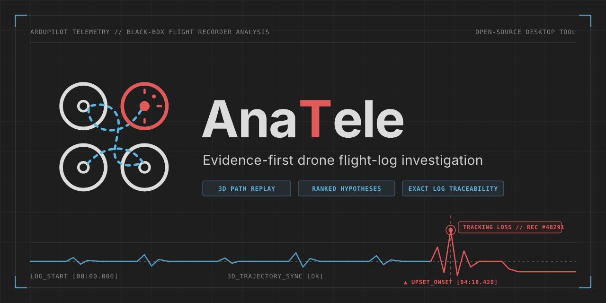
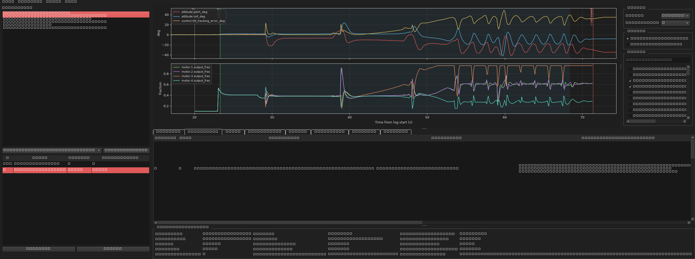
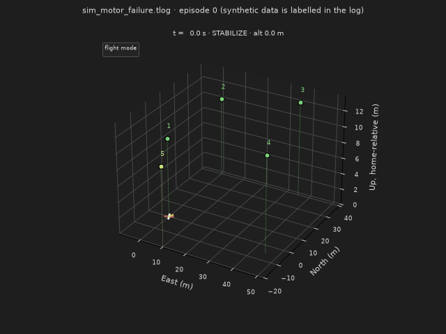
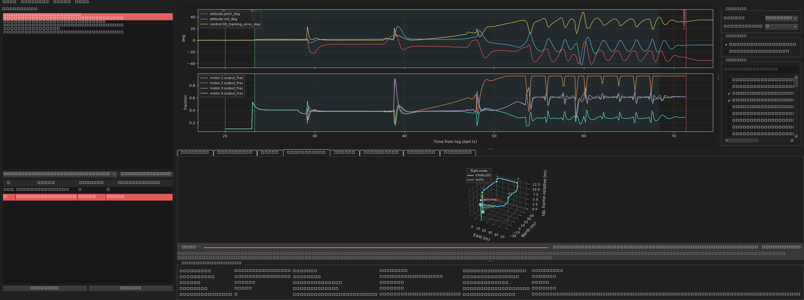
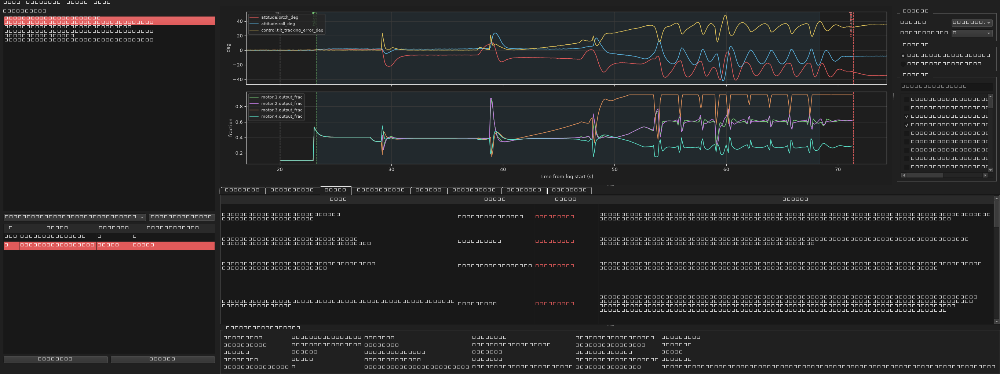

<p align="center"></p>

<p align="center">
  <a href="https://github.com/Avinashistoocool/AnaTele/actions/workflows/ci.yml"></a>
  <a href="https://github.com/Avinashistoocool/AnaTele/releases/latest"></a>
  <a href="LICENSE"></a>
</p>

**Evidence-first drone flight-log investigation.** AnaTele reads ArduPilot logs (Mission Planner `.tlog`,
DataFlash `.bin`/`.log`) and turns them into a reproducible investigation:

- **What happened?** A timeline built from reports in the log, armed episodes and flight phases (takeoff, pre-event window, upset, disarm).
- **Where did it go?** A 3D replay of the recorded path with the mission waypoints and their completion status.
- **What looks wrong?** A versioned, declarative rule pack. Each rule reports *triggered*, *not triggered*, *unassessable* or *not applicable*.
- **Why might it have happened?** Competing hypotheses ranked by the evidence for and against each one, plus the data that would tell them apart.
- **Can I check it?** Every claim links back to the original record and its raw bytes.

It also includes a **flight simulator** that generates realistic synthetic crashes and faults. You can try every
feature without a real log.



<p align="center"></p>

> AnaTele gives you observations and hypotheses. It is **not** a crash verdict, a probability of cause or an
> airworthiness approval. Missing data is treated as *unknown*, never as *healthy*.

---

## Download

No Python needed. Grab the build for your OS from the [latest release](https://github.com/Avinashistoocool/AnaTele/releases/latest):

| OS | Download | Run |
|---|---|---|
| Windows 10/11 | [AnaTele-windows.zip](https://github.com/Avinashistoocool/AnaTele/releases/latest/download/AnaTele-windows.zip) | Extract ? `AnaTele.exe` (SmartScreen: *More info ? Run anyway*) |
| macOS | [AnaTele-macos.zip](https://github.com/Avinashistoocool/AnaTele/releases/latest/download/AnaTele-macos.zip) | Extract ? right-click `AnaTele` ? *Open* |
| Linux | [AnaTele-linux.zip](https://github.com/Avinashistoocool/AnaTele/releases/latest/download/AnaTele-linux.zip) | Extract ? `./AnaTele/AnaTele` |

Each zip includes five simulated flights in `simulations/`. Open `sim_motor_failure.tlog` to try it.
The builds are not code-signed, so your OS may warn you the first time you run them. To check that a download is genuine:

```bash
# compare with SHA256SUMS.txt attached to the release
sha256sum AnaTele-windows.zip            # PowerShell: Get-FileHash AnaTele-windows.zip
# or verify the signed GitHub build provenance (GitHub CLI)
gh attestation verify AnaTele-windows.zip --repo Avinashistoocool/AnaTele
```

## Quick start (from source)

```bash
git clone https://github.com/Avinashistoocool/AnaTele.git
cd AnaTele
python -m venv .venv
# Windows: .venv\Scripts\activate    macOS/Linux: source .venv/bin/activate
pip install -e ".[desktop]"

anatele simulate --out simulations      # five synthetic flights (nominal + four faults)
anatele simulations/sim_motor_failure.tlog
```

This opens the desktop application with the simulated motor failure loaded. Prefer the terminal?

```bash
anatele analyse simulations/sim_motor_failure.tlog
anatele replay  simulations/sim_motor_failure.tlog --out where_it_went.gif
```

## What's inside

| Area | What it does |
|---|---|
| **Ingestion** | Mission Planner tlog (timestamp-prefixed MAVLink 1/2 with CRC validation and resync), DataFlash binary/text, mapped CSV. Immutable originals with a SHA-256, parser version and corruption diagnostics. |
| **Sources & clocks** | Separates vehicle, ground-station and radio sources (a GCS heartbeat never arms the vehicle). Splits capture time from boot time, handles clock epochs and reboots, and reassembles chunked STATUSTEXT messages. |
| **Flight phases** | Uses reported landed state when available. Otherwise infers takeoff from home-relative altitude rise with throttle or motor demand, and labels it as inferred. Also marks attitude-excursion onset and a pre-event window. |
| **Diagnostics** | 20 rules in `telemetry_platform/rules/core.yaml`: crash-check, compass and EKF sequence, vibration persistence (>30 m/s² for 2 s, >60 m/s² for 1 s), clipping before the event versus at impact, tilt tracking error, motor floor/ceiling saturation and imbalance (with frame mixer decomposition), power-monitoring gaps, pre-arm and arming rejections, GPS configuration, parameter reviews and profile mismatch. |
| **Hypotheses** | Estimator/magnetic, thrust or configuration, vibration and power. Each gets capped support per evidence family minus explicit contradictions. Labels range from *strong support* to *unassessable*, and no probabilities are given. |
| **Firmware semantics** | Versioned packs (`semantics/*.yaml`). ArduCopter 4.7.2 meanings are tied to the official git hash, and the C-cast parameter decoding is validated against the declared type. |
| **Missions** | Upload, download, partial-write and clear transactions, broadcast ACKs, retransmits and restarts. Plan versions carry a confidence level. Each item gets a status of `reported_complete`, `geometry_consistent_with_completion`, `completion_not_observed`, `not_visited_in_observed_trajectory` or `unassessable`, using `WP_RADIUS_M` and GPS accuracy. |
| **Flight path** | Interactive 3D replay: path coloured by flight mode, waypoint status, takeoff/upset/crash markers and a live aircraft attitude glyph. Exports to GIF or PNG. Coordinates are local metres, so screenshots don't reveal your field. |
| **Comparison** | Parameter diff (log vs log, or log vs profile), side-by-side flights aligned by phase, and per-aircraft trends. |
| **Simulator** | Quad physics with an ArduPilot-like mixer, waypoint guidance, wind, crash check and failsafes. Scenarios: `nominal`, `motor_failure`, `compass_interference`, `vibration`, `radio_failsafe`. |
| **Interfaces** | Desktop app (PySide6 + matplotlib), local web UI and API (FastAPI), CLI, and an HTML report. |

## Documentation

- [**Usage guide**](docs/USAGE.md): desktop app walkthrough, CLI, web UI, API, profiles and the simulator.
- [**Diagnostics reference**](docs/DIAGNOSTICS.md): every rule, the hypothesis ranking, flight phases, mission statuses and how to read *unassessable*.
- [**Deployment**](docs/DEPLOYMENT.md): pip install, standalone desktop builds, Docker, data directories and security.
- [**Design**](docs/DESIGN.md): the full architecture proposal and its reasoning.

## Screenshots

| Flight path | Rule coverage |
|---|---|
|  |  |

All screenshots use **synthetic** simulator output.

## Supported inputs

| Format | Notes |
|---|---|
| `.tlog` | Mission Planner capture: 8-byte big-endian µs timestamp followed by a MAVLink 1/2 frame. Signed frames are kept but not verified. |
| `.bin` / `.log` | ArduPilot DataFlash, via pymavlink `DFReader`. Common signals (ATT, VIBE, RCOU, POS, GPA, XKF4, CTUN, BAT, ARM, MSG, PARM) are normalised. |
| `.csv` | Fixed schema: `flight_id,drone_id,sequence,timestamp,latitude_deg,longitude_deg,altitude_m,battery_pct,mode` |

Limits: 100 MiB per file, 1,000,000 records, a 180 s analysis deadline and a separate worker process for each file.

## Safety and privacy

- Read-only. No MAVLink link to an aircraft, no parameter writes, no flight commands.
- Everything runs locally. Logs never leave your machine unless you choose to share them.
- The web UI binds to `127.0.0.1` and has no login. See [DEPLOYMENT](docs/DEPLOYMENT.md) before exposing it.
- The analysis worker is a separate process with time and size limits, but it is **not** a security sandbox.

## Development

```bash
pip install -e ".[desktop,dev]"
python -m unittest discover -p "test_*.py" -v     # 44 tests; GUI tests run offscreen
pyflakes telemetry_platform
```

`test_real_log.py` is a regression test for a private real-world crash capture. It is skipped unless
`ANATELE_REAL_TLOG` points to that file; its annotated expectations are in `fixtures/real_tlog_expectations.json`.

Contributions are welcome, especially rules (with tests), semantic packs for other firmware versions and
anonymised real logs with known outcomes.

## License

[MIT](LICENSE)
