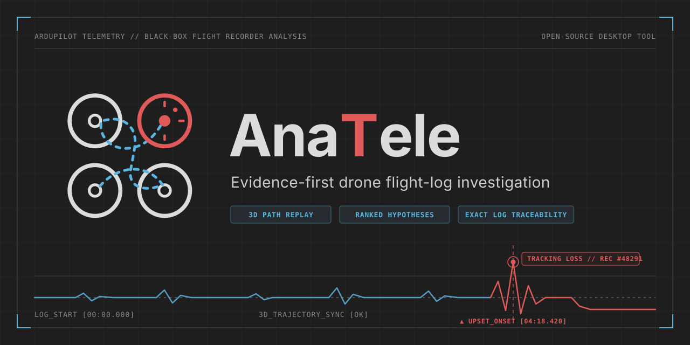
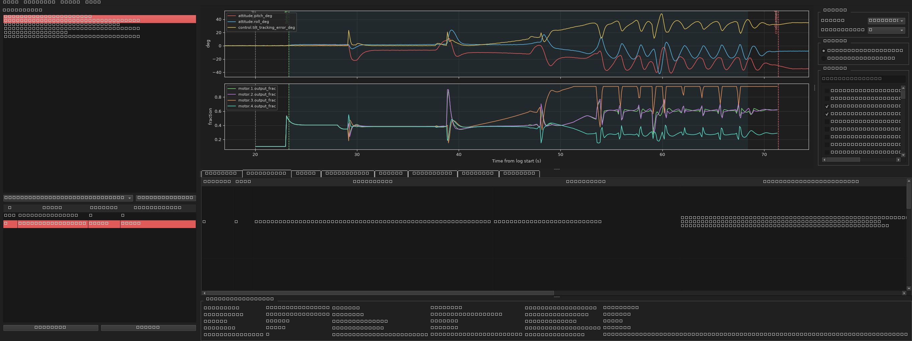
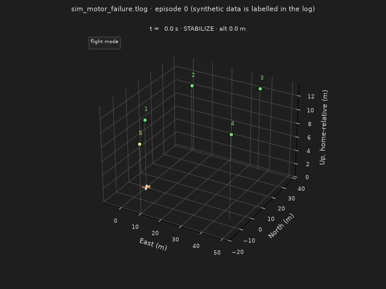
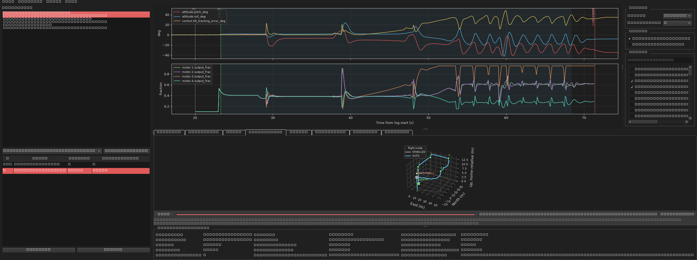
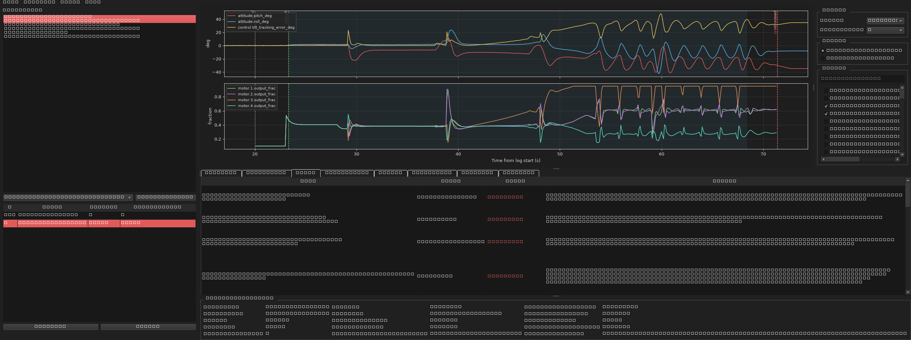

<p align="center"></p>

<p align="center">
  <a href="https://github.com/Avinashistoocool/AnaTele/actions/workflows/ci.yml"></a>
  <a href="https://github.com/Avinashistoocool/AnaTele/releases/latest"></a>
  <a href="LICENSE"></a>
</p>

**Evidence-first investigation of drone flight logs.** AnaTele reads ArduPilot logs (Mission Planner `.tlog`,
DataFlash `.bin`/`.log`). It changes them into an investigation that you can do again with the same result:

- **What occurred?** A timeline from the reports in the log, the armed episodes and the flight phases (takeoff, pre-event window, upset, disarm).
- **Where did the aircraft go?** A 3D replay of the recorded path, with the mission waypoints and their completion status.
- **What is possibly wrong?** A declarative rule pack with versions. Each rule reports *triggered*, *not triggered*, *unassessable* or *not applicable*.
- **What are the possible causes?** Competing hypotheses, in a sequence that agrees with the evidence for and against each one. AnaTele also shows the data that can tell the hypotheses apart.
- **Can I examine the claims?** Each claim has a link to the original record and its raw bytes.

AnaTele also contains a **flight simulator**. The simulator makes realistic synthetic crashes and faults. Thus, you can try all of the features without a real log.



<p align="center"></p>

> AnaTele gives you observations and hypotheses. It does **not** give a crash verdict, a probability of cause or an
> airworthiness approval. AnaTele records missing data as *unknown*. It never records missing data as *healthy*.

---

## Download

You do not need Python. Get the build for your operating system (OS) from the [latest release](https://github.com/Avinashistoocool/AnaTele/releases/latest):

| OS | Download | Run |
|---|---|---|
| Windows 10/11 | [AnaTele-windows.zip](https://github.com/Avinashistoocool/AnaTele/releases/latest/download/AnaTele-windows.zip) | Extract → `AnaTele.exe` (SmartScreen: *More info → Run anyway*) |
| macOS | [AnaTele-macos.zip](https://github.com/Avinashistoocool/AnaTele/releases/latest/download/AnaTele-macos.zip) | Extract → right-click `AnaTele` → *Open* |
| Linux | [AnaTele-linux.zip](https://github.com/Avinashistoocool/AnaTele/releases/latest/download/AnaTele-linux.zip) | Extract → `./AnaTele/AnaTele` |

Each zip file contains five simulated flights in `simulations/`. To try AnaTele, open `sim_motor_failure.tlog`.

The builds do not have a code signature. Thus, your OS can show a warning when you run them for the first time. To make sure that a download is genuine, do one of these checks:

```bash
# compare with SHA256SUMS.txt attached to the release
sha256sum AnaTele-windows.zip            # PowerShell: Get-FileHash AnaTele-windows.zip
# or verify the signed GitHub build provenance (GitHub CLI)
gh attestation verify AnaTele-windows.zip --repo Avinashistoocool/AnaTele
```

## Quick start (from source)

```bash
git clone https://github.com/Avinashistoocool/AnaTele.git
cd AnaTele
python -m venv .venv
# Windows: .venv\Scripts\activate    macOS/Linux: source .venv/bin/activate
pip install -e ".[desktop]"

anatele simulate --out simulations      # five synthetic flights (nominal + four faults)
anatele simulations/sim_motor_failure.tlog
```

These commands open the desktop application with the simulated motor failure. To use the terminal, use these commands:

```bash
anatele analyse simulations/sim_motor_failure.tlog
anatele replay  simulations/sim_motor_failure.tlog --out where_it_went.gif
anatele export  simulations/sim_motor_failure.tlog -o motor_failure.ant   # share it; open with `anatele motor_failure.ant`
```

## What's inside

| Area | Function |
|---|---|
| **Ingestion** | Mission Planner tlog (MAVLink 1/2 with a timestamp prefix, CRC validation and resync), DataFlash binary/text, and mapped CSV. AnaTele keeps the originals without change, with a SHA-256, the parser version and the diagnostics for corruption. |
| **Sources & clocks** | AnaTele keeps the vehicle, ground-station and radio sources separate (a GCS heartbeat never arms the vehicle). It keeps capture time and boot time separate, and it processes clock epochs and reboots. It also assembles STATUSTEXT messages that arrive in chunks. |
| **Flight phases** | AnaTele uses the reported landed state when it is available. If not, it infers takeoff from an increase of the altitude above home together with throttle or motor demand. It labels this result as inferred. It also marks the start of an attitude excursion and a pre-event window. |
| **Diagnostics** | 20 rules in `telemetry_platform/rules/core.yaml`. The rules examine crash-check, the sequence of compass and EKF events, and persistent vibration (>30 m/s² for 2 s, >60 m/s² for 1 s). They compare clipping before the event with clipping at impact, and they examine tilt tracking error. They also examine motor floor/ceiling saturation and imbalance (with decomposition of the frame mixer) and gaps in power monitoring. Other rules examine pre-arm and arming rejections, GPS configuration, parameter reviews and profile mismatch. |
| **Hypotheses** | Estimator/magnetic, thrust or configuration, vibration and power. Each hypothesis gets support with a limit for each evidence family, minus explicit contradictions. The labels go from *strong support* to *unassessable*. AnaTele gives no probabilities. |
| **Firmware semantics** | Packs with versions (`semantics/*.yaml`). The ArduCopter 4.7.2 meanings agree with the official git hash. AnaTele validates the C-cast decoding of parameters against the declared type. |
| **Missions** | Upload, download, partial-write and clear transactions, broadcast ACKs, retransmits and restarts. Each plan version has a confidence level. Each item gets one status: `reported_complete`, `geometry_consistent_with_completion`, `completion_not_observed`, `not_visited_in_observed_trajectory` or `unassessable`. The status uses `WP_RADIUS_M` and the GPS accuracy. |
| **Flight path** | Interactive 3D replay. It shows the path with a colour for each flight mode, the waypoint status, takeoff/upset/crash markers and a live glyph of the aircraft attitude. It exports to GIF or PNG. The coordinates are local metres, thus screenshots do not show the location of your field. |
| **Comparison** | Parameter diff (log compared with log, or log compared with profile), flights side by side and aligned by phase, and trends for each aircraft. |
| **Simulator** | Quad physics with a mixer similar to ArduPilot, waypoint guidance, wind, crash check and failsafes. Scenarios: `nominal`, `motor_failure`, `compass_interference`, `vibration`, `radio_failsafe`. |
| **Sharing** | You can save each analysis as one **`.ant`** file (*ANalysed Telemetry*). The file opens directly in AnaTele with the findings, the plots and the flight path. Optionally, it contains the original log. AnaTele verifies the hash when it opens the file. Refer to [Sharing analyses](docs/USAGE.md#sharing-analyses-ant). |
| **Interfaces** | Desktop app (PySide6 + matplotlib), local web UI and API (FastAPI), CLI and an HTML report. |

## Documentation

All of the documentation is at **[avinashistoocool.github.io/AnaTele](https://avinashistoocool.github.io/AnaTele/)**.

- [**Learn AnaTele from scratch**](https://avinashistoocool.github.io/AnaTele/learn/) ([PDF](docs/AnaTele_Illustrated_Guide.pdf)): an illustrated course for persons with no experience. It has 12 chapters, 32 figures from real simulated flights, and interactive widgets. The subjects are drones, logs, flight phases, tilt error, motors, sensors, rules, hypotheses, missions, the simulator and `.ant` sharing. To make the figures again, use `python docs/figures/make_guide_figures.py`.
- [**Technical report (PDF)**](docs/AnaTele_Technical_Report.pdf): the architecture and all of the mathematics. The subjects are framing, clock epochs, phase inference, tilt error, mixer decomposition and the rule detectors. Other subjects are hypothesis scores, waypoint geometry, the simulator physics and the `.ant` integrity model. The LaTeX source is in [`docs/AnaTele_Technical_Report.tex`](docs/AnaTele_Technical_Report.tex).
- [**Usage guide**](docs/USAGE.md): the desktop app, CLI, web UI, API, profiles and the simulator.
- [**Preflight checklist**](docs/PREFLIGHT.md): the separate AnaTele Preflight tool for a live vehicle.
- [**Diagnostics reference**](docs/DIAGNOSTICS.md): all rules, the hypothesis sequence, flight phases, mission statuses and how to read *unassessable*.
- [**Deployment**](docs/DEPLOYMENT.md): pip installation, standalone desktop builds, Docker, data directories and security.
- [**Design**](docs/DESIGN.md): the full architecture proposal and the reasons for it.

## AnaTele Preflight (live vehicle)

AnaTele Preflight is a **separate tool**. It is the only part of AnaTele that connects to a live vehicle.

AnaTele Preflight **finds the flight controller automatically**. It examines the USB ports first, then UDP 14550. You can also select USB (`COM3`), telemetry radio, UDP (`udpin:0.0.0.0:14550`) or TCP.

One button, **Run full preflight**, does these steps in sequence:

1. Gyro and barometer calibration.
2. Level calibration.
3. Guided compass calibration.
4. Guided 6-position accelerometer calibration.
5. Pre-arm health (sensors, EKF, GPS, battery, RC, `PreArm:` messages).
6. A motor test with the propellers removed.
7. A comparison with the parameter profile.

The tool stops each time that you must move the vehicle. It writes a JSON report and a Markdown report.

```bash
anatele preflight                         # window, auto-detects the vehicle (also: desktop app > Tools > Preflight checklist)
anatele preflight --list-ports            # show detected serial ports
anatele preflight --no-gui                # terminal, auto-detect (or --connect COM3)
anatele preflight --simulate               # try it without hardware
```

> **WARNING:** Remove the propellers before the motor test. The motors turn during the test and can cause injury.
> The motor test starts only after you confirm that the propellers are removed.

> **CAUTION:** Read the [Preflight guide](docs/PREFLIGHT.md) before you use the tool on a vehicle. The calibrations change the stored calibration of the vehicle.

The tool never arms the vehicle.

## Screenshots

| Flight path | Rule coverage |
|---|---|
|  |  |

All screenshots show **synthetic** output from the simulator.

## Supported inputs

| Format | Notes |
|---|---|
| `.tlog` | Mission Planner capture: an 8-byte big-endian µs timestamp, then a MAVLink 1/2 frame. AnaTele keeps signed frames, but it does not verify them. |
| `.bin` / `.log` | ArduPilot DataFlash, through pymavlink `DFReader`. AnaTele normalises the common signals (ATT, VIBE, RCOU, POS, GPA, XKF4, CTUN, BAT, ARM, MSG, PARM). |
| `.csv` | Fixed schema: `flight_id,drone_id,sequence,timestamp,latitude_deg,longitude_deg,altitude_m,battery_pct,mode` |

Limits: 100 MiB for each file, 1,000,000 records, an analysis deadline of 180 s and a separate worker process for each file.

## Safety and privacy

- The analyser only reads data. It has no MAVLink link to an aircraft, it writes no parameters and it sends no flight commands. The separate [Preflight](docs/PREFLIGHT.md) tool is the only part that communicates with a vehicle. Preflight does calibrations and a motor test with the propellers removed. It never arms the vehicle, and it never writes other parameters.
- All processes run locally. Your logs stay on your computer, unless you decide to share them.
- `.ant` files contain the GPS positions of the flight, also when they do not contain the original log.
- Do not trust the `.ant` files that you receive. AnaTele validates them and examines their hash, and it never executes their contents.
- The web UI binds to `127.0.0.1` and has no login. Read [DEPLOYMENT](docs/DEPLOYMENT.md) before you make it available to other computers.
- The analysis worker is a separate process with time and size limits. But it is **not** a security sandbox.

## Development

```bash
pip install -e ".[desktop,dev]"
python -m unittest discover -p "test_*.py" -v     # 44 tests; GUI tests run offscreen
pyflakes telemetry_platform
```

`test_real_log.py` is a regression test for a private crash capture from a real flight. AnaTele skips this test unless
`ANATELE_REAL_TLOG` points to that file. The annotated expectations for the test are in `fixtures/real_tlog_expectations.json`.

Contributions are welcome. We especially want rules (with tests), semantic packs for other firmware versions and
anonymised real logs with known outcomes.

## Citing

If AnaTele helps your research or competition report, use the **Cite this repository** button on GitHub
(from [`CITATION.cff`](CITATION.cff)).

## License

[MIT](LICENSE)
