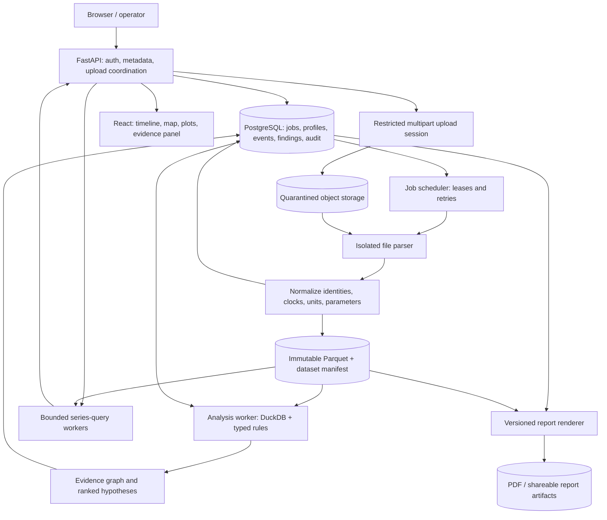

# Drone telemetry investigation platform

**Design baseline:** 29 October 2026  
**Status:** architecture proposal, not an implementation claim. The existing
`drone_telemetry.py` prototype remains a CSV-only offline demonstrator.

## Executive summary

Build an evidence-based flight investigation workbench. Its main job is to
reconstruct what the aircraft and its operator reported, distinguish observations
from interpretations, rank plausible failure mechanisms, and make every claim
traceable to the original records. It must not issue an unqualified crash verdict
or certify that an aircraft is safe to fly.

The proposed stack is Python/FastAPI, isolated parser and analysis workers,
PostgreSQL, S3-compatible immutable object storage, Parquet/DuckDB, and a
React/TypeScript frontend using MapLibre and Plotly. Start with ArduPilot tlog and
DataFlash support, profile/parameter provenance, a synchronized timeline, a small
validated diagnostic rule pack, and evidence-linked reports. Defer arbitrary
scripts, broad autopilot coverage, predictive maintenance and elaborate 3D.

The motivating incident illustrates why this distinction matters: a compass
switch before a crash-check disarm is a useful association, but not proof that the
compass caused the loss of control. In the inspected Copter 4.7.2 source, the
reported `AngErr` is a thrust-vector tracking error, not a compass/yaw-error
measurement.[1]

## 1. Assumptions and boundaries

1. The described real log has not been supplied for this design review. Its
   size, message counts, warnings, distances and measurements are treated as
   user-reported observations, not independently reproduced results.
2. The first release is post-flight and read-only. There is no MAVLink connection
   to an aircraft, parameter-write endpoint, motor-control function or automated
   flight approval.
3. ArduPilot is the first fully supported ecosystem. PX4 later receives a
   separate semantic adapter and rule pack, rather than inheriting Copter rules.
4. Users may upload incomplete, corrupt, malicious or incorrectly labelled files.
5. Uploaded locations, operator identities, routes and configurations are private
   unless deliberately shared.
6. Human-readable firmware strings may identify an official release or a custom
   build. Semantics are only as trustworthy as the firmware match.
7. Thresholds, time windows and performance budgets proposed below are design
   decisions unless explicitly identified as firmware behavior or documentation.
8. A profile describes an aircraft; a log describes an observation of that aircraft
   at a particular time. Neither silently overrides the other.

## 2. Product vision and users

### The central product promise

> Turn a flight log into a reproducible incident investigation: what happened,
> which explanations fit, what contradicts them, and what evidence is missing.

The interface should answer these questions in order:

1. Which aircraft, firmware, configuration and source streams are represented?
2. Which portions of the recording are usable?
3. What happened before, during and after each flight?
4. Which observations indicate a problem?
5. Which failure mechanisms are supported, and with what limitations?
6. What additional data or safe inspection would discriminate among them?

### Different users

| User | Primary problem | Product value |
|---|---|---|
| Hobbyist or builder | Many warnings, little understanding of their relationships | Plain-language explanations, parameter context, precise evidence links |
| Commercial operator | Need incident triage and an operational record | Repeatable reports, flight comparison, annotations and accountable review |
| Fleet maintainer | Need to distinguish a recurring hardware issue from changing flight conditions | Per-aircraft histories, configuration-aware trends and maintenance records |
| Developer or investigator | Need reproducible details, not a dashboard assertion | Raw record access, parser versions, full-resolution plots and competing hypotheses |

Use the same evidence model for all four. Adjust presentation depth rather than
maintaining an opaque simplified diagnosis for beginners.

## 3. Correctly interpreting the motivating incident

### Facts to reconstruct versus conclusions to investigate

| Reported observation | Defensible interpretation | Unsupported shortcut to avoid |
|---|---|---|
| `PreArm: Radio failsafe on`, throttle about 1000, threshold 975 | A radio-integrity/pre-arm problem was reported; investigate its actual trigger and timing | “1000 is below 975” or “the threshold caused this” |
| GPS “unable to configure band” | A receiver configuration operation was rejected | “GPS had no usable fix” |
| `Auto mode not armable` | Arming was rejected in that mode under the active configuration | “GPS caused the arming rejection” |
| EKF compass selection changed before disarm | An estimator event preceded the reported crash-check action | “Changing compass caused the crash” |
| `AngErr=160>30` | The crash detector reported a large thrust-vector tracking error | “The compass had a 160-degree yaw error” |
| `Compasses inconsistent` after both incidents | Compass checks failed afterward | “They were necessarily inconsistent before flight” |
| Z vibration peak about 66 | A high processed vibration value was observed | “Vibration caused the crash”, without timing and persistence |
| Clipping count 316 | A counter or derived count needs sensor-instance and reset context | Sum all sampled counter values and call that 316 new events |
| Position estimate approached WP2 by 0.4 m | A reported position series was close to the candidate waypoint | “The aircraft physically reached it to 0.4 m accuracy” |

### Critical firmware details

The `Copter-4.7.2` tag was verified at commit
`fb773567896014da007bca58358704d4a0d8516f`. This makes a versioned semantic pack
possible, but does not establish that the user's aircraft ran that exact binary.

For that version, the crash check includes armed/not-landed and mode-related
gates, filtered gravity-compensated acceleration below 3 m/s², estimated lean
above 15 degrees, thrust-vector tracking error above 30 degrees, and a speed gate
below 10 m/s when velocity is available. The gate must persist for a counter
equivalent to nominally two seconds at the configured loop rate. The printed
error is the value at triggering, not necessarily throughout the interval.
The source's executable conditions should take precedence over stale comments.[1]

This is not a physical-impact detector and does not identify a failed component.
The estimated attitude itself can be wrong.

For the same verified release:

- `ARMING_SKIPCHK=128` skips the **board-voltage check**, not compass checking.
  Do not decode this using a remembered `ARMING_CHECK` bit table.
- `BATT_MONITOR=0` disables that battery-monitor instance. Inspect additional
  instances before saying that all battery monitoring is absent.
- `FS_GCS_ENABLE=0` disables the GCS-heartbeat failsafe. Whether this conflicts
  with the intended operation depends on the control-link and mission policy.[2]

### A provisional investigation, not a numeric verdict

The reported observations justify investigating three competing mechanisms:

1. **Estimator/magnetic inconsistency:** supported by the reported compass
   selection and inconsistency messages; weakened as a causal conclusion if the
   affected core was not primary or the disagreement appears only after impact.
2. **Mechanical/thrust-generation or configuration problem:** compatible with
   loss of thrust-vector tracking; needs motor mapping, target-versus-estimated
   attitude, ESC evidence and inspection. Apparently successful takeoff is
   context to consider, not a conclusive exclusion.
3. **Vibration-driven estimation degradation:** plausible only if excessive
   vibration/clipping is shown before the loss of control, not just at impact.

The radio/pre-arm failures should be a separate finding group. They may share
underlying electrical issues, but that relationship must be demonstrated.
The platform should not assign numerical root-cause probabilities from this
description alone.

## 4. Recommended system architecture



### Technology choices

| Layer | Recommendation | Reason |
|---|---|---|
| API | FastAPI, Python, typed request/response models | Same language as parsers and analysis; explicit contracts |
| Job scheduling | PostgreSQL job table with leased workers | One operational datastore initially; durable retries and audit |
| Parsing | Pinned pymavlink adapters; pyulog for later ULog support | Existing format implementations, wrapped by platform validation |
| Raw/derived artifacts | S3-compatible versioned storage | Immutable source and output references; large files kept out of SQL |
| Metadata | PostgreSQL | Transactions, tenant isolation, structured relationships |
| Bulk samples | Parquet grouped by dataset and signal family | Efficient bounded interval and column reads |
| Analysis/query engine | DuckDB in separate resource-limited workers | SQL over Parquet without introducing a distributed analytics cluster |
| Frontend | React + TypeScript, MapLibre, Plotly | Linked investigation panels, maps and engineering plots |
| First deployment | Docker Compose, separate API/scheduler/worker services | Easier operation than Kubernetes while retaining isolation boundaries |

Heavy parsing is not a FastAPI in-process background task. It belongs in a
separate worker with resource limits and a durable job record.[14]

Use at-least-once execution with idempotent outputs, not an “exactly once” claim.
An analysis identity includes input manifest, profile snapshot, semantic pack,
rule-set hash, analysis configuration and engine version.

### Job lifecycle

```text
created -> uploading -> upload_verified -> parsing -> normalizing
        -> analysis_queued -> analyzing -> publishing -> complete
```

There are explicit `failed`, `cancelled`, and `partial_dataset` outcomes.
An interrupted upload is not the same as a fully received but truncated log.
Publish a dataset manifest only after its referenced files pass integrity
checks; failed work must not appear as a complete analysis.

## 5. Data model

Avoid one table called `flights` containing everything.

| Entity | Purpose and important fields |
|---|---|
| Tenant / user / membership | Ownership, roles, permissions, audit actor |
| Drone | Stable physical asset ID; not simply MAVLink system ID |
| ProfileVersion | Frame, propulsion, sensors, firmware, operating policy, effective interval, provenance |
| SourceArtifact | Hash, original name, size, object version, format, acquisition metadata |
| ParseRun / DatasetVersion | Parser/dialect hashes, diagnostics, clock mappings, coverage inventory, Parquet manifests |
| SourceIdentity | System/component IDs, topic instance, candidate role, link evidence, boot epoch |
| RecordingSession | Capture session that can contain several aircraft, reboots or flights |
| ArmedEpisode | Armed interval, possibly entirely on the ground |
| FlightEpisode | Observed/inferred takeoff and landing intervals, confidence, vehicle and clock epoch |
| ParameterObservation | Name, typed raw/decoded value, instance, source, requested/reported distinction |
| ParameterSnapshot | Values and completeness evidence at a time; missing indices and conflicts |
| MissionTransaction / MissionVersion | Direction, participants, mission type, items, acceptance evidence and uncertainty |
| Observation | Typed measurement, raw source locator, original time, normalized time, units and quality |
| Event / EventEpisode | Individual transitions/warnings and derived grouped occurrences |
| RuleVersion | Applicability, requirements, typed logic, thresholds, tests, validation status, content hash |
| RuleEvaluation | Triggered, not triggered, unassessable, or not applicable; coverage and reasons |
| Finding / Hypothesis | Claim, severity, support, contradictions, unknowns, ranking and evidence |
| AnalysisRun | Exact immutable inputs, rule versions, engine image, options and execution status |
| Annotation / MaintenanceAction | Human interpretation, inspected component, corrective action, eventual outcome |
| Report / Share | Versioned output, redactions, access scope, expiry and revocation |

### Example canonical observation

```json
{
  "dataset_id": "ds-17",
  "source": {
    "artifact_id": "log-7",
    "record_ordinal": 21841,
    "byte_offset": 893402,
    "message": "VIBRATION",
    "system_id": 1,
    "component_id": 1,
    "instance": 0
  },
  "clock": {
    "epoch_id": "boot-2",
    "native_time_us": 192340000,
    "capture_time_us": 1790000192340000,
    "analysis_time_us": 192340000,
    "mapping_id": "clock-map-4",
    "uncertainty_us": 150000
  },
  "signal": "imu.vibration.z",
  "raw_value": 66.0,
  "normalized_value": 66.0,
  "unit": "m/s^2",
  "quality": ["crc_valid", "capture_clock_unverified"]
}
```

This is a schema illustration, not an observation extracted from the motivating
log. Use integer timestamps; timestamp precision is not timestamp accuracy.

### Example finding

```json
{
  "kind": "hypothesis",
  "hypothesis": "magnetic_estimation_problem",
  "severity": "critical",
  "interval": {"start_us": 180000000, "end_us": 205000000},
  "rule_version": "compass-switch-loss-of-control@1.2",
  "support": ["event-43", "evidence-window-81"],
  "contradictions": ["evidence-window-82"],
  "missing": ["primary_ekf_core", "magnetic_innovations"],
  "ranking_score": 4.1,
  "calibrated_probability": null,
  "confidence_label": "limited evidence",
  "recommendation_id": "obtain-onboard-log-and-inspect-magnetic-installation"
}
```

A ranking score such as 4.1 is an illustrative uncalibrated value, not “41% likely.”

## 6. Parsing and data integrity

### Format detection and isolation

Use explicit file-only adapters:

```text
adapters\ardupilot_tlog
adapters\ardupilot_dataflash
adapters\px4_ulog
adapters\mapped_csv
```

Inspect file signatures and record structure, not just the extension.
Pymavlink's convenience dispatcher is not a universal detector: it includes
network/device transports and other behaviors that an upload API should never
expose. Do not pass an arbitrary user string into that dispatcher.[3]

Run parsers with no network or credentials, read-only staged input, isolated
scratch storage, and CPU, memory, process, output-size and wall-time budgets.
Reject unsupported incompatibility flags. Keep the original file even when
salvaging its usable records.

### Mission Planner tlog

The inspected Mission Planner writer prefixes packet bytes with an eight-byte
big-endian Unix-epoch microsecond timestamp. It records both outgoing and
incoming traffic, so call this capture/write time rather than assuming it is
always a sensor receive time.[4]

Preserve the prefix bytes. Pymavlink exposes low timestamp bits as a link value,
but the inspected Mission Planner writer does not explicitly reserve them.
Do not treat that decoded value as proof of multiple physical links for every
Mission Planner recording.[3][4]

### MAVLink validation

Classify every frame as validated, truncated, CRC-failed, signature-unverified,
signature-failed, unknown-definition, or unsupported-framing as appropriate.
CRC validity is not authentication. A present signature is not a verified
signature without the necessary validation context.

Robust parsing can return bad-data records; it does not repair information.
Unknown message definitions may be retained by a parser without undergoing the
same checks as known messages. Store unknown payloads and offsets so a later
dialect version can reinterpret them.[3][5]

For MAVLink2, distinguish valid trailing-zero payload truncation from an
incomplete/corrupted frame. Preserve whether optional fields were actually
available before treating a decoded default as a physical measurement.

### Identities and message loss

Use sender system/component IDs, available link provenance, and boot/session
identity. Separate source from command target. Identify the flight-controller
stream through heartbeat type/autopilot and corroborating messages, not “ID 1
must be the drone.” A single recording can contain relayed duplicates, GCS
heartbeats, radio reports and more than one aircraft.[5]

Sequence numbers wrap at 256. Evaluate continuity only within defensible
source/channel/session streams. A gap does not uniquely prove radio loss:
filtering, forwarding, reordering and mixed channels also matter.
Report a conditional loss estimate with its assumptions rather than a universal
“packet loss percentage.”

### STATUSTEXT

Reassemble long MAVLink2 text using sender/session/message ID and chunk sequence.
Preserve partial or conflicting assemblies. Reconstruct bytes before decoding
UTF-8 so a character split across chunks is not corrupted.[5]

Store every warning occurrence. A UI episode such as “Radio failsafe ×47 across
4 minutes” is a derived view, not 47 independent confirmations and not proof
that a failsafe flag remained continuously asserted for all four minutes.

### DataFlash, ULog and CSV

DataFlash adapters retain embedded format, unit, multiplier and instance
definitions. Preserve native boot timestamps even if a parser supplies a
derived wall-clock timestamp. PX4 ULog uses its own formats, subscription IDs,
instances and dropout records; do not force these into fake MAVLink IDs.[3][6]

CSV import requires an explicit mapping for timestamps, timezone/domain,
identity, units and null values. Never execute user-supplied timestamp
expressions. Units inferred from column names should remain suggestions pending
confirmation.

## 7. Clock model and synchronization

Maintain at least:

1. Capture clock.
2. Vehicle boot clock.
3. GPS/UTC clock when usable.
4. Derived investigation clock with mapping uncertainty.

`SYSTEM_TIME` can provide boot/Unix relationships. Some timestamp fields permit
either boot-relative or epoch values; interpretation must follow the message
definition, not one global heuristic.[5]

Segment credible reboot epochs. Distinguish reboot, delayed delivery and
32-bit boot-millisecond wrap. Record inconsistent anchors and clock jumps.
Capture minus sensor time is not automatically network latency.

When combining onboard and telemetry logs, align through multiple shared
landmarks and clock anchors, retain residual error, and make an uncertain match
visible. Two records separated by five seconds in display time may not have a
defensible causal order if the alignment uncertainty is larger.

Never interpolate across reboot, estimator-origin reset, long data gaps or
incompatible frames. Hold discrete states between observations with a visible
freshness limit. Interpolated chart points must never masquerade as original
evidence.

## 8. Profile and parameter audit

Build this early: diagnostic thresholds and applicability depend on it.

A profile should contain:

- Frame class/type and motor geometry.
- Motor/ESC/propeller specifications and channel-function mapping where known.
- Firmware name/version, git identity, board and build information.
- Sensor instances, orientations, device IDs and intended estimator sources.
- Battery chemistry/cell count/capacity and monitor assignments.
- Intended control links and failsafe policy.
- Payload and typical operating envelope.
- Maintenance changes, configuration versions and known limitations.

Each field records whether it is operator-declared, firmware-reported, inferred
or externally verified. “Quadrotor” in a heartbeat does not alone identify an
X-frame geometry, and a generic GPS message does not establish a u-blox model.

### Parameter completeness

973 observed names does not prove a full snapshot. Track `param_count`, index
coverage, sender component, request/response context, repeated values and changes
within a collection epoch. A snapshot can be complete, partial, internally
inconsistent or of unknown completeness.[7]

Separate a requested `PARAM_SET` from a reported `PARAM_VALUE`. Decode the
advertised parameter type and supported value encoding; preserve raw bytes.
Do not treat an unacknowledged request as an effective configuration change.
For restart-required parameters, reported stored value and active runtime value
may differ; retain that uncertainty.

### Audits and comparisons

Version parameter metadata by exact firmware where possible. Diff changes in
value, type, meaning, availability and completeness. Do not report a missing
parameter in a partial snapshot as “reset to default.”

A known-good preset is a **scoped reference**, not a universal safety certificate:
it needs frame, hardware, firmware, payload/mission assumptions, provenance,
validation owner and expiry/review state. Show why a mismatch matters. Never
automatically apply a preset or disable arming checks.

## 9. Diagnosis engine

### Stage A: establish observations and operating context

Before ranking causes, reconstruct:

- Vehicle/source and boot identity.
- Armed episodes versus observed/inferred airborne flights.
- Mode, mission and parameter state.
- Available channels, rates, gaps and invalid samples.
- Relevant pre-arm, takeoff, transition, flight, landing and post-event phases.

An armed vehicle on a bench is not automatically an airborne flight. Use
flight-controller heartbeat and landed-state reports where present; otherwise
label phase estimates and their uncertainty.[8]

### Stage B: derive events and indicators

Examples: an arming rejection, a compass-selection change, a rise in clipping,
sustained tracking error, a voltage sag, a command-output plateau.

Use full-resolution observations for detection. A plot's downsampled line is
not the input to the diagnostic engine.

### Stage C: evaluate hypothesis rules

```yaml
id: compass-switch-before-crash-check
version: 1
semantic_pack: arducopter-4.7.2
requires:
  events:
    - crash_check_disarm
    - ekf_compass_selection_change
  context:
    - vehicle_identity
    - clock_epoch
    - flight_episode
correlate:
  same_vehicle: true
  same_epoch: true
  before_seconds: 20
support:
  - compass_change_in_active_ekf_core
  - magnetic_innovation_failure_before_tracking_loss
contradictions:
  - first_attitude_failure_precedes_compass_change
  - changed_core_not_primary
unknowns:
  - missing_primary_core_identity
  - missing_magnetic_innovations
output:
  observed_pattern: compass_event_before_crash_check
  hypotheses:
    - magnetic_estimation_problem
    - vibration_related_estimator_degradation
  probability: null
```

This is an illustrative DSL, not executed firmware logic. Its 20-second
correlation window is a proposed screening window, not a documented causal
threshold.

Rule results have four states: `triggered`, `not_triggered`, `unassessable`,
`not_applicable`. A failed applicability or coverage check is not a healthy
result.

### Stage D: rank without pretending to know probabilities

Start with an explainable, expert-reviewed ranking:

```text
rank(H) =
    configured prior weight
  + capped support from each evidence family
  - explicit contradictory evidence
```

Evidence families might be magnetic/estimator, inertial/vibration, propulsion,
power, navigation and communications. Source integrity, timestamp uncertainty,
phase relevance and sampling coverage govern whether evidence is usable.

Do not count every repeated STATUSTEXT message, derivative feature and plot
summary as independent support. Do not treat two flights on the same hardware
and configuration as independent laboratory replications.

Display four separate concepts:

- Severity if the mechanism is real.
- Comparative investigation priority.
- Evidence completeness/quality.
- Calibrated probability, **only if validated for that task and population**.

Initially use labels such as strong support, mixed support and limited evidence
with explanations, not “92% compass failure.” Future probability calibration
requires adjudicated outcomes and held-out evaluation.

### Stage E: recommend discriminating evidence and safe actions

For every hypothesis, answer:

> What observation would most clearly distinguish this from its nearest rival?

Examples are onboard magnetic innovations, measured ESC RPM/current, a complete
parameter snapshot, or qualified inspection of mounting and propulsion.
Post-crash recommendations should prioritize safe, propellers-removed inspection
and review of existing evidence—not another Auto flight or force-arming.

## 10. Eight concrete rule designs

The persistence windows below are initial configurable analysis choices.
Firmware gates are separately versioned and must not be confused with them.

### Rule 1: repeated pre-arm radio-integrity failure

- **Trigger:** repeated `Radio failsafe on` warnings or an explicitly observed
  failsafe state during a pre-arm episode.
- **Evidence:** mapped throttle input, `RCMAP_THROTTLE`, calibration, reversal,
  freshness, receiver failsafe indications, RC options, override activity and
  timeout settings.
- **Logic:** distinguish below-threshold input, lost valid updates and receiver/
  override-related mechanisms. In the motivating report, 1000 exceeds 975, so
  those samples do not establish the below-threshold mechanism.
- **Exclusions:** GCS-origin RC messages, old retained values, sparse observations
  that cannot demonstrate fresh receiver updates.
- **Output:** an arming blocker with unresolved or supported trigger branches,
  not a fabricated adjustment to `FS_THR_VALUE`.

Copter's channel state can include overrides; streamed RC values are not an
independent capture of the receiver wire protocol.[9]

### Rule 2: arming rejected by mode or throttle state

- **Trigger:** `Auto mode not armable` or `Throttle too high`.
- **Evidence:** exact firmware semantics, current mode, arming-command method,
  Auto options, calibrated throttle/control demand and contemporaneous warnings.
- **Logic:** assess each rejected attempt separately. Copter 4.7.2 has an Auto
  allow-arming option and mode-specific conditions; throttle-high checking is
  different from low-throttle failsafe.
- **Exclusions:** an old mission upload or GPS configuration message merely
  appearing nearby.
- **Output:** distinct rejection reasons, not a single “GPS arming failure.”

The GPS band warning should create a configuration warning whose operational
impact remains conditional on actual fix/accuracy and estimator acceptance.[9]

### Rule 3: estimator/compass event before crash-check disarm

- **Trigger:** correctly classified compass/core/yaw event within a proposed
  20-second pre-disarm window.
- **Evidence:** exact warning text, active EKF core, compass device mapping,
  innovations, target/estimated attitude, current and vibration history.
- **Logic:** distinguish compass selection, EKF lane switch, yaw-source change
  and yaw reset. Record onset ordering relative to tracking deterioration.
- **Exclusions:** inactive-core-only changes; post-impact disagreement used as
  proof of pre-impact failure; correlation based on uncertain clocks.
- **Output:** supported chronology and competing hypotheses. Mark any causal
  interpretation as limited when internal EKF evidence is unavailable.

Compass switching may be an estimator recovery action rather than the initiating
fault.[10]

### Rule 4: loss of thrust-vector tracking

- **Trigger:** controller/estimate divergence sustained for a configurable
  0.5–1 second screening interval, or an observed crash-check disarm message.
- **Evidence:** target and estimated orientation, body rates, outputs, filtered
  acceleration, speed and exact detector semantics.
- **Logic:** distinguish an implausible target, a state-estimate jump, and failure
  to follow a plausible target. Reproduce internal crash gates only if the
  necessary signals and sampling permit it.
- **Exclusions:** mismatched coordinate frames, comparing unaligned signals,
  treating `AngErr` as full yaw error.
- **Output:** a tracking failure; possible control, estimation and thrust causes
  remain separate.

For Copter 4.7.2, use the thrust-vector definition and executable crash gates.[1]

### Rule 5: sustained vibration and accelerometer clipping

- **Trigger:** initial screening above 30 m/s² for 2 seconds, above 60 m/s² for
  1 second, or positive clipping increments in airborne pre-event intervals.
- **Evidence:** per-instance vibration and clipping, boot boundaries, sample
  intervals and phase.
- **Logic:** calculate positive counter increments within a valid epoch; report
  increments over known intervals rather than inventing individual clip times.
- **Exclusions:** impact/handling-only peaks, counter resets, mixed IMU instances,
  and summing cumulative samples.
- **Output:** pre-event vibration exposure, impact-only exposure or insufficient
  temporal evidence.

ArduPilot's documentation gives 30/60 as useful vibration guidance, not universal
crash thresholds. Its vibration metric is filtered, not instantaneous
acceleration. DataFlash instance fields differ from MAVLink's clipping0/1/2
representation, so the semantic adapter must normalize them.[11]

### Rule 6: abnormal propulsion-command distribution

- **Trigger:** output imbalance/saturation persisting in a comparable, nominally
  steady phase; initially use a configurable two-second screening interval.
- **Evidence:** actual channel-function mapping, frame geometry, output limits,
  desired attitude/rates, achieved motion, ESC RPM/current where available.
- **Logic:** compare outputs with expected control demands, not just their spread.
- **Exclusions:** takeoff transients, aggressive maneuvers, yaw commands, wind,
  asymmetric payload and different mixer configurations.
- **Output:** command-distribution anomaly. Without measured motor response or
  inspection, do not claim a particular motor/propeller has failed.

Motor commands are not measured thrust. Wrong geometry/order/direction requires
additional corroboration.

### Rule 7: power monitoring gap or voltage anomaly

- **Trigger A:** no usable propulsion battery or board-supply observations for
  the operating policy.
- **Trigger B:** sustained sag/undervoltage against an appropriate configured
  threshold with valid current/load context.
- **Evidence:** all monitor instances, voltage/current, board supply, resets,
  battery profile and arming-check configuration.
- **Logic:** separate an observability defect from observed power degradation.
- **Exclusions:** invalid sentinels, disconnected/unused monitor instances,
  chemistry/cell-count mismatch and sparse unaligned current measurements.
- **Output:** monitoring coverage gap, observed voltage anomaly, or unassessable
  battery condition. `ARMING_SKIPCHK=128` is contextual risk in the verified
  firmware, not proof of an electrical cause.[2]

### Rule 8: communication/navigation policy mismatch

- **Trigger:** required RC/GCS/GNSS service becomes unavailable, or configured
  failsafe behavior contradicts the declared operating policy.
- **Evidence:** relevant source freshness, explicit failsafe events, GCS role,
  RC availability, mode, mission policy, fix/accuracy and estimator use.
- **Logic:** distinguish a radio's status report from actual vehicle link health
  and a GNSS configuration warning from failed positioning.
- **Exclusions:** optional GCS loss during a deliberately permitted autonomous
  mission; message absence when a topic was never streamed.
- **Output:** actionable policy mismatch or loss evidence, not “unsafe because
  FS_GCS_ENABLE is zero.”

## 11. Mission reconstruction and analysis

### Treat uploads as transactions with uncertain outcomes

Recognize the direction of `MISSION_COUNT`, requests, items and ACKs.
An upload and a download can carry similar messages in opposite directions.
Retransmissions are not automatically new plans.[12]

Maintain separate:

1. GCS-intended mission versions.
2. Observed upload/download transactions.
3. Acceptance evidence.
4. Inferred/confirmed onboard mission state.
5. Execution observations.

A confirmed shorter full upload replaces the earlier plan; do not keep old
trailing points. Partial writes need a known baseline. The MAVLink documentation
notes non-atomic ArduPilot upload behavior; therefore, do not guarantee that the
last accepted mission remains onboard after an interrupted overwrite. Model
possible partial modification unless the exact firmware/transaction evidence
establishes otherwise.[12]

Use available opaque plan IDs as corroboration, not universal identifiers.
Missing or zero extension fields do not establish plan identity.

### Reached versus observed near

Use explicit statuses:

```text
reported_complete
geometry_consistent_with_completion
completion_not_observed
not_visited_in_observed_trajectory
unassessable
```

Store the command itself. A takeoff item is not an ordinary horizontal waypoint.
ArduPilot commonly uses sequence zero for home; never relabel by display order
without retaining original sequence numbers.[12]

A missing `MISSION_ITEM_REACHED` does not prove failure to reach, and a
`MISSION_CURRENT` advance can reflect a jump or set-current operation.
Generic MAVLink waypoint fields do not guarantee that a given Copter release
implements each field. In particular, do not invent a universal waypoint yaw
acceptance condition.[12][13]

For the reported 0.4 m approach, show:

- Candidate mission version and item command/frame.
- Nearest recorded horizontal distance.
- Vertical error only when frames/datums are compatible.
- GPS/estimator uncertainty and observation gap.
- Whether interpolation was used.
- Whether an execution completion message was observed.

Call the 21.6 m value a recorded-position distance to a waypoint unless an
along-path definition and correct active plan are established.

### Geometry and mission warnings

Distinguish MSL, ellipsoid, home-relative and terrain-relative altitude.
Home-relative altitude is not generally AGL. Preserve local NED/ENU and body
FRD semantics; local frames require a known origin. GPS course is not vehicle
heading, and the estimated global position is not physical ground truth.[5][13]

Cross-track distance must name its reference: a straight mission segment is not
the controller's curved/spline path. Plan-level battery margin is unassessable
without sufficient battery/energy observations and a validated load model;
distance alone is not a credible energy estimate.

## 12. Interface and reports

### Investigation screen

Use one time-selection model shared by:

- Severity-filtered event timeline.
- Map and planned/flown path.
- Linked engineering plots.
- Parameter changes and flight-phase markers.
- Hypothesis cards with support/contradictions.
- Raw record/evidence inspector.

Clicking a finding selects its interval and opens the exact source records plus
bounded before/after context. A warning episode expands to individual messages.
Show missing/invalid data as gaps, not zeros.

Compare flights by elapsed time from takeoff or equivalent mission phase while
retaining actual timestamps and durations. Do not automatically equate “WP2”
between different mission versions.

### 3D

Start with correct 2D and altitude plots. Later add 3D with explicit altitude
datum and frame conversion. Interpolate quaternions with sign continuity;
unwrap displayed angles and stop interpolation at gaps/resets. A visually smooth
trajectory must not imply more accurate measurements.

### Reports

Each report includes:

1. Scope, aircraft/profile identity, firmware match and data limitations.
2. Observed incident sequence.
3. Ranked hypotheses and supporting/contradicting evidence.
4. Parameter and monitoring concerns.
5. Missing evidence and recommended safe follow-up.
6. Analysis/rule versions and immutable evidence links.

An optional LLM can phrase already-approved structured findings. It must not
invent diagnoses, thresholds, source citations or repair instructions.
Log strings are untrusted input and must not become model instructions.
Provide a deterministic report fallback.

## 13. Fleet trends and maintenance

First implement condition trends, not remaining-useful-life claims.

Compare like-for-like flight phases while accounting for:

- Firmware/profile revisions and sensor replacement.
- Payload, battery identity, temperature and environment.
- Maneuver intensity, duration and recording rates.
- Sensor instances, units and signal coverage.

A vibration trend is not automatically motor wear. Motor wear needs appropriate
response measurements and maintenance outcomes. Battery degradation needs
consistent battery identity and comparable charge/load/temperature conditions.
Record maintenance actions, replaced parts, inspection findings and subsequent
flights so useful labels can accumulate.

Do not compare a sparse radio log with a high-rate onboard log as if their peaks
and counter visibility were directly equivalent.

## 14. Rule extensibility

### MVP: a bounded DSL

Allow registered signals, comparisons, durations, aggregates, temporal joins,
exclusions and templated evidence. Validate units, expected types, applicable
firmware and required coverage at rule creation.

Every shared rule needs a version/hash, author, tests, description, applicability,
known confounders, validation state and review history. A tenant pins a rule
version; publishing an update must not silently rewrite old investigations.

### Later: isolated executable extensions

Do not execute user Python in the API or privileged analysis process. If scripts
become necessary, use reviewed immutable packages in disposable sandboxes:
no network, no secrets, read-only scoped inputs, strict CPU/RAM/process/output
budgets, deadlines and validated result schemas. Do not expose a container-engine
socket. Hostile public plugins need stronger isolation than ordinary shared
containers before launch.

## 15. Testing and evaluation

### Four test layers

1. **Parser fixtures:** valid formats, wrong suffixes, truncated frames, missing
   chunks, unknown messages, CRC/signature states, reboots and corrupted regions.
2. **Semantic fixtures:** version-specific parameter bitmasks, message units,
   instance mappings, time anchors, arming versus airborne state, mission
   retransmission/partial-write behavior.
3. **Diagnostic fixtures:** positive cases, healthy counterexamples, missing
   channels, contradictory evidence and known confounders.
4. **End-to-end investigations:** immutable expected event sequences, evidence
   locators, findings and report versions.

The motivating log should become a manually annotated regression case, ideally
paired with its onboard logs and inspection outcome. Do not make it the entire
evaluation set.

### Ground-truth levels

Distinguish hardware-confirmed causes, expert-adjudicated interpretations and
weak labels from operator narratives. Do not train or score “root cause” against
an unverified description as if it were ground truth.

Include healthy flights, recoveries, aborted takeoffs, bench activity and benign
warnings—not only crashes. Split by aircraft/operator and time; keep duplicate
recordings and related flights out of opposing splits.

Measure:

- False alerts per flight-hour and per flight phase.
- Precision/recall of observable events.
- Top-k hypothesis recall on adjudicated incidents.
- Correctness of cited evidence and timeline order.
- Abstention and coverage when signals are missing.
- Calibration only for outputs that claim probabilities.
- Analyst time to identify and verify a useful explanation.

A high recall model that blames a compass on every crash is not a useful product.

## 16. Security, privacy and operational reliability

- Tenant authorization must follow every data/evidence relationship.
- Treat parser code as exposed to hostile files. Sandbox and fuzz it.
- Validate actual file sizes and content; bound expansion if archives are later
  accepted. Do not trust filenames, MIME types or client-reported hashes.
- Use unique immutable object versions; object-store multipart ETags are not a
  substitute for the platform's chosen integrity hash.
- Keep tenant-scoped caches and deduplication semantics to avoid exposing another
  tenant's upload or analysis.
- Redact home coordinates, routes, identities and timestamps where required.
  Redaction must cover PDFs, metadata, downloadable artifacts and maps, not just
  visible text.
- Use revocable application-level share tokens with narrow scope and expiry.
  Issue short-lived object URLs only after authorization; presigned storage URLs
  are bearer credentials and may be reused until expiry.[15]
- Define deletion across raw data, Parquet, indexes, caches, reports, shares and
  backups; state backup-retention limits clearly.
- Maintain access logs, restore tests and incident procedures.
- Explain third-party map/LLM processing. Offer a no-external-services workflow
  for sensitive logs.

## 17. Performance and large-log design

Define test workloads rather than inventing performance claims:

| Workload | What to measure |
|---|---|
| Roughly 55,000-message tlog | Time to first useful preview and final analysis |
| Ten-million-message onboard dataset | Parse throughput, peak RAM and scratch storage |
| 1 GB interrupted upload | Resume behavior, integrity validation and cleanup |
| Multiple tenants | Queue fairness, cancellation and query latency under load |
| Corrupt/high-cardinality data | Resource ceilings, bounded recovery and useful error output |

Stream records in bounded batches. Do not retain millions of Python message
objects or emit one JSON blob per full flight to the browser. Group Parquet by
dataset/signal family with suitable row groups; avoid one tiny file per message
type or sensor sample.

Series-query requests specify allowlisted channels, interval, source, quality
policy and point budget. Enforce bytes-scanned, execution-time and output caps.
Use min/max envelopes or other spike-preserving chart summaries, with exact
evidence windows fetched on demand. Analysis operates on full-resolution data,
with sufficient pre/post overlap at chunk boundaries.

Cache by tenant, dataset/time-mapping version, channels, interval, aggregation and
redaction policy. Benchmark on explicitly stated hardware before promising
interactive latencies.

## 18. Roadmap and MVP acceptance

### Milestone 0: establish the evidence contract

- Obtain permitted, representative logs and paired onboard/telemetry recordings.
- Annotate the motivating case without assuming its cause.
- Freeze canonical identity, time, provenance and quality semantics.
- Define firmware-match and data-coverage policies.

**Exit:** two analysts can distinguish observations, interpretations and unknowns
in the same case without relying on screenshots alone.

### Milestone 1: reliable ArduPilot ingestion

- Tlog and DataFlash adapters, immutable artifacts and job lifecycle.
- Source-role inventory, clock epochs, corrupt-region diagnostics.
- Parameters/profile snapshots and channel coverage.

**Exit:** accepted input is reproducible and every normalized record can be traced
to its original artifact; partial data cannot appear complete.

### Milestone 2: investigation UI and baseline health

- Armed/airborne episodes, warning grouping, mode/failsafe timeline.
- 2D planned/flown map, linked plots and exact evidence navigation.
- Basic mission-transaction history and version-aware parameter audit.
- Vibration, radio, tracking and monitoring checks.

**Exit:** the motivating case can be investigated end to end without a generated
root-cause verdict.

### Milestone 3: diagnostic MVP

- A small expert-reviewed rule pack covering the eight patterns above, initially
  prioritizing radio pre-arm failure, vibration/clipping, tracking loss and
  compass-event association.
- Hypothesis ranking with contradictions and abstention.
- Versioned operator reports and manual annotations.
- Regression corpus including benign and missing-data cases.

**MVP acceptance:** on the motivating case, correctly distinguish the 1000/975
issue, interpret crash `AngErr`, avoid summing clipping counters, distinguish
takeoff from waypoint commands, and avoid treating absent completion telemetry
as definitive non-completion. Every finding has evidence and limitations.

### Milestone 4: operational hardening and expansion

- Tenant isolation, access/retention controls, quotas, recoverability and benchmark
  budgets before accepting broad external uploads.
- PX4 ULog with its own semantic/rule pack; explicit CSV mapping.
- Cross-flight comparisons, improved 3D and maintenance records.

### Milestone 5: outcome-driven learning

- Fleet condition trends and validated maintenance outcomes.
- Optional learned hypothesis ranking or evidence prioritization.
- Calibrated probabilities only if supported by held-out data.

If time is short, cut arbitrary scripts, LLM narratives, public rule marketplaces,
live telemetry, predictive-maintenance claims and sophisticated 3D first.
Do not cut provenance, profile/version awareness, data-quality reporting,
counterexample tests or the distinction between unknown and healthy.

## 19. Important challenges to the original plan

1. **Move profile/parameter handling forward.** It is a dependency of trustworthy
   health and root-cause rules, not a later cosmetic feature.
2. **Treat mission reconstruction as state estimation.** Interrupted uploads and
   missing messages can make the active plan genuinely unknowable.
3. **Do not equate warning order with causality.** Recovery actions often occur
   after a problem has already begun.
4. **A tlog cannot supply information never streamed.** Requesting onboard data
   is sometimes the correct product output.
5. **“100% analyzed” must not mean “all subsystems healthy.”** Publish a capability
   and coverage matrix alongside every report.
6. **Frame and sensor identity are temporal.** Components can be replaced; an
   IMU index is not a permanent physical identity.
7. **A baseline may already be unhealthy.** Personalized thresholds need reviewed
   reference flights, not just the aircraft's historical average.
8. **A smooth 3D replay can be misleading.** Keep uncertainty and missing data
   visible; graphics do not strengthen the underlying measurement.
9. **Root-cause labels are expensive.** Maintenance/inspection outcomes and
   expert review are core product data, not optional future polish.
10. **Models are optional, evidence is not.** A System-One classifier may later
    help prioritize reviewed evidence; it should not replace exact protocol
    reconstruction or invent causal certainty.

## Source notes

The report combines architectural recommendations with primary-source checks.
Version-specific crash/parameter interpretations use the verified Copter 4.7.2
release source; the aircraft's actual binary is still unverified. General mission
documentation and current source examples require matching against that binary
before exact execution predicates are asserted.

[1] ArduPilot Copter 4.7.2:
[crash detector](https://github.com/ArduPilot/ardupilot/blob/fb773567896014da007bca58358704d4a0d8516f/ArduCopter/crash_check.cpp),
[attitude-control interface](https://github.com/ArduPilot/ardupilot/blob/fb773567896014da007bca58358704d4a0d8516f/libraries/AC_AttitudeControl/AC_AttitudeControl.h),
[thrust/attitude calculations](https://github.com/ArduPilot/ardupilot/blob/fb773567896014da007bca58358704d4a0d8516f/libraries/AC_AttitudeControl/AC_AttitudeControl.cpp).

[2] Copter 4.7.2:
[arming metadata](https://github.com/ArduPilot/ardupilot/blob/fb773567896014da007bca58358704d4a0d8516f/libraries/AP_Arming/AP_Arming.cpp),
[battery parameters](https://github.com/ArduPilot/ardupilot/blob/fb773567896014da007bca58358704d4a0d8516f/libraries/AP_BattMonitor/AP_BattMonitor_Params.cpp),
[failsafe handling](https://github.com/ArduPilot/ardupilot/blob/fb773567896014da007bca58358704d4a0d8516f/ArduCopter/events.cpp).

[3] Pymavlink at `bd0a1b29d5b8b54b7d66abfe9ac043c528ac490f`:
[mavutil dispatch/log parsing](https://github.com/ArduPilot/pymavlink/blob/bd0a1b29d5b8b54b7d66abfe9ac043c528ac490f/mavutil.py),
[generated-parser behavior](https://github.com/ArduPilot/pymavlink/blob/bd0a1b29d5b8b54b7d66abfe9ac043c528ac490f/generator/mavgen_python.py),
[DataFlash reader](https://github.com/ArduPilot/pymavlink/blob/bd0a1b29d5b8b54b7d66abfe9ac043c528ac490f/DFReader.py).

[4] Mission Planner
[timestamp writer and recording](https://github.com/ArduPilot/MissionPlanner/blob/82dd96dfb44bccc51a6e77fcc7c309553b794f39/ExtLibs/ArduPilot/Mavlink/MAVLinkInterface.cs#L1474-L1512);
[telemetry-log scope](https://ardupilot.org/planner/docs/mission-planner-telemetry-logs.html).

[5] MAVLink
[serialization](https://mavlink.io/en/guide/serialization.html),
[message definitions](https://mavlink.io/en/messages/common.html),
[routing](https://mavlink.io/en/guide/routing.html),
[signing](https://mavlink.io/en/guide/message_signing.html).

[6] PX4 [ULog specification](https://docs.px4.io/main/en/dev_log/ulog_file_format.html);
[pyulog implementation](https://github.com/PX4/pyulog/blob/0b392f8444f843b796405b9766cc15a6dddedf62/pyulog/core.py).

[7] MAVLink [parameter protocol](https://mavlink.io/en/services/parameter.html).

[8] MAVLink [heartbeat](https://mavlink.io/en/services/heartbeat.html) and
[landed state](https://mavlink.io/en/messages/common.html#MAV_LANDED_STATE).

[9] Copter 4.7.2
[radio handling](https://github.com/ArduPilot/ardupilot/blob/fb773567896014da007bca58358704d4a0d8516f/ArduCopter/radio.cpp),
[arming checks](https://github.com/ArduPilot/ardupilot/blob/fb773567896014da007bca58358704d4a0d8516f/ArduCopter/AP_Arming_Copter.cpp),
[Auto arming](https://github.com/ArduPilot/ardupilot/blob/fb773567896014da007bca58358704d4a0d8516f/ArduCopter/mode_auto.cpp),
[RC channel state](https://github.com/ArduPilot/ardupilot/blob/fb773567896014da007bca58358704d4a0d8516f/libraries/RC_Channel/RC_Channel.cpp),
[u-blox configuration handling](https://github.com/ArduPilot/ardupilot/blob/fb773567896014da007bca58358704d4a0d8516f/libraries/AP_GPS/AP_GPS_UBLOX.cpp).

[10] Copter 4.7.2
[EKF compass selection](https://github.com/ArduPilot/ardupilot/blob/fb773567896014da007bca58358704d4a0d8516f/libraries/AP_NavEKF3/AP_NavEKF3_Measurements.cpp),
[EKF primary-core handling](https://github.com/ArduPilot/ardupilot/blob/fb773567896014da007bca58358704d4a0d8516f/libraries/AP_NavEKF3/AP_NavEKF3.cpp),
[compass consistency](https://github.com/ArduPilot/ardupilot/blob/fb773567896014da007bca58358704d4a0d8516f/libraries/AP_Compass/AP_Compass.cpp).

[11] ArduPilot [vibration guidance](https://ardupilot.org/copter/docs/common-measuring-vibration.html);
Copter 4.7.2 [vibration calculation](https://github.com/ArduPilot/ardupilot/blob/fb773567896014da007bca58358704d4a0d8516f/libraries/AP_InertialSensor/AP_InertialSensor.cpp)
and [DataFlash definitions](https://github.com/ArduPilot/ardupilot/blob/fb773567896014da007bca58358704d4a0d8516f/libraries/AP_InertialSensor/LogStructure.h).

[12] MAVLink [mission protocol, including ArduPilot-specific notes](https://mavlink.io/en/services/mission.html).

[13] ArduPilot [mission-command behavior](https://ardupilot.org/copter/docs/common-mavlink-mission-command-messages-mav_cmd.html)
and [Auto mode](https://ardupilot.org/copter/docs/auto-mode.html).

[14] FastAPI [background-task caveat](https://fastapi.tiangolo.com/tutorial/background-tasks/#caveat).

[15] AWS [presigned URL behavior](https://docs.aws.amazon.com/AmazonS3/latest/userguide/using-presigned-url.html).
