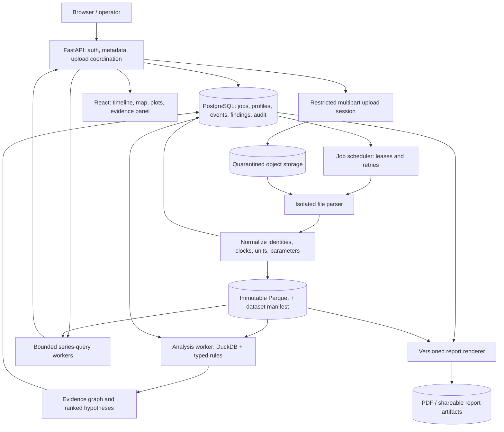

# Drone telemetry investigation platform

**Design baseline:** 29 October 2026  
**Status:** architecture proposal. This document does not claim an implementation. The existing
`drone_telemetry.py` prototype stays an offline demonstrator for CSV only.

## Executive summary

Build a workbench for flight investigations that uses evidence. Its main function is to
reconstruct what the aircraft and its operator reported. It must keep observations
separate from interpretations, put the possible failure mechanisms in sequence, and give a trace from each claim
to the original records. It must not give an unqualified crash verdict.
It must not certify that an aircraft is safe to fly.

The proposed stack is Python/FastAPI, isolated parser and analysis workers,
PostgreSQL, S3-compatible immutable object storage, Parquet/DuckDB, and a
React/TypeScript frontend with MapLibre and Plotly. Start with these items:

- ArduPilot tlog and DataFlash support;
- the provenance of profiles and parameters;
- a synchronized timeline;
- a small, validated pack of diagnostic rules;
- reports with links to the evidence.

Do arbitrary scripts, broad autopilot coverage, predictive maintenance and complex 3D later.

The incident that started this project shows why this difference is important. A compass
switch before a crash-check disarm is a useful association. But it does not prove that the
compass caused the loss of control. In the Copter 4.7.2 source that we examined, the
reported `AngErr` is a tracking error of the thrust vector. It is not a measurement of a compass or yaw error.[1]

## 1. Assumptions and boundaries

1. The real log was not available for this design review. Thus, we treat its
   size, message counts, warnings, distances and measurements as
   observations that the user reported. We did not reproduce them independently.
2. The first release is read-only and for use after the flight. It has no MAVLink connection
   to an aircraft, no endpoint that writes parameters, no motor-control function and no automated
   flight approval.
3. ArduPilot is the first ecosystem with full support. Later, PX4 gets a
   separate semantic adapter and rule pack. It does not use the Copter rules.
4. Users can upload files that are incomplete, corrupt, malicious or that have incorrect labels.
5. Uploaded locations, operator identities, routes and configurations are private,
   unless the user intentionally shares them.
6. Firmware strings that persons can read can identify an official release or a custom
   build. The semantics are only as trustworthy as the firmware match.
7. The thresholds, time windows and performance budgets below are design
   decisions. Exceptions are values that we explicitly identify as firmware behaviour or documentation.
8. A profile describes an aircraft. A log describes an observation of that aircraft
   at a specified time. Neither one silently replaces the other.

## 2. Product vision and users

### The central product promise

> Turn a flight log into a reproducible incident investigation: what happened,
> which explanations fit, what contradicts them, and what evidence is missing.

The interface must answer these questions in this sequence:

1. Which aircraft, firmware, configuration and source streams does the recording contain?
2. Which parts of the recording are usable?
3. What occurred before, during and after each flight?
4. Which observations show a problem?
5. Which failure mechanisms have support, and what are the limitations?
6. Which more data or safe inspection can tell the mechanisms apart?

### Different users

| User | Primary problem | Product value |
|---|---|---|
| Hobbyist or builder | Many warnings, and little understanding of how they are related | Explanations in plain language, parameter context, precise links to evidence |
| Commercial operator | Must sort incidents and keep an operational record | Repeatable reports, flight comparison, annotations and accountable review |
| Fleet maintainer | Must tell a recurring hardware problem from changes in flight conditions | Histories for each aircraft, trends that know the configuration, and maintenance records |
| Developer or investigator | Needs reproducible details, not a statement on a dashboard | Access to raw records, parser versions, plots at full resolution and competing hypotheses |

Use the same evidence model for all four users. Change the depth of the presentation. Do not
keep a separate, simplified diagnosis for beginners that hides its logic.

## 3. Correct interpretation of the incident

### Facts to reconstruct versus conclusions to investigate

| Reported observation | Defensible interpretation | Unsupported shortcut to avoid |
|---|---|---|
| `PreArm: Radio failsafe on`, throttle about 1000, threshold 975 | The vehicle reported a radio-integrity/pre-arm problem. Investigate its actual trigger and timing. | “1000 is below 975” or “the threshold caused this” |
| GPS “unable to configure band” | The receiver rejected a configuration operation | “GPS had no usable fix” |
| `Auto mode not armable` | Arming was rejected in that mode with the active configuration | “GPS caused the arming rejection” |
| EKF compass selection changed before disarm | An estimator event occurred before the reported crash-check action | “Changing compass caused the crash” |
| `AngErr=160>30` | The crash detector reported a large tracking error of the thrust vector | “The compass had a 160-degree yaw error” |
| `Compasses inconsistent` after the two incidents | The compass checks failed after the incidents | “They were necessarily inconsistent before flight” |
| Z vibration peak about 66 | AnaTele observed a high processed vibration value | “Vibration caused the crash”, without timing and persistence |
| Clipping count 316 | A counter or a derived count needs the context of the sensor instance and the resets | Add all sampled counter values and call the sum 316 new events |
| Position estimate approached WP2 by 0.4 m | A reported position series was near the candidate waypoint | “The aircraft physically reached it to 0.4 m accuracy” |

### Critical firmware details

We verified the `Copter-4.7.2` tag at commit
`fb773567896014da007bca58358704d4a0d8516f`. Thus, a semantic pack with a version is
possible. But this does not prove that the aircraft of the user ran that exact binary.

For that version, the crash check contains these gates:

- armed and not landed, and gates related to the mode;
- filtered, gravity-compensated acceleration below 3 m/s²;
- estimated lean above 15 degrees;
- tracking error of the thrust vector above 30 degrees;
- speed below 10 m/s, when velocity is available.

The gate must stay true for a counter that is nominally equal to two seconds at the configured loop rate. The printed
error is the value at the trigger. It is not necessarily the value during all of the interval.
The executable conditions in the source have priority over comments that are out of date.[1]

The crash check does not detect a physical impact, and it does not identify a failed component.
The estimated attitude itself can be wrong.

For the same verified release:

- `ARMING_SKIPCHK=128` skips the **board-voltage check**, not the compass check.
  Do not decode this value with an `ARMING_CHECK` bit table from memory.
- `BATT_MONITOR=0` disables that battery-monitor instance. Examine the other
  instances before you say that no battery monitoring is available.
- `FS_GCS_ENABLE=0` disables the GCS-heartbeat failsafe. Whether this conflicts
  with the intended operation depends on the control link and on the mission policy.[2]

### A provisional investigation, not a numeric verdict

The reported observations are sufficient to investigate three competing mechanisms:

1. **Estimator/magnetic inconsistency:** the reported compass selection and
   inconsistency messages support it. It is weaker as a causal conclusion if the
   affected core was not primary, or if the disagreement occurs only after impact.
2. **Mechanical/thrust-generation or configuration problem:** it agrees with the
   loss of thrust-vector tracking. It needs motor mapping, target attitude compared with estimated
   attitude, ESC evidence and inspection. A takeoff that seems successful is
   context. It does not exclude this mechanism.
3. **Vibration-driven estimation degradation:** this is possible only if the data shows too much
   vibration/clipping before the loss of control, not only at impact.

Put the radio/pre-arm failures in a separate group of findings. They can have the same
electrical cause, but you must show that relation.
The platform must not give numerical probabilities of the root cause from this
description only.

## 4. Recommended system architecture



### Technology choices

| Layer | Recommendation | Reason |
|---|---|---|
| API | FastAPI, Python, typed request/response models | The same language as the parsers and the analysis; explicit contracts |
| Job scheduling | PostgreSQL job table with leased workers | One operational datastore at the start; durable retries and audit |
| Parsing | Pinned pymavlink adapters; pyulog for later ULog support | Existing format implementations, with platform validation around them |
| Raw/derived artifacts | S3-compatible storage with versions | Immutable references to sources and outputs; large files stay out of SQL |
| Metadata | PostgreSQL | Transactions, tenant isolation, structured relations |
| Bulk samples | Parquet, grouped by dataset and signal family | Efficient reads of bounded intervals and columns |
| Analysis/query engine | DuckDB in separate workers with resource limits | SQL over Parquet without a distributed analytics cluster |
| Frontend | React + TypeScript, MapLibre, Plotly | Linked investigation panels, maps and engineering plots |
| First deployment | Docker Compose, separate API/scheduler/worker services | Easier to operate than Kubernetes, and it keeps the isolation boundaries |

Do not do heavy parsing as an in-process background task of FastAPI. Do it in a
separate worker with resource limits and a durable job record.[14]

Use at-least-once execution with idempotent outputs. Do not claim “exactly once”.
The identity of an analysis contains the input manifest, the profile snapshot and the semantic pack.
It also contains the hash of the rule set, the analysis configuration and the engine version.

### Job lifecycle

```text
created -> uploading -> upload_verified -> parsing -> normalizing
        -> analysis_queued -> analyzing -> publishing -> complete
```

There are also the explicit outcomes `failed`, `cancelled` and `partial_dataset`.
An interrupted upload is not the same as a log that the platform received fully but that is truncated.
Publish a dataset manifest only after its files pass the integrity
checks. Failed work must not show as a complete analysis.

## 5. Data model

Do not use one table with the name `flights` for all data.

| Entity | Purpose and important fields |
|---|---|
| Tenant / user / membership | Ownership, roles, permissions, audit actor |
| Drone | Stable ID of the physical asset; not only the MAVLink system ID |
| ProfileVersion | Frame, propulsion, sensors, firmware, operating policy, effective interval, provenance |
| SourceArtifact | Hash, original name, size, object version, format, acquisition metadata |
| ParseRun / DatasetVersion | Parser/dialect hashes, diagnostics, clock mappings, coverage inventory, Parquet manifests |
| SourceIdentity | System/component IDs, topic instance, candidate role, link evidence, boot epoch |
| RecordingSession | Capture session that can contain more than one aircraft, reboot or flight |
| ArmedEpisode | Armed interval. It can be fully on the ground. |
| FlightEpisode | Observed/inferred takeoff and landing intervals, confidence, vehicle and clock epoch |
| ParameterObservation | Name, typed raw/decoded value, instance, source, difference between requested and reported |
| ParameterSnapshot | Values and evidence of completeness at a time; missing indices and conflicts |
| MissionTransaction / MissionVersion | Direction, participants, mission type, items, acceptance evidence and uncertainty |
| Observation | Typed measurement, locator of the raw source, original time, normalized time, units and quality |
| Event / EventEpisode | Individual transitions/warnings and derived groups of occurrences |
| RuleVersion | Applicability, requirements, typed logic, thresholds, tests, validation status, content hash |
| RuleEvaluation | Triggered, not triggered, unassessable or not applicable; coverage and reasons |
| Finding / Hypothesis | Claim, severity, support, contradictions, unknowns, ranking and evidence |
| AnalysisRun | Exact immutable inputs, rule versions, engine image, options and execution status |
| Annotation / MaintenanceAction | Human interpretation, inspected component, corrective action, final outcome |
| Report / Share | Output with a version, redactions, access scope, expiry and revocation |

### Example canonical observation

```json
{
  "dataset_id": "ds-17",
  "source": {
    "artifact_id": "log-7",
    "record_ordinal": 21841,
    "byte_offset": 893402,
    "message": "VIBRATION",
    "system_id": 1,
    "component_id": 1,
    "instance": 0
  },
  "clock": {
    "epoch_id": "boot-2",
    "native_time_us": 192340000,
    "capture_time_us": 1790000192340000,
    "analysis_time_us": 192340000,
    "mapping_id": "clock-map-4",
    "uncertainty_us": 150000
  },
  "signal": "imu.vibration.z",
  "raw_value": 66.0,
  "normalized_value": 66.0,
  "unit": "m/s^2",
  "quality": ["crc_valid", "capture_clock_unverified"]
}
```

This example shows the schema. It is not an observation from the log of the incident.
Use integer timestamps. The precision of a timestamp is not the accuracy of the timestamp.

### Example finding

```json
{
  "kind": "hypothesis",
  "hypothesis": "magnetic_estimation_problem",
  "severity": "critical",
  "interval": {"start_us": 180000000, "end_us": 205000000},
  "rule_version": "compass-switch-loss-of-control@1.2",
  "support": ["event-43", "evidence-window-81"],
  "contradictions": ["evidence-window-82"],
  "missing": ["primary_ekf_core", "magnetic_innovations"],
  "ranking_score": 4.1,
  "calibrated_probability": null,
  "confidence_label": "limited evidence",
  "recommendation_id": "obtain-onboard-log-and-inspect-magnetic-installation"
}
```

A ranking score such as 4.1 is an example value without calibration. It does not mean “41% likely”.

## 6. Parsing and data integrity

### Format detection and isolation

Use explicit adapters that accept files only:

```text
adapters\ardupilot_tlog
adapters\ardupilot_dataflash
adapters\px4_ulog
adapters\mapped_csv
```

Examine the file signatures and the record structure, not only the extension.
The convenience dispatcher of pymavlink is not a universal detector. It contains
network/device transports and other behaviours that an upload API must never
expose. Do not give an arbitrary user string to that dispatcher.[3]

Run the parsers with no network and no credentials. Give them read-only staged input, isolated
scratch storage, and budgets for CPU, memory, processes, output size and wall time.
Reject unsupported incompatibility flags. Keep the original file, also when you
recover its usable records.

### Mission Planner tlog

The Mission Planner writer that we examined puts an eight-byte
big-endian Unix-epoch microsecond timestamp in front of the packet bytes. It records the outgoing and the
incoming traffic. Thus, call this the capture/write time. Do not assume that it is
always the time when a sensor value was received.[4]

Keep the prefix bytes. Pymavlink shows the low timestamp bits as a link value,
but the Mission Planner writer that we examined does not explicitly reserve them.
Do not use that decoded value as proof of more than one physical link for each
Mission Planner recording.[3][4]

### MAVLink validation

Classify each frame as validated, truncated, CRC-failed, signature-unverified,
signature-failed, unknown-definition or unsupported-framing, as applicable.
A valid CRC is not authentication. A signature that is present is not a verified
signature without the necessary validation context.

A tolerant parser can return records with bad data. It does not repair information.
A parser can keep unknown message definitions without the
same checks as known messages. Keep the unknown payloads and their offsets, so that a later
dialect version can interpret them again.[3][5]

For MAVLink2, keep valid truncation of trailing-zero payloads separate from an
incomplete/corrupted frame. Record whether the optional fields were actually
available. Do this before you use a decoded default as a physical measurement.

### Identities and message loss

Use the system/component IDs of the sender, the available link provenance, and the boot/session
identity. Keep the source separate from the command target. Identify the stream of the flight controller
from the heartbeat type/autopilot and from corroborating messages. Do not assume that “ID 1
must be the drone.” One recording can contain relayed duplicates, GCS
heartbeats, radio reports and more than one aircraft.[5]

Sequence numbers wrap at 256. Examine continuity only in streams of one
source/channel/session that you can defend. A gap does not prove only radio loss.
Filtering, forwarding, reordering and mixed channels are also possible causes.
Report a conditional loss estimate with its assumptions. Do not report a universal
“packet loss percentage.”

### STATUSTEXT

Assemble long MAVLink2 text again with the sender/session/message ID and the chunk sequence.
Keep partial or conflicting assemblies. Reconstruct the bytes before you decode
UTF-8, so that a character that is split across chunks does not become corrupted.[5]

Keep each occurrence of a warning. A UI episode such as “Radio failsafe ×47 across
4 minutes” is a derived view. It is not 47 independent confirmations. It also does not prove
that a failsafe flag stayed continuously set for all four minutes.

### DataFlash, ULog and CSV

DataFlash adapters keep the embedded definitions of format, unit, multiplier and instance.
Keep the native boot timestamps, also if a parser gives a
derived wall-clock timestamp. PX4 ULog uses its own formats, subscription IDs,
instances and dropout records. Do not force these into false MAVLink IDs.[3][6]

A CSV import needs an explicit mapping for timestamps, timezone/domain,
identity, units and null values. Never execute timestamp expressions that the user supplies.
If the units come from column names, they stay suggestions until a person
confirms them.

## 7. Clock model and synchronization

Keep a minimum of these clocks:

1. Capture clock.
2. Vehicle boot clock.
3. GPS/UTC clock, when it is usable.
4. Derived investigation clock, with the uncertainty of the mapping.

`SYSTEM_TIME` can give the relation between boot time and Unix time. Some timestamp fields accept
boot-relative values or epoch values. The interpretation must follow the message
definition, not one global heuristic.[5]

Divide the data into credible reboot epochs. Keep reboot, delayed delivery and the
wrap of the 32-bit boot millisecond counter separate. Record inconsistent anchors and clock jumps.
Capture time minus sensor time is not automatically network latency.

When you combine onboard logs and telemetry logs, align them with more than one shared
landmark and clock anchor. Keep the residual error, and show an uncertain match.
Two records with five seconds between them in display time possibly do not have a
defensible causal sequence, if the alignment uncertainty is larger.

Never interpolate across a reboot, a reset of the estimator origin, long data gaps or
incompatible frames. Hold discrete states between observations, with a visible
freshness limit. Interpolated chart points must never look like original
evidence.

## 8. Profile and parameter audit

Build this early, because the diagnostic thresholds and their applicability depend on it.

A profile must contain:

- Frame class/type and motor geometry.
- Motor/ESC/propeller specifications and the channel-function mapping, if known.
- Firmware name/version, git identity, board and build information.
- Sensor instances, orientations, device IDs and the intended estimator sources.
- Battery chemistry/cell count/capacity and monitor assignments.
- Intended control links and failsafe policy.
- Payload and typical operating envelope.
- Maintenance changes, configuration versions and known limitations.

Each field records its origin: declared by the operator, reported by the firmware, inferred
or verified externally. “Quadrotor” in a heartbeat does not identify an
X-frame geometry. A generic GPS message does not identify a u-blox model.

### Parameter completeness

973 observed names do not prove a full snapshot. Track `param_count`, index
coverage, sender component, request/response context, repeated values and changes
in one collection epoch. A snapshot can be complete, partial, internally
inconsistent or of unknown completeness.[7]

Keep a requested `PARAM_SET` separate from a reported `PARAM_VALUE`. Decode the
advertised parameter type and the supported value encoding. Keep the raw bytes.
Do not treat a request without an acknowledgement as an effective configuration change.
For parameters that need a restart, the reported stored value and the active runtime value
can be different. Keep that uncertainty.

### Audits and comparisons

Where possible, give the parameter metadata a version for each exact firmware. Show the differences in
value, type, meaning, availability and completeness. If a parameter is missing in a partial snapshot,
do not report it as “reset to default.”

A known-good preset is a **reference with a scope**. It is not a universal safety certificate.
It needs the frame, hardware, firmware, payload/mission assumptions, provenance,
validation owner and expiry/review state. Show why a mismatch is important. Never
apply a preset automatically, and never disable arming checks.

## 9. Diagnosis engine

### Stage A: establish observations and operating context

Before you put causes in sequence, reconstruct these items:

- The identity of the vehicle/source and of the boot.
- Armed episodes compared with observed/inferred airborne flights.
- Mode, mission and parameter state.
- Available channels, rates, gaps and invalid samples.
- The applicable phases: pre-arm, takeoff, transition, flight, landing and after the event.

An armed vehicle on a bench is not automatically an airborne flight. Use the
heartbeat of the flight controller and the landed-state reports, if available. If not,
label the phase estimates and their uncertainty.[8]

### Stage B: derive events and indicators

Examples are an arming rejection, a change of compass selection and an increase in clipping.
Other examples are a persistent tracking error, a voltage sag and a plateau of the command output.

Use the observations at full resolution for detection. The diagnostic engine must not use the
downsampled line of a plot as its input.

### Stage C: evaluate hypothesis rules

```yaml
id: compass-switch-before-crash-check
version: 1
semantic_pack: arducopter-4.7.2
requires:
  events:
    - crash_check_disarm
    - ekf_compass_selection_change
  context:
    - vehicle_identity
    - clock_epoch
    - flight_episode
correlate:
  same_vehicle: true
  same_epoch: true
  before_seconds: 20
support:
  - compass_change_in_active_ekf_core
  - magnetic_innovation_failure_before_tracking_loss
contradictions:
  - first_attitude_failure_precedes_compass_change
  - changed_core_not_primary
unknowns:
  - missing_primary_core_identity
  - missing_magnetic_innovations
output:
  observed_pattern: compass_event_before_crash_check
  hypotheses:
    - magnetic_estimation_problem
    - vibration_related_estimator_degradation
  probability: null
```

This is an example DSL. It is not executed firmware logic. Its correlation window of 20 seconds
is a proposed screening window. It is not a documented causal
threshold.

Rule results have four states: `triggered`, `not_triggered`, `unassessable`,
`not_applicable`. A failed check of applicability or coverage is not a healthy
result.

### Stage D: put hypotheses in sequence without false probabilities

Start with a sequence that experts review and that you can explain:

```text
rank(H) =
    configured prior weight
  + capped support from each evidence family
  - explicit contradictory evidence
```

Possible evidence families are magnetic/estimator, inertial/vibration, propulsion,
power, navigation and communications. The integrity of the source, the timestamp uncertainty,
the relevance of the phase and the sampling coverage decide whether evidence is usable.

Do not count each repeated STATUSTEXT message, derived feature and plot
summary as independent support. Do not treat two flights on the same hardware
and configuration as independent laboratory replications.

Show four separate concepts:

- The severity, if the mechanism is real.
- The comparative priority for the investigation.
- The completeness/quality of the evidence.
- A calibrated probability, **only if it is validated for that task and population**.

At the start, use labels such as strong support, mixed support and limited evidence,
with explanations. Do not use “92% compass failure.” A future calibration of probabilities
needs adjudicated outcomes and an evaluation on held-out data.

### Stage E: recommend discriminating evidence and safe actions

For each hypothesis, answer this question:

> What observation would most clearly distinguish this from its nearest rival?

Examples are onboard magnetic innovations, measured ESC RPM/current, a complete
parameter snapshot, or a qualified inspection of the mounting and the propulsion.
After a crash, recommend first a safe inspection with the propellers removed
and a review of the existing evidence. Do not recommend a new Auto flight or force-arming.

## 10. Eight concrete rule designs

The persistence windows below are initial analysis decisions that you can configure.
The firmware gates have separate versions. Do not confuse the firmware gates with these windows.

### Rule 1: repeated pre-arm radio-integrity failure

- **Trigger:** repeated `Radio failsafe on` warnings, or an explicitly observed
  failsafe state during a pre-arm episode.
- **Evidence:** mapped throttle input, `RCMAP_THROTTLE`, calibration, reversal,
  freshness, receiver failsafe indications, RC options, override activity and
  timeout settings.
- **Logic:** keep these mechanisms separate: input below the threshold, loss of valid updates, and mechanisms
  related to the receiver/overrides. In the incident report, 1000 is more than 975. Thus,
  those samples do not prove the below-threshold mechanism.
- **Exclusions:** RC messages from the GCS, old retained values, and sparse observations
  that cannot show fresh receiver updates.
- **Output:** an arming blocker with trigger branches that are unresolved or supported.
  Not an invented adjustment to `FS_THR_VALUE`.

The channel state of Copter can include overrides. Streamed RC values are not an
independent capture of the wire protocol of the receiver.[9]

### Rule 2: arming rejected by mode or throttle state

- **Trigger:** `Auto mode not armable` or `Throttle too high`.
- **Evidence:** exact firmware semantics, current mode, arming-command method,
  Auto options, calibrated throttle/control demand and warnings at the same time.
- **Logic:** examine each rejected attempt separately. Copter 4.7.2 has an Auto
  allow-arming option and conditions for each mode. The throttle-high check is
  different from the low-throttle failsafe.
- **Exclusions:** an old mission upload or a GPS configuration message that only
  occurs near the event.
- **Output:** different rejection reasons. Not one “GPS arming failure.”

The GPS band warning must make a configuration warning. Its operational
effect stays conditional on the actual fix/accuracy and on the acceptance by the estimator.[9]

### Rule 3: estimator/compass event before crash-check disarm

- **Trigger:** a correctly classified compass/core/yaw event in a proposed
  window of 20 seconds before the disarm.
- **Evidence:** exact warning text, active EKF core, compass device mapping,
  innovations, target/estimated attitude, history of current and vibration.
- **Logic:** keep compass selection, EKF lane switch, yaw-source change
  and yaw reset separate. Record the sequence of the start relative to the decrease in tracking.
- **Exclusions:** changes on an inactive core only; disagreement after the impact as
  proof of a failure before the impact; correlation from uncertain clocks.
- **Output:** a supported chronology and competing hypotheses. Mark each causal
  interpretation as limited when the internal EKF evidence is not available.

A compass switch can be a recovery action of the estimator, and not the initial
fault.[10]

### Rule 4: loss of thrust-vector tracking

- **Trigger:** a divergence between the controller and the estimate that continues for a
  configurable screening interval of 0.5–1 second. An observed crash-check disarm message is also a trigger.
- **Evidence:** target and estimated orientation, body rates, outputs, filtered
  acceleration, speed and the exact semantics of the detector.
- **Logic:** keep these cases separate: an implausible target, a jump of the state estimate, and failure
  to follow a plausible target. Reproduce the internal crash gates only if the
  necessary signals and samples make this possible.
- **Exclusions:** mismatched coordinate frames, comparisons of signals that are not aligned, and the use of
  `AngErr` as a full yaw error.
- **Output:** a tracking failure. The possible control, estimation and thrust causes
  stay separate.

For Copter 4.7.2, use the thrust-vector definition and the executable crash gates.[1]

### Rule 5: sustained vibration and accelerometer clipping

- **Trigger:** initial screening above 30 m/s² for 2 seconds, or above 60 m/s² for
  1 second. Positive clipping increments in airborne intervals before the event are also a trigger.
- **Evidence:** vibration and clipping for each instance, boot boundaries, sample
  intervals and phase.
- **Logic:** calculate the positive counter increments in a valid epoch. Report the
  increments over known intervals. Do not invent the times of individual clips.
- **Exclusions:** peaks from impact/handling only, counter resets, mixed IMU instances,
  and sums of cumulative samples.
- **Output:** vibration exposure before the event, exposure at impact only, or insufficient
  temporal evidence.

The ArduPilot documentation gives 30/60 as useful vibration guidance. These values are not universal
crash thresholds. The vibration metric of ArduPilot is filtered. It is not the instantaneous
acceleration. The DataFlash instance fields are different from the clipping0/1/2
representation of MAVLink. Thus, the semantic adapter must normalize them.[11]

### Rule 6: abnormal propulsion-command distribution

- **Trigger:** output imbalance/saturation that continues in a comparable, nominally
  steady phase. At the start, use a screening interval of two seconds that you can configure.
- **Evidence:** the actual channel-function mapping, frame geometry, output limits,
  desired attitude/rates, achieved motion, and ESC RPM/current if available.
- **Logic:** compare the outputs with the expected control demands, not only their spread.
- **Exclusions:** takeoff transients, aggressive manoeuvres, yaw commands, wind,
  asymmetric payload and different mixer configurations.
- **Output:** an anomaly in the command distribution. Without a measured motor response or an
  inspection, do not claim that a specified motor/propeller failed.

Motor commands are not measured thrust. A wrong geometry/sequence/direction needs
more corroboration.

### Rule 7: power monitoring gap or voltage anomaly

- **Trigger A:** no usable observations of the propulsion battery or the board supply for
  the operating policy.
- **Trigger B:** a sag/undervoltage that continues, against an applicable configured
  threshold, with valid current/load context.
- **Evidence:** all monitor instances, voltage/current, board supply, resets,
  battery profile and arming-check configuration.
- **Logic:** keep a defect in observability separate from an observed degradation of power.
- **Exclusions:** invalid sentinels, monitor instances that are disconnected or not used,
  a mismatch of chemistry/cell count, and sparse current measurements that are not aligned.
- **Output:** a gap in monitoring coverage, an observed voltage anomaly, or an unassessable
  battery condition. In the verified firmware, `ARMING_SKIPCHK=128` is a contextual risk.
  It is not proof of an electrical cause.[2]

### Rule 8: communication/navigation policy mismatch

- **Trigger:** a necessary RC/GCS/GNSS service becomes unavailable, or the configured
  failsafe behaviour contradicts the declared operating policy.
- **Evidence:** freshness of the applicable source, explicit failsafe events, GCS role,
  RC availability, mode, mission policy, fix/accuracy and use by the estimator.
- **Logic:** keep the status report of a radio separate from the actual health of the vehicle link.
  Keep a GNSS configuration warning separate from failed positioning.
- **Exclusions:** an optional GCS loss during an autonomous mission that the policy intentionally permits;
  a missing message when the topic was never streamed.
- **Output:** a policy mismatch or loss evidence that the user can act on. Not “unsafe because
  FS_GCS_ENABLE is zero.”

## 11. Mission reconstruction and analysis

### Treat uploads as transactions with uncertain outcomes

Identify the direction of `MISSION_COUNT`, of the requests, of the items and of the ACKs.
An upload and a download can carry similar messages in opposite directions.
Retransmissions are not automatically new plans.[12]

Keep these items separate:

1. Mission versions that the GCS intended.
2. Observed upload/download transactions.
3. Acceptance evidence.
4. Inferred/confirmed onboard mission state.
5. Execution observations.

A confirmed, shorter full upload replaces the earlier plan. Do not keep the old
points at the end. Partial writes need a known baseline. The MAVLink documentation
tells that ArduPilot uploads are not atomic. Thus, do not guarantee that the
last accepted mission stays onboard after an interrupted overwrite. Model a
possible partial change, unless the exact firmware/transaction evidence
proves a different result.[12]

Use the available opaque plan IDs as corroboration, not as universal identifiers.
Missing or zero extension fields do not prove the identity of a plan.

### Reached versus observed near

Use explicit statuses:

```text
reported_complete
geometry_consistent_with_completion
completion_not_observed
not_visited_in_observed_trajectory
unassessable
```

Keep the command itself. A takeoff item is not a usual horizontal waypoint.
ArduPilot usually uses sequence zero for home. Never change the labels to the display sequence
without keeping the original sequence numbers.[12]

A missing `MISSION_ITEM_REACHED` does not prove that the aircraft did not reach the item. An advance of
`MISSION_CURRENT` can come from a jump or a set-current operation.
The generic MAVLink waypoint fields do not guarantee that a given Copter release
implements each field. Specifically, do not invent a universal acceptance condition for waypoint yaw.[12][13]

For the reported approach of 0.4 m, show:

- The candidate mission version and the command/frame of the item.
- The nearest recorded horizontal distance.
- The vertical error, only when the frames/datums are compatible.
- The GPS/estimator uncertainty and the observation gap.
- Whether AnaTele used interpolation.
- Whether AnaTele observed an execution completion message.

Call the 21.6 m value a distance from a recorded position to a waypoint, unless an
along-path definition and the correct active plan are known.

### Geometry and mission warnings

Keep MSL, ellipsoid, home-relative and terrain-relative altitude separate.
Home-relative altitude is usually not AGL. Keep the semantics of local NED/ENU and body
FRD. Local frames need a known origin. The GPS course is not the vehicle
heading, and the estimated global position is not physical ground truth.[5][13]

A cross-track distance must name its reference. A straight mission segment is not
the curved/spline path of the controller. The battery margin of a plan is unassessable
without sufficient battery/energy observations and a validated load model.
Distance alone does not give a credible energy estimate.

## 12. Interface and reports

### Investigation screen

Use one model for the time selection. These items share the model:

- Event timeline with a severity filter.
- Map and planned/flown path.
- Linked engineering plots.
- Parameter changes and flight-phase markers.
- Hypothesis cards with support/contradictions.
- Raw record/evidence inspector.

When you click a finding, the interface selects its interval. It opens the exact source records and
a bounded context before and after. A warning episode expands to individual messages.
Show missing/invalid data as gaps, not as zeros.

Compare flights by the time since takeoff or by the equivalent mission phase. Keep the
actual timestamps and durations. Do not automatically make “WP2”
equal between different mission versions.

### 3D

Start with correct 2D plots and altitude plots. Later, add 3D with an explicit altitude
datum and frame conversion. Interpolate quaternions with sign continuity.
Unwrap the displayed angles, and stop the interpolation at gaps/resets. A smooth
trajectory must not suggest that the measurements are more accurate.

### Reports

Each report contains:

1. Scope, aircraft/profile identity, firmware match and data limitations.
2. Observed incident sequence.
3. Hypotheses in sequence, and the supporting/contradicting evidence.
4. Concerns about parameters and monitoring.
5. Missing evidence and the recommended safe follow-up.
6. Analysis/rule versions and immutable evidence links.

An optional LLM can write the text of structured findings that are already approved. It must not
invent diagnoses, thresholds, source citations or repair instructions.
Log strings are untrusted input. They must not become model instructions.
Supply a deterministic report as a fallback.

## 13. Fleet trends and maintenance

First, implement condition trends. Do not claim a remaining useful life.

Compare equivalent flight phases, and include these items:

- Firmware/profile revisions and sensor replacement.
- Payload, battery identity, temperature and environment.
- Manoeuvre intensity, duration and recording rates.
- Sensor instances, units and signal coverage.

A vibration trend is not automatically motor wear. Motor wear needs applicable
response measurements and maintenance outcomes. Battery degradation needs a
consistent battery identity and comparable charge/load/temperature conditions.
Record the maintenance actions, replaced parts, inspection findings and the flights after them,
so that useful labels accumulate.

Do not compare a sparse radio log with an onboard log at a high rate as if their peaks
and counter visibility were directly equivalent.

## 14. Rule extensibility

### MVP: a bounded DSL

Permit registered signals, comparisons, durations, aggregates, temporal joins,
exclusions and evidence templates. When a person makes a rule, validate the units, the expected types, the applicable
firmware and the necessary coverage.

Each shared rule needs a version/hash, author, tests, description, applicability,
known confounders, validation state and review history. A tenant pins a rule
version. An update must not silently write over old investigations.

### Later: isolated executable extensions

Do not execute user Python in the API or in the privileged analysis process. If scripts
become necessary, use reviewed immutable packages in disposable sandboxes.
The sandboxes have no network and no secrets. They have read-only inputs with a scope, strict CPU/RAM/process/output
budgets, deadlines and validated result schemas. Do not expose a socket of the container engine.
Hostile public plugins need stronger isolation than usual shared
containers before the launch.

## 15. Testing and evaluation

### Four test layers

1. **Parser fixtures:** valid formats, wrong suffixes, truncated frames, missing
   chunks, unknown messages, CRC/signature states, reboots and corrupted regions.
2. **Semantic fixtures:** parameter bitmasks for each version, message units,
   instance mappings, time anchors, armed state compared with airborne state, mission
   retransmission and partial-write behaviour.
3. **Diagnostic fixtures:** positive cases, healthy counterexamples, missing
   channels, contradictory evidence and known confounders.
4. **End-to-end investigations:** immutable expected event sequences, evidence
   locators, findings and report versions.

Make the log of the incident a manually annotated regression case. If possible,
pair it with its onboard logs and the inspection outcome. Do not make it the full
evaluation set.

### Ground-truth levels

Keep these levels separate: causes confirmed on the hardware, interpretations adjudicated by experts, and
weak labels from the narratives of operators. Do not train or score “root cause” against
an unverified description as if it were ground truth.

Include healthy flights, recoveries, aborted takeoffs, bench activity and benign
warnings, not only crashes. Split the data by aircraft/operator and by time. Keep duplicate
recordings and related flights out of opposite splits.

Measure:

- False alerts for each flight-hour and for each flight phase.
- Precision/recall of observable events.
- Top-k hypothesis recall on adjudicated incidents.
- Correctness of the cited evidence and of the timeline sequence.
- Abstention and coverage when signals are missing.
- Calibration, only for outputs that claim probabilities.
- The time that an analyst needs to identify and verify a useful explanation.

A model with high recall that says that the compass caused each crash is not a useful product.

## 16. Security, privacy and operational reliability

- Tenant authorization must follow each data/evidence relation.
- Parser code is exposed to hostile files. Put it in a sandbox and fuzz it.
- Validate the actual file sizes and contents. If the platform accepts archives later, limit their expansion.
  Do not trust filenames, MIME types or hashes that the client reports.
- Use unique immutable object versions. The multipart ETags of the object store do not replace
  the integrity hash that the platform selected.
- Keep caches and deduplication semantics for each tenant. This prevents the exposure of the upload or analysis of
  a different tenant.
- Redact home coordinates, routes, identities and timestamps where necessary.
  The redaction must apply to PDFs, metadata, downloadable artifacts and maps, not only to
  the visible text.
- Use application-level share tokens that you can revoke, with a narrow scope and an expiry.
  Issue short-lived object URLs only after authorization. Presigned storage URLs
  are bearer credentials, and persons can use them again until they expire.[15]
- Define the deletion across raw data, Parquet, indexes, caches, reports, shares and
  backups. State the backup-retention limits clearly.
- Keep access logs, restore tests and incident procedures.
- Explain the processing by third-party maps/LLMs. Supply a workflow without external services
  for sensitive logs.

## 17. Performance and large-log design

Define test workloads. Do not invent performance claims:

| Workload | What to measure |
|---|---|
| Roughly 55,000-message tlog | Time to the first useful preview and to the final analysis |
| Ten-million-message onboard dataset | Parse throughput, peak RAM and scratch storage |
| 1 GB interrupted upload | Resume behaviour, integrity validation and cleanup |
| Multiple tenants | Queue fairness, cancellation and query latency under load |
| Corrupt/high-cardinality data | Resource ceilings, bounded recovery and useful error output |

Stream the records in bounded batches. Do not keep millions of Python message
objects. Do not send one JSON blob for each full flight to the browser. Group Parquet by
dataset/signal family, with applicable row groups. Do not make one small file for each message
type or sensor sample.

Requests for series queries specify allowlisted channels, interval, source, quality
policy and point budget. Apply limits to the scanned bytes, the execution time and the output.
Use min/max envelopes or other chart summaries that keep spikes. Get the exact
evidence windows on demand. The analysis operates on data at full resolution,
with sufficient overlap before and after the chunk boundaries.

Cache by tenant, dataset/time-mapping version, channels, interval, aggregation and
redaction policy. Do benchmarks on explicitly stated hardware before you promise
interactive latencies.

## 18. Roadmap and MVP acceptance

### Milestone 0: establish the evidence contract

- Get permitted, representative logs and paired onboard/telemetry recordings.
- Annotate the incident case. Do not assume its cause.
- Freeze the canonical semantics of identity, time, provenance and quality.
- Define the policies for the firmware match and the data coverage.

**Exit:** two analysts can tell observations, interpretations and unknowns apart
in the same case, without only screenshots.

### Milestone 1: reliable ArduPilot ingestion

- Tlog and DataFlash adapters, immutable artifacts and job lifecycle.
- Inventory of source roles, clock epochs, diagnostics for corrupt regions.
- Parameters/profile snapshots and channel coverage.

**Exit:** the accepted input is reproducible, and each normalized record has a trace
to its original artifact. Partial data cannot show as complete.

### Milestone 2: investigation UI and baseline health

- Armed/airborne episodes, groups of warnings, timeline of modes/failsafes.
- 2D map of the planned/flown path, linked plots and navigation to the exact evidence.
- Basic history of mission transactions and a parameter audit that knows the version.
- Checks for vibration, radio, tracking and monitoring.

**Exit:** a person can investigate the incident case from start to end without a generated
root-cause verdict.

### Milestone 3: diagnostic MVP

- A small rule pack, reviewed by experts, for the eight patterns above. At the start,
  give priority to radio pre-arm failure, vibration/clipping, tracking loss and
  compass-event association.
- Hypothesis sequence with contradictions and abstention.
- Operator reports with versions, and manual annotations.
- A regression corpus that includes benign cases and cases with missing data.

**MVP acceptance:** on the incident case, the MVP must correctly identify the 1000/975
problem and interpret the crash `AngErr`. It must not add clipping counters together. It must tell
takeoff commands from waypoint commands. It must not treat missing completion telemetry
as definitive non-completion. Each finding has evidence and limitations.

### Milestone 4: operational hardening and expansion

- Tenant isolation, access/retention controls, quotas, recoverability and benchmark
  budgets, before the platform accepts broad external uploads.
- PX4 ULog with its own semantic/rule pack; explicit CSV mapping.
- Comparisons across flights, improved 3D and maintenance records.

### Milestone 5: outcome-driven learning

- Fleet condition trends and validated maintenance outcomes.
- Optional learned hypothesis sequence or evidence priority.
- Calibrated probabilities, only if held-out data supports them.

If time is short, remove these items first: arbitrary scripts, LLM narratives, public rule marketplaces,
live telemetry, claims of predictive maintenance and complex 3D.
Do not remove provenance, knowledge of profiles/versions, data-quality reports,
counterexample tests or the difference between unknown and healthy.

## 19. Important challenges to the original plan

1. **Move the profile/parameter functions forward.** Trustworthy health and root-cause rules
   depend on them. They are not a cosmetic feature for later.
2. **Treat mission reconstruction as state estimation.** Interrupted uploads and
   missing messages can make the active plan truly unknowable.
3. **Do not make the sequence of warnings equal to causality.** Recovery actions frequently occur
   after a problem has started.
4. **A tlog cannot give information that was never streamed.** Sometimes, the correct product output is
   a request for onboard data.
5. **“100% analyzed” must not mean “all subsystems healthy.”** Publish a matrix of capability
   and coverage with each report.
6. **Frame and sensor identity change with time.** Persons can replace components. An
   IMU index is not a permanent physical identity.
7. **A baseline can already be unhealthy.** Personalized thresholds need reviewed
   reference flights, not only the historical average of the aircraft.
8. **A smooth 3D replay can give a wrong impression.** Keep the uncertainty and the missing data
   visible. Graphics do not make the measurement stronger.
9. **Root-cause labels are expensive.** Maintenance/inspection outcomes and
   expert review are core product data. They are not optional improvements for the future.
10. **Models are optional, evidence is not.** Later, a System-One classifier can
    help to give priority to reviewed evidence. It must not replace the exact protocol
    reconstruction, and it must not invent causal certainty.

## Source notes

This report combines architectural recommendations with checks of primary sources.
The crash/parameter interpretations for a specified version use the verified source of the Copter 4.7.2
release. The actual binary of the aircraft is still not verified. The general mission
documentation and the current source examples must be compared with that binary
before you state exact execution predicates.

[1] ArduPilot Copter 4.7.2:
[crash detector](https://github.com/ArduPilot/ardupilot/blob/fb773567896014da007bca58358704d4a0d8516f/ArduCopter/crash_check.cpp),
[attitude-control interface](https://github.com/ArduPilot/ardupilot/blob/fb773567896014da007bca58358704d4a0d8516f/libraries/AC_AttitudeControl/AC_AttitudeControl.h),
[thrust/attitude calculations](https://github.com/ArduPilot/ardupilot/blob/fb773567896014da007bca58358704d4a0d8516f/libraries/AC_AttitudeControl/AC_AttitudeControl.cpp).

[2] Copter 4.7.2:
[arming metadata](https://github.com/ArduPilot/ardupilot/blob/fb773567896014da007bca58358704d4a0d8516f/libraries/AP_Arming/AP_Arming.cpp),
[battery parameters](https://github.com/ArduPilot/ardupilot/blob/fb773567896014da007bca58358704d4a0d8516f/libraries/AP_BattMonitor/AP_BattMonitor_Params.cpp),
[failsafe handling](https://github.com/ArduPilot/ardupilot/blob/fb773567896014da007bca58358704d4a0d8516f/ArduCopter/events.cpp).

[3] Pymavlink at `bd0a1b29d5b8b54b7d66abfe9ac043c528ac490f`:
[mavutil dispatch/log parsing](https://github.com/ArduPilot/pymavlink/blob/bd0a1b29d5b8b54b7d66abfe9ac043c528ac490f/mavutil.py),
[generated-parser behavior](https://github.com/ArduPilot/pymavlink/blob/bd0a1b29d5b8b54b7d66abfe9ac043c528ac490f/generator/mavgen_python.py),
[DataFlash reader](https://github.com/ArduPilot/pymavlink/blob/bd0a1b29d5b8b54b7d66abfe9ac043c528ac490f/DFReader.py).

[4] Mission Planner
[timestamp writer and recording](https://github.com/ArduPilot/MissionPlanner/blob/82dd96dfb44bccc51a6e77fcc7c309553b794f39/ExtLibs/ArduPilot/Mavlink/MAVLinkInterface.cs#L1474-L1512);
[telemetry-log scope](https://ardupilot.org/planner/docs/mission-planner-telemetry-logs.html).

[5] MAVLink
[serialization](https://mavlink.io/en/guide/serialization.html),
[message definitions](https://mavlink.io/en/messages/common.html),
[routing](https://mavlink.io/en/guide/routing.html),
[signing](https://mavlink.io/en/guide/message_signing.html).

[6] PX4 [ULog specification](https://docs.px4.io/main/en/dev_log/ulog_file_format.html);
[pyulog implementation](https://github.com/PX4/pyulog/blob/0b392f8444f843b796405b9766cc15a6dddedf62/pyulog/core.py).

[7] MAVLink [parameter protocol](https://mavlink.io/en/services/parameter.html).

[8] MAVLink [heartbeat](https://mavlink.io/en/services/heartbeat.html) and
[landed state](https://mavlink.io/en/messages/common.html#MAV_LANDED_STATE).

[9] Copter 4.7.2
[radio handling](https://github.com/ArduPilot/ardupilot/blob/fb773567896014da007bca58358704d4a0d8516f/ArduCopter/radio.cpp),
[arming checks](https://github.com/ArduPilot/ardupilot/blob/fb773567896014da007bca58358704d4a0d8516f/ArduCopter/AP_Arming_Copter.cpp),
[Auto arming](https://github.com/ArduPilot/ardupilot/blob/fb773567896014da007bca58358704d4a0d8516f/ArduCopter/mode_auto.cpp),
[RC channel state](https://github.com/ArduPilot/ardupilot/blob/fb773567896014da007bca58358704d4a0d8516f/libraries/RC_Channel/RC_Channel.cpp),
[u-blox configuration handling](https://github.com/ArduPilot/ardupilot/blob/fb773567896014da007bca58358704d4a0d8516f/libraries/AP_GPS/AP_GPS_UBLOX.cpp).

[10] Copter 4.7.2
[EKF compass selection](https://github.com/ArduPilot/ardupilot/blob/fb773567896014da007bca58358704d4a0d8516f/libraries/AP_NavEKF3/AP_NavEKF3_Measurements.cpp),
[EKF primary-core handling](https://github.com/ArduPilot/ardupilot/blob/fb773567896014da007bca58358704d4a0d8516f/libraries/AP_NavEKF3/AP_NavEKF3.cpp),
[compass consistency](https://github.com/ArduPilot/ardupilot/blob/fb773567896014da007bca58358704d4a0d8516f/libraries/AP_Compass/AP_Compass.cpp).

[11] ArduPilot [vibration guidance](https://ardupilot.org/copter/docs/common-measuring-vibration.html);
Copter 4.7.2 [vibration calculation](https://github.com/ArduPilot/ardupilot/blob/fb773567896014da007bca58358704d4a0d8516f/libraries/AP_InertialSensor/AP_InertialSensor.cpp)
and [DataFlash definitions](https://github.com/ArduPilot/ardupilot/blob/fb773567896014da007bca58358704d4a0d8516f/libraries/AP_InertialSensor/LogStructure.h).

[12] MAVLink [mission protocol, including ArduPilot-specific notes](https://mavlink.io/en/services/mission.html).

[13] ArduPilot [mission-command behavior](https://ardupilot.org/copter/docs/common-mavlink-mission-command-messages-mav_cmd.html)
and [Auto mode](https://ardupilot.org/copter/docs/auto-mode.html).

[14] FastAPI [background-task caveat](https://fastapi.tiangolo.com/tutorial/background-tasks/#caveat).

[15] AWS [presigned URL behavior](https://docs.aws.amazon.com/AmazonS3/latest/userguide/using-presigned-url.html).
