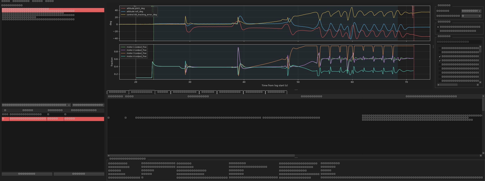
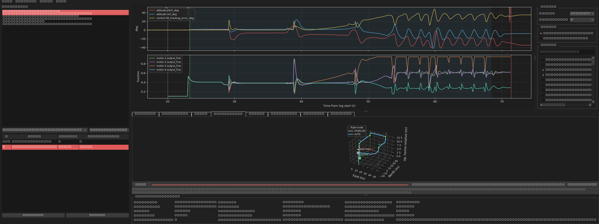

# Usage guide

- [Install](#install)
- [Desktop application](#desktop-application)
- [Command line](#command-line)
- [Flight simulator](#flight-simulator)
- [Aircraft profiles](#aircraft-profiles)
- [Web UI and HTTP API](#web-ui-and-http-api)
- [Sharing analyses (.ant)](#sharing-analyses-ant)
- [Reports](#reports)
- [Investigate a crash: a worked example](#investigate-a-crash-a-worked-example)
- [Tips and troubleshooting](#tips-and-troubleshooting)

## Install

```bash
python -m venv .venv
.venv\Scripts\activate            # Windows
source .venv/bin/activate         # macOS / Linux
pip install -e ".[desktop]"       # drop [desktop] for a headless/server install
```

You must have Python 3.11 or newer. Alternatively, download a standalone build from
[Releases](https://github.com/Avinashistoocool/AnaTele/releases). A standalone build does not need Python (refer to [DEPLOYMENT](DEPLOYMENT.md)).

## Desktop application

```bash
anatele                          # empty window
anatele path/to/flight.tlog      # import and analyse immediately
```



### Layout

| Region | Contents |
|---|---|
| **Menu** | File (Open Log or Analysis `Ctrl+O`, Save Analysis As .ant `Ctrl+S`, Export Report `Ctrl+E`, Show Original File), Analysis (Re-analyse with the selected profile, Refresh `F5`), Tools (Profile Editor, Compare With Log, Aircraft Trends), Help (Limitations). |
| **Left: Recordings** | Each imported file shows its status and progress. The analysis runs in a separate worker process, thus the window continues to respond. A failed file shows the error. |
| **Left: Profile** | AnaTele attaches the profile that you select to the *next* import (or re-analysis). You cannot change a profile after you save it. Each profile has a version. |
| **Left: Episodes** | One row for each armed episode. The row shows the phase status (`airborne reported`, `airborne inferred`, `no airborne evidence`, `unassessable`), the takeoff time and the time of the crash report. When you select an episode, the plots and the replay zoom to it. *All* shows the full recording. |
| **Centre: Plot** | The selected signals, stacked by unit. Dashed lines mark armed, takeoff, crash report and disarmed. The shaded band is the airborne window before the event. AnaTele does not draw a line across a gap of more than 5 s. Click a point to open its record in the **Evidence** tab. |
| **Right: X Axis** | Time from the start of the log, or time from takeoff (to compare flights). |
| **Right: Y Axis** | All decoded or derived signals for the selected source. To find a signal, type in the filter box, for example `vibration`, `motor.`, `ekf`. |
| **Bottom tabs** | Findings · Hypotheses · Rules · Flight Path · Events · Parameters · Missions · Evidence. To see the evidence for a row, double-click the row. |
| **Flight Statistics** | Firmware and semantic pack, frame, record count, takeoff, airborne time and crash report. Also vibration before the event, EKF compass ratio, tilt error, motor spread, battery monitoring and the first hypothesis. |

### Useful signals

| Signal | Meaning |
|---|---|
| `attitude.roll_deg`, `attitude.pitch_deg`, `attitude.yaw_deg` | Estimated attitude |
| `attitude.desired_roll_deg`, `attitude.desired_pitch_deg` | Controller target (NAV_CONTROLLER_OUTPUT, ATTITUDE_TARGET or ATT Des*) |
| `control.tilt_tracking_error_deg` | Angle between the desired and the estimated thrust vectors (derived) |
| `control.throttle_pct` | Throttle output (VFR_HUD or CTUN) |
| `output.chN` | Raw servo/ESC PWM |
| `motor.N.output_frac`, `motor.N.at_floor`, `motor.N.at_ceiling` | Motor command, mapped through `SERVOn_FUNCTION` and normalised to the PWM range (derived) |
| `motor.mix.right_minus_left`, `front_minus_back`, `ccw_minus_cw` | Mixer decomposition of the motor commands (derived) |
| `imu.N.vibration.{x,y,z}`, `imu.N.clipping_counter` | Vibration and clipping |
| `ekf.compass_ratio`, `ekf.velocity_ratio`, `ekf.core*.…` | EKF innovation test ratios |
| `gps.fix_type`, `gps.h_acc_m` | GPS quality |
| `position.altitude_home`, `position.latitude`, `position.longitude` | Estimated position |
| `battery.voltage`, `battery.current` | Only when a monitor reports values that are not zero |

### Flight Path tab



- The 3D path shows the recorded estimated position in metres east/north/up. The origin is the first fix of the episode.
- The **path colour** shows the flight mode (AUTO, RTL, LAND …). The grey line is the shadow on the ground.
- **Waypoint colours:** green = reported complete, yellow-green = in the radius plus the GPS accuracy, amber = completion not observed, red = not visited.
- **X markers:** takeoff, attitude excursion, crash report and disarmed.
- **Play** shows an animation of the aircraft. The red arms are the front. To turn the view, drag with the mouse.
- **Export GIF…** saves an animation. If you select `.png`, it saves a still image.

### Comparisons and trends

- **Parameters tab → Compare against → Diff:** typed differences against a different log or the attached profile. AnaTele shows the raw-only differences (unverified encoding) in a separate list.
- **Tools → Compare With Log:** the metrics from the airborne window before the event, side by side, with the rule states and the parameter diff.
- **Tools → Aircraft Trends:** all analysed flights that you uploaded with a profile of that aircraft key. A chart shows vibration, compass ratio and motor spread over time.

## Command line

```text
anatele                         desktop app
anatele web [--port 8766]       web UI on 127.0.0.1
anatele analyse LOG [--json]    findings, hypotheses and rule summary in the terminal (LOG may be a .ant)
anatele export LOG [-o F.ant] [--include-original]   analyse and save a shareable .ant
anatele replay LOG [--out x.gif|x.png] [--episode N] [--fps 12] [--seconds 12]
anatele simulate [--scenario NAME|all] [--out DIR|file.tlog] [--seed N] [--duration S]
```

Example:

```text
$ anatele analyse simulations/sim_motor_failure.tlog
sim_motor_failure.tlog: 5,387 records, status complete
  source 1:1        vehicle              arducopter-4.7.2
  episode 0: airborne_inferred, takeoff 23.3s, crash report 71.4s

Findings:
  [critical] Crash-check disarm reported
  [critical] Sustained attitude (tilt) tracking error before upset
  [warning ] Motor command at ceiling before upset
  [warning ] Motor output imbalance before event
  ...
Hypotheses for episode 0 (screening order, not probability):
  1. Mechanical/thrust-generation or frame configuration problem — strong support
  ...
```

## Flight simulator

```bash
anatele simulate --out simulations                  # all five scenarios
anatele simulate --scenario compass_interference --out compass.tlog --seed 7
```

| Scenario | Events in the flight | Expected result in AnaTele |
|---|---|---|
| `nominal` | Arm, AUTO takeoff, 4 waypoints, RTL, land | No critical findings. All waypoints are `reported_complete`. |
| `motor_failure` | The thrust of motor 3 decreases during the mission. Then the controller saturates and the crash check disarms. | Loss of tracking, motor ceiling and imbalance. The thrust hypothesis is first. The later waypoints are not visited. |
| `compass_interference` | The motor current corrupts the magnetometer. This causes yaw error, a circular "toilet-bowl" movement during RTL and a compass switch. | EKF compass ratio more than 1 before the event, a compass-selection event, and a circular path in the replay |
| `vibration` | Damaged propeller | Persistent vibration of more than 30 m/s², and clipping increments before the event |
| `radio_failsafe` | PreArm radio warnings, then RC loss during the mission and RTL | PreArm radio finding, RTL mode change. The waypoints after the loss are not visited. |

The physics is intentionally simple: a rigid quad, an ArduPilot-style mixer priority (roll/pitch before yaw), linear drag
and wind. The log contains the label `SIMULATED FLIGHT`. The location is the public default field of SITL.
Use the simulator to learn the tool, to test rules and to make patterns again. It does not prove anything about a real aircraft.

## Aircraft profiles

**Tools → Profile Editor** (or `POST /api/profiles`):

| Field | Use |
|---|---|
| Aircraft key | A stable id, for example `quad-01`. When you save again, AnaTele makes version 2, 3, … |
| Name, frame, firmware, notes | Declarations from the operator. The reports show them. AnaTele does not verify them against the binary. |
| Vibration screening | The threshold for the vibration rules (default 30 m/s²) |
| Expected parameters | One `NAME=value` on each line. `profile-parameter-mismatch` and the parameter diff examine these values. |

Attach the profile *before* you import the log. AnaTele never writes over an existing analysis. To analyse again, use **Analysis → Re-analyse**.

## Web UI and HTTP API

```bash
anatele web            # http://127.0.0.1:8766
```

The web UI gives the same analysis with a simpler layout. The OpenAPI documentation is at `/docs`. The main endpoints are:

```text
POST /api/logs                              multipart file (+ profile_id)
POST /api/analyses                          multipart .ant file (opens a shared analysis)
GET  /api/logs | /api/logs/{id}
GET  /api/logs/{id}/events?search=&severity=&collapse=
GET  /api/logs/{id}/rules?state=triggered
GET  /api/logs/{id}/parameters?search=
GET  /api/logs/{id}/parameter-diff?against_log=ID | against_profile=ID
GET  /api/logs/{id}/series?source=1:1&signal=imu.0.vibration.z
GET  /api/logs/{id}/positions?source=1:1
GET  /api/logs/{id}/records/{record_id}     decoded record + raw bytes
GET  /api/logs/{id}/report                  printable HTML
GET  /api/logs/{id}/original
GET  /api/logs/{id}/export.ant?include_original=false
GET  /api/compare?left=ID&right=ID
GET  /api/drones/{drone_key}/trends
POST /api/profiles | GET /api/profiles
```

## Reports

**File → Export Report** (or `/api/logs/{id}/report`) writes one HTML file that contains all of its content. The report contains:

- the file hash;
- the engine, rule and semantic versions;
- the phases and the hypotheses in sequence;
- the findings with evidence ids;
- the full table of rule coverage;
- the mission item statuses and the limitations.

To make a PDF, print the report from a browser.

## Sharing analyses (.ant)

An **`.ant`** file (*ANalysed Telemetry*) is a complete AnaTele analysis. A different person can open it without
a new analysis. It contains the findings, the hypotheses in sequence, the rule coverage, the phases, the missions, the flight statistics, all
plots and the 3D flight path.

| Method | Save | Open |
|---|---|---|
| Desktop | **File → Save Analysis As (.ant)** `Ctrl+S` | **File → Open** `Ctrl+O`, or `anatele shared.ant` |
| Web | The *Save analysis (.ant)* link above the results | Select the `.ant` in the upload box |
| CLI | `anatele export LOG -o flight.ant` | `anatele analyse flight.ant` |

When you save, you select one of these options:

- **Analysis only** (default): a smaller file. The recipient sees the decoded records, but not the raw bytes. The recipient cannot analyse the log again.
- **Include original log**: the file contains the unchanged log. The recipient can see the raw bytes. The recipient can also analyse the log again with a newer engine or with a different profile.

> **CAUTION:** Share `.ant` files only with persons that you trust. Both options contain the **GPS positions and timestamps** of the flight.

**Contents.** An `.ant` file is a ZIP container (similar to `.docx`). Thus, `unzip -l flight.ant` shows the contents:

| Entry | Contents |
|---|---|
| `mimetype` | `application/vnd.anatele.analysis+zip` (first, uncompressed) |
| `meta.json` | Format version, AnaTele/engine/rule-pack versions, original filename/size/SHA-256, profile snapshot, SHA-256 of each entry |
| `manifest.json` | The full analysis result |
| `observations.parquet`, `signals.parquet` | Decoded records and normalised signals |
| `report.html` | The printable report. You can read it without AnaTele. |
| `original.tlog` / `.bin` / `.log` / `.csv` | Only with *Include original log* |

**Safety.** When AnaTele opens an `.ant` file, it never runs an analysis or code from the file. AnaTele does these checks:

- It accepts only the entries in the table above.
- It sets size limits during extraction: 1 GiB for the file, 768 MiB for each Parquet, 100 MiB for the original.
- It does not accept encrypted entries.
- It verifies each SHA-256 and the Parquet schema before it registers the file.

AnaTele does not accept changed or damaged files.
The hashes prove that the content agrees with itself. They do not prove the identity of the person who made the file. For an imported analysis, the report and the status line show *shared analysis
from …*. The analysis keeps the engine version that made it.

## Investigate a crash: a worked example

1. Import the log with the profile of the aircraft attached.
2. Examine **Flight Statistics**. Did the firmware match? Is battery monitoring available? Was the takeoff reported or inferred?
3. In **Episodes**, select the crash episode.
4. Plot roll, pitch and `control.tilt_tracking_error_deg`. Find the time when tracking first diverged. Compare this time with the shaded window before the event.
5. Add `motor.*.output_frac`. Did one motor go to the ceiling or to the floor first? Is the imbalance mostly in yaw (`motor.mix.ccw_minus_cw`)?
6. Add `ekf.compass_ratio` and `imu.0.vibration.z`. Were the values high *before* the upset, or only at impact?
7. Read **Hypotheses**. Each hypothesis shows its supporting and contradicting rules. It also shows the observation that makes it different from the other hypotheses.
8. Open **Flight Path**. Find where the upset started in the mission, and which waypoints the aircraft reached.
9. Export the report.
10. Examine the onboard `.bin` log.
11. Do a safe inspection with the propellers removed.

> **WARNING:** Do not fly a new Auto mission before you complete the investigation. The cause of the crash is possibly not corrected.

## Tips and troubleshooting

| Symptom | Explanation |
|---|---|
| `airborne inferred` instead of `reported` | The capture has no EXTENDED_SYS_STATE. AnaTele inferred the takeoff from an increase in altitude together with demand. |
| Many rules are `unassessable` | The log does not contain the necessary messages, or the sample rate is too low for the persistence criterion. Use the onboard `.bin` log. |
| Parameters show as `raw … (unverified)` | AnaTele could not confirm the integer encoding (the autopilot is not ArduPilot, or capabilities are missing). |
| `Power-related causes cannot be assessed` | `SYS_STATUS` reported 0 V. This means that no battery monitor is configured. |
| Older analyses have no phases and rules | An earlier engine made them. Use **Analysis → Re-analyse**. |
| The analysis stopped after 180 s | The file is too large for the local deadline. Divide the file, or increase `TIMEOUT_SECONDS` in `worker.py`. |
| Where is my data? | Refer to [DEPLOYMENT → Data directory](DEPLOYMENT.md#data-directory). |
