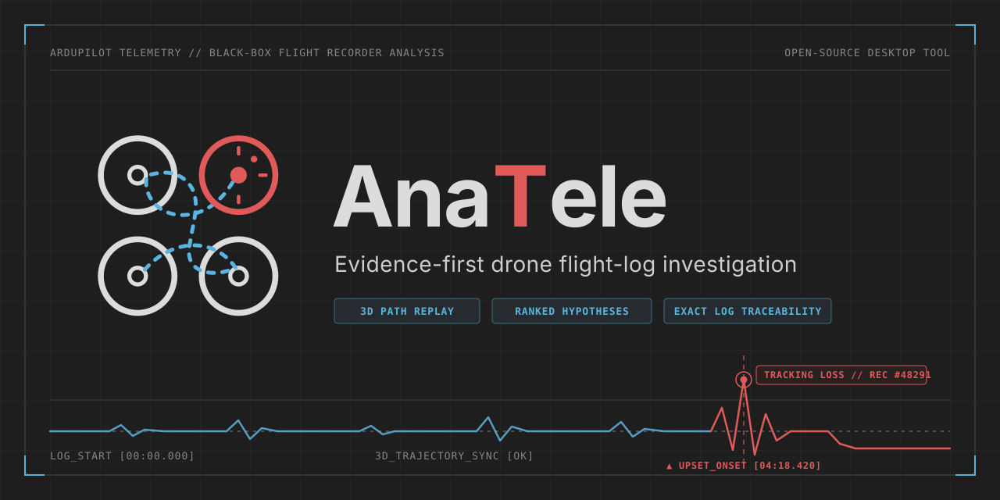
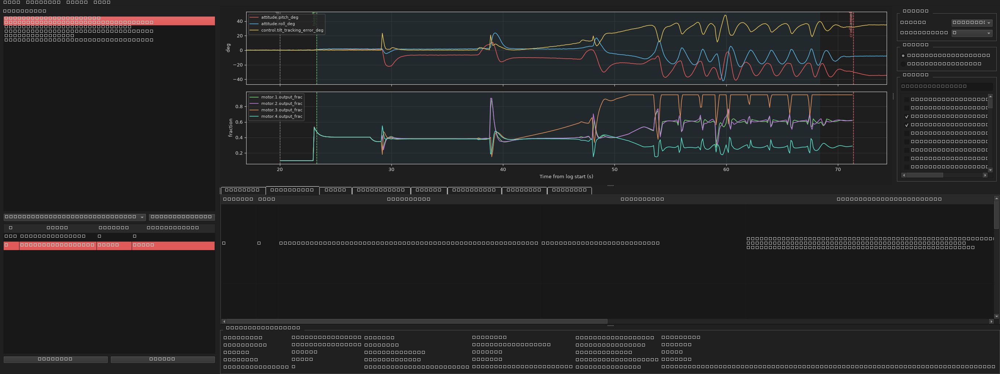

# AnaTele



**Evidence-first investigation of ArduPilot flight logs.** AnaTele reads Mission Planner `.tlog` files and
DataFlash `.bin`/`.log` files. It changes them into an investigation that you can do again with the same result:

- **What occurred?** A timeline, armed episodes and flight phases (takeoff, pre-event window, upset, disarm).
- **Where did the aircraft go?** A 3D replay of the recorded path, with the mission waypoints and their status.
- **What is possibly wrong?** A rule pack with versions. Each rule is *triggered*, *not triggered*, *unassessable* or *not applicable*.
- **What are the possible causes?** Hypotheses in a sequence that agrees with the evidence for and against each one. AnaTele does not invent probabilities.
- **Can I examine the claims?** Each claim has a link to the exact log record and its raw bytes.
- **Can I share the analysis?** Save the full analysis as one [`.ant` file](USAGE.md#sharing-analyses-ant).



## Get it

[Download for Windows, macOS or Linux](https://github.com/Avinashistoocool/AnaTele/releases/latest){ .md-button .md-button--primary }
[Source on GitHub](https://github.com/Avinashistoocool/AnaTele){ .md-button }

```bash
pip install "git+https://github.com/Avinashistoocool/AnaTele"
anatele simulate --out simulations
anatele simulations/sim_motor_failure.tlog
```

## Documentation

| | |
|---|---|
| [**Learn AnaTele from scratch**](learn/index.md) | Illustrated course. You do not need previous knowledge. 12 chapters, 32 figures, interactive widgets ([PDF](AnaTele_Illustrated_Guide.pdf)) |
| [Usage guide](USAGE.md) | Desktop app, CLI, web UI, API, profiles, simulator, `.ant` sharing |
| [Preflight checklist](PREFLIGHT.md) | A separate tool for a **live** vehicle: one-button gyro/baro/level/compass/accelerometer calibration, pre-arm health, motor test with the propellers removed, parameter profile check |
| [Diagnostics reference](DIAGNOSTICS.md) | All rules, the hypothesis sequence, flight phases, mission statuses |
| [Deployment](DEPLOYMENT.md) | Standalone builds, pip, Docker, data directories, security |
| [Technical report (PDF)](AnaTele_Technical_Report.pdf) | The architecture and all of the mathematics, from framing to the simulator |
| [Design](DESIGN.md) | The original architecture proposal |

!!! note
    AnaTele gives you observations and hypotheses. It does **not** give a crash verdict, a probability of cause or an
    airworthiness approval. AnaTele records missing data as *unknown*. It never records missing data as *healthy*.
