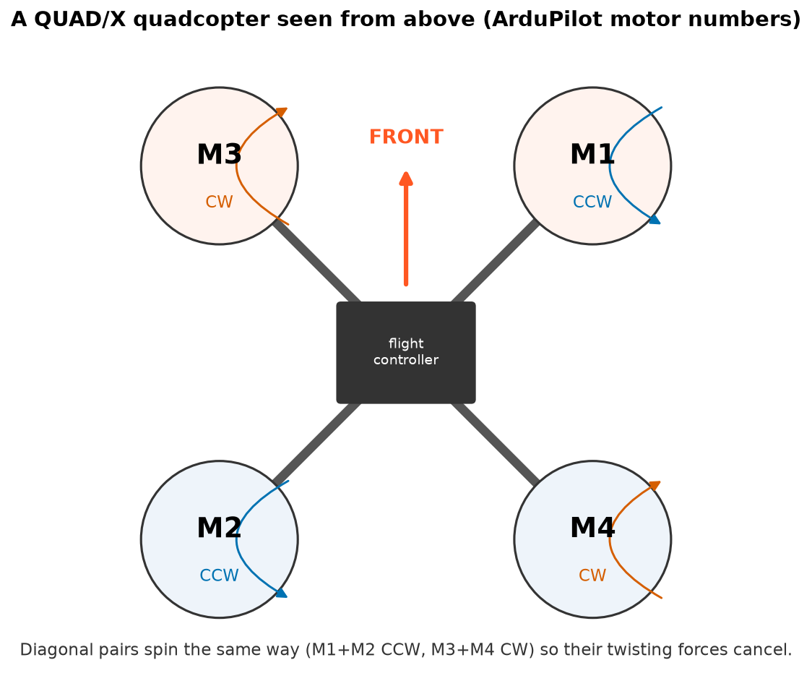
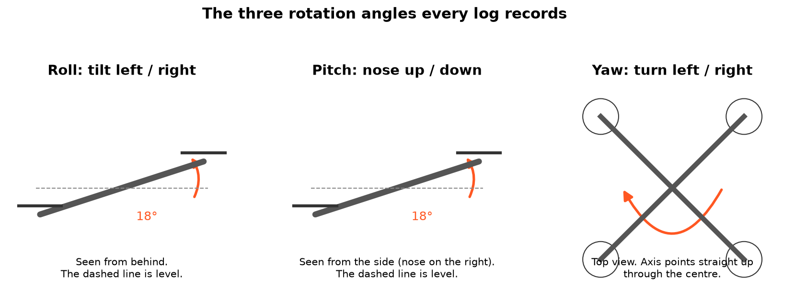
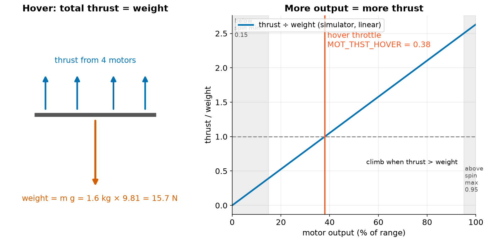

# 1. Drones 101

## The parts

A quadcopter has four motors with propellers on arms, a battery, and a small computer. This computer is the **flight
controller**. AnaTele operates with flight controllers that use **ArduPilot**. ArduPilot is an open-source autopilot. Many types of drones use it, from hobby quads to survey drones.

ArduPilot gives numbers to the motors of an "X" quad as the figure shows. Motor 1 is at the front right, not at the front left.
Many persons do not expect this. Diagonal pairs turn in the same direction: M1 and M2 turn counter-clockwise (CCW), and M3 and M4 turn
clockwise (CW). Each turning propeller applies a torque to the frame in the opposite direction. With two motors in each direction, the torques
cancel, and the drone does not turn.

!!! tip "Why this is important in an investigation"
    A motor can have a wire connection to the wrong output, or a propeller can be on the wrong motor. Then the drone usually turns over
    at takeoff. AnaTele reads `SERVOn_FUNCTION`, `FRAME_CLASS` and `FRAME_TYPE` from the log. Thus, each motor
    number that it shows agrees with this figure.

## Three angles: roll, pitch, yaw

The **attitude** of a drone is the direction that it points to and its tilt. Three angles give the attitude:

- **Roll**: tilt to the left or to the right, as an aeroplane does in a bank.
- **Pitch**: nose up or nose down.
- **Yaw**: a turn to the left or to the right while the drone stays level. This is the *heading* of the drone.

A quadcopter has no rudder or wings. Thus, it moves when it **tilts**. To fly forward, it lowers its nose. Then a part of the
thrust points to the rear and pushes the drone forward. For this reason, "is the tilt correct?" is the most important
question in chapter 5.

## Thrust, weight and hover

To hover, the motors must push up with a force that is equal to the force of gravity.

The drone in the simulator has a mass of 1.6 kg. Thus, its weight is

$$ W = m g = 1.6\,\text{kg} \times 9.81\,\text{m/s}^2 \approx 15.7\,\text{N}. $$

ArduPilot records the motor output that is necessary to hover as `MOT_THST_HOVER`. In the simulated flights, this value is **0.38**:
38 % of the usable range. More output gives more thrust, and the drone climbs. Less output causes the drone to descend.

Motors also have limits. Below `MOT_SPIN_MIN` (0.15 here), a motor can stall. Above `MOT_SPIN_MAX` (0.95), no
margin remains. A motor that stays at one of these limits is **saturated**. Chapter 6 shows why this is an
important clue.

!!! example "Check your understanding"
    The drone hovers and you want it to roll to the right. Which motors must push harder?
    ??? success "Answer"
        The motors on the **left** (M2 back-left and M3 front-left). When the left side pushes up harder, the drone tilts to the right.
