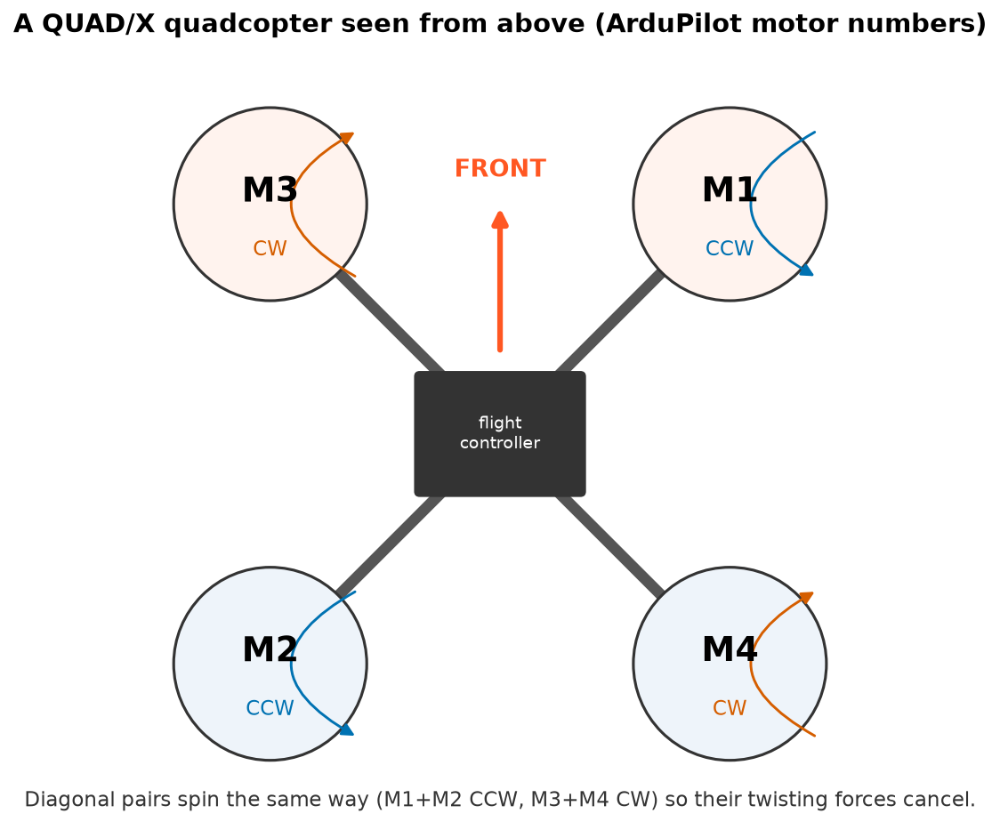
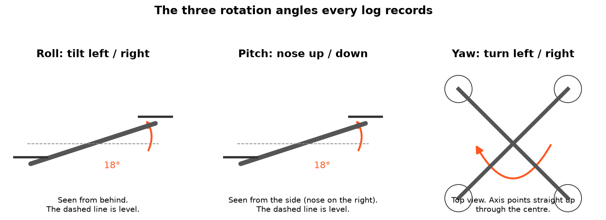
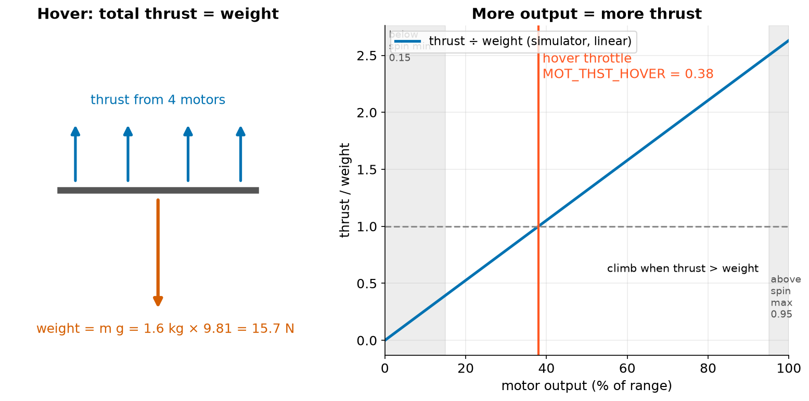

# 1. Drones 101

## The parts

A quadcopter is four motors with propellers on arms, a battery, and a small computer called the **flight
controller**. AnaTele works with flight controllers running **ArduPilot**, the open-source autopilot used in
everything from hobby quads to survey drones.

ArduPilot numbers the motors of an "X" quad the way the figure shows. Motor 1 is front-right, not front-left,
which surprises most people. Diagonal pairs spin the same way: M1 and M2 counter-clockwise (CCW), M3 and M4
clockwise (CW). Each spinning propeller twists the frame the opposite way. With two of each direction, the twists
cancel and the drone doesn't spin.

!!! tip "Why this matters in an investigation"
    If a motor is wired to the wrong output, or a propeller is on the wrong motor, the drone usually flips
    on takeoff. AnaTele reads `SERVOn_FUNCTION`, `FRAME_CLASS` and `FRAME_TYPE` from the log so that every motor
    number it shows matches this picture.

## Three angles: roll, pitch, yaw

The **attitude** of a drone is which way it's facing and how it's tilted. Three angles describe it:

- **Roll**: tilting left or right, like a plane banking.
- **Pitch**: nose up or nose down.
- **Yaw**: turning left or right while staying level. This is the drone's *heading*.

A quadcopter has no rudder or wings, so it moves by **tilting**. To fly forward it pitches its nose down. Part of the
thrust then points backwards and pushes it forward. That is why "is the tilt correct?" is the most important
question in chapter 5.

## Thrust, weight and hover

To hover, the motors must push up exactly as hard as gravity pulls down.

The simulator's drone weighs 1.6 kg, so its weight is

$$ W = m g = 1.6\,\text{kg} \times 9.81\,\text{m/s}^2 \approx 15.7\,\text{N}. $$

ArduPilot records the motor output needed to hover as `MOT_THST_HOVER`. In the simulated flights it is **0.38**:
38 % of the usable range. More output gives more thrust and the drone climbs. Less output and it descends.

Motors also have limits. Below `MOT_SPIN_MIN` (0.15 here) they can stall. Above `MOT_SPIN_MAX` (0.95) there's
no headroom left. A motor that sits at one of these limits is **saturated**. Chapter 6 shows why that's an
important clue.

!!! example "Check your understanding"
    The drone is hovering and you want it to roll right. Which motors must push harder?
    ??? success "Answer"
        The **left** ones (M2 back-left and M3 front-left). Pushing up harder on the left tips the drone to the right.
