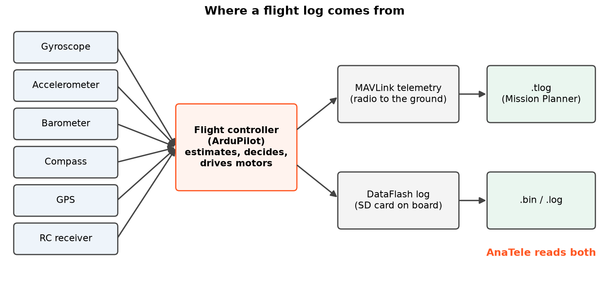
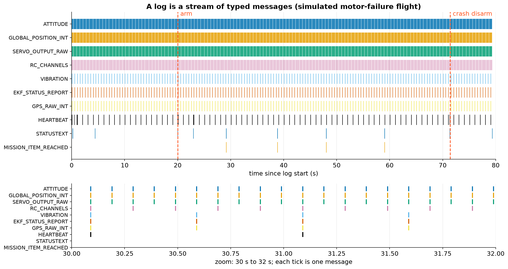
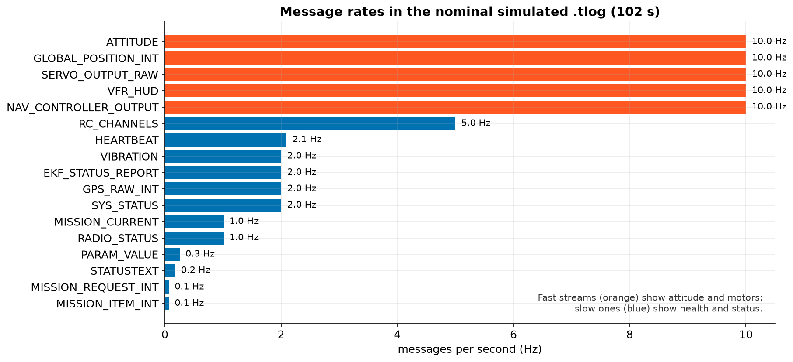

# 2. Logs and MAVLink

## What is a flight log?

During a flight, the flight controller reads its sensors hundreds of times each second. It calculates its position,
decides what to do and controls the motors. It also writes a record of all these actions. This record is the
**flight log**.

There are two types of log. AnaTele reads the two types:

| Log | Where it is made | Contents |
|---|---|---|
| **Telemetry log** `.tlog` | On the ground station (for example Mission Planner), from the radio link | **MAVLink** messages. Each message has a stamp with the time when the ground station received it. |
| **DataFlash log** `.bin` / `.log` | On the SD card of the drone | The on-board records of ArduPilot. Usually, they have a higher rate and more detail. |

**MAVLink** is the language that drones and ground stations use to communicate. Each MAVLink message has a type (for example
`ATTITUDE` or `GPS_RAW_INT`) and named fields (`roll`, `pitch`, `lat`, `lon`…).

## A log is a stream of typed messages

The figure shows the full stream of a simulated flight in which one motor fails. Each tick is one message.

Look at these items:

- `ATTITUDE`, `GLOBAL_POSITION_INT` and `SERVO_OUTPUT_RAW` are dense bands. These messages arrive many times each second.
- `STATUSTEXT` (text that persons can read, for example *"Crash: Disarming"*) occurs only a small number of times. But these
  messages are frequently the most important ones.
- `MISSION_ITEM_REACHED` marks each waypoint that the autopilot reports as reached.

## Different messages, different rates

In this simulated `.tlog` of 102 seconds, attitude, position, motor outputs and the controller targets arrive at
**10 Hz** (10 times each second). RC input arrives at 5 Hz. Vibration, EKF status, GPS and battery arrive at **2 Hz**.

!!! warning "The rate limits your conclusions"
    A rule can need "more than 30 for a minimum of 0.5 s". This rule cannot correctly examine data that arrives each 0.5 s. AnaTele
    knows this. When the data is too sparse, AnaTele marks the rule **unassessable**. It does not show the rule as healthy
    (chapter 8).

## What AnaTele keeps

When AnaTele opens a log, it keeps **all decoded records**, each with its byte offset in the file. The simulated
motor-failure log has 5,387 records. Thus, you can trace each chart, threshold and hypothesis in the report
back to the exact bytes that it came from. The *evidence viewer* in the desktop app does this.
