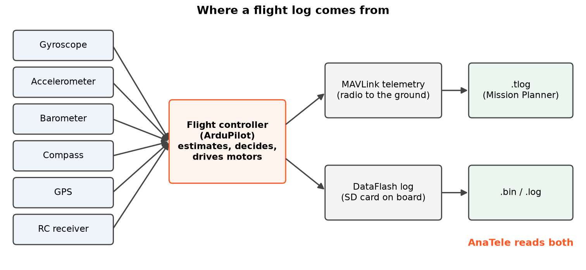
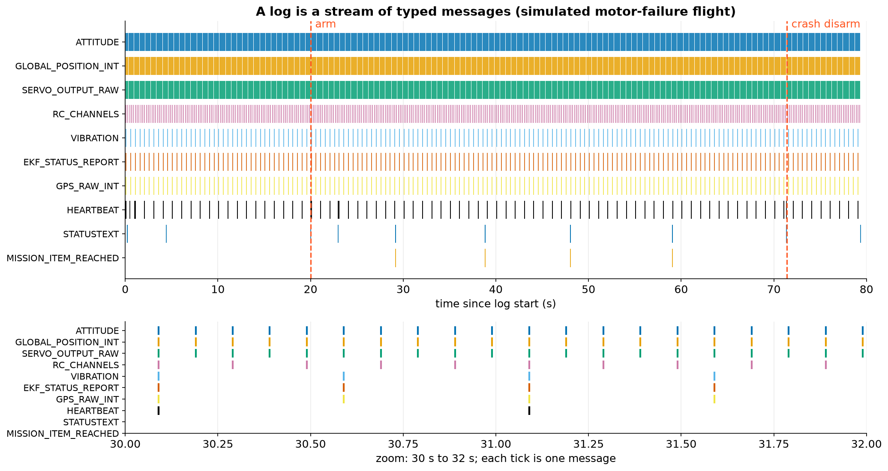
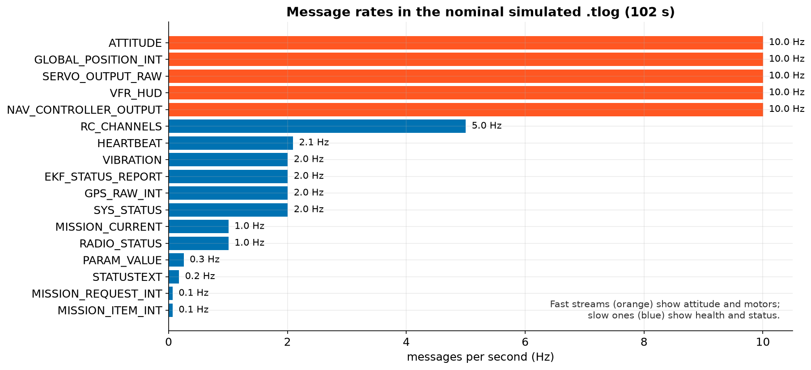

# 2. Logs and MAVLink

## What is a flight log?

During a flight, the flight controller reads its sensors hundreds of times a second. It estimates where it is,
decides what to do and drives the motors. It also writes a record of all of this, and that record is the
**flight log**.

There are two kinds, and AnaTele reads both:

| Log | Where it is made | What it contains |
|---|---|---|
| **Telemetry log** `.tlog` | On the ground station (e.g. Mission Planner), from the radio link | **MAVLink** messages, each stamped with the time the ground received it |
| **DataFlash log** `.bin` / `.log` | On the drone's SD card | ArduPilot's own on-board records; usually higher rate and more detail |

**MAVLink** is the language drones and ground stations use to talk. Each MAVLink message has a type (for example
`ATTITUDE` or `GPS_RAW_INT`) and named fields (`roll`, `pitch`, `lat`, `lon`…).

## A log is a stream of typed messages

Here is the start-to-finish stream of a simulated flight in which one motor fails. Each tick is one message.

Things to notice:

- `ATTITUDE`, `GLOBAL_POSITION_INT` and `SERVO_OUTPUT_RAW` are dense bands: they arrive many times a second.
- `STATUSTEXT` (human-readable text such as *"Crash: Disarming"*) shows up only a handful of times, but these
  messages are often the most important ones.
- `MISSION_ITEM_REACHED` marks each waypoint the autopilot reports reaching.

## Different messages, different rates

In this 102-second simulated `.tlog`, attitude, position, motor outputs and the controller's targets arrive at
**10 Hz** (10 times a second). RC input arrives at 5 Hz, and vibration, EKF status, GPS and battery at **2 Hz**.

!!! warning "Rate limits what you can conclude"
    A rule that needs "above 30 for at least 0.5 s" can't be checked properly with data every 0.5 s. AnaTele
    knows this. When the data is too sparse, it marks the rule **unassessable** instead of pretending it's healthy
    (chapter 8).

## What AnaTele keeps

When AnaTele opens a log it keeps **every decoded record**, with its byte offset in the file. The simulated
motor-failure log has 5,387 records. Every chart, threshold and hypothesis in the report can therefore be traced
back to the exact bytes it came from. This is the *evidence viewer* in the desktop app.
