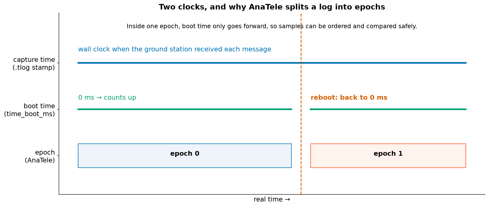

# 3. Time and sources

## Two clocks

Every record in a log has a time, but not always from the same clock.

- **Capture time**: when the ground station received the message (the 8-byte stamp in front of each `.tlog`
  record). It's wall-clock time, so it can jump if the PC's clock is adjusted, and it includes radio delay.
- **Boot time** (`time_boot_ms`, `time_usec`): how long the flight controller has been powered on. It's
  precise, but it **restarts from zero** when the board reboots.

## Epochs

If the board reboots mid-log, "10 s after boot" happens twice. Put both runs on one timeline and you'd mix two
different flights. AnaTele avoids this by splitting the log into **epochs**. A new epoch starts whenever a clock
clearly goes backwards. Inside one epoch, time only moves forward, so samples can be ordered, paired and compared
safely.

The exact tests (per source) are:

| Clock | New epoch when… | Why the margin |
|---|---|---|
| `.tlog` boot time `time_boot_ms` | it drops by more than **10 s** | Small regressions are just reordered / delayed packets |
| DataFlash boot time | it drops by more than **1 s** | On-board records are written in order |
| `.tlog` capture time | it drops by more than **2 s** | PC clock adjustments separate the whole capture |

A boot-time drop from near $2^{32}$ ms back to near zero is recognised as a counter **wrap** (after ~49.7 days),
not a reboot. Every epoch split is listed as a diagnostic, so you can see why it happened.

## Sources

A capture can hold messages from more than one system: the drone, a gimbal, the ground station, a companion
computer. MAVLink identifies each sender by a *system id* and *component id*. AnaTele calls each pair a
**source** (for example `1:1` is the autopilot) and never mixes signals from different sources.

## Pairing samples

Many checks compare two signals, for example desired and actual roll. They don't arrive at exactly the same
instant, so AnaTele pairs each sample with the **nearest** sample of the other signal, within a tolerance. For
attitude that tolerance is **0.25 s**. If no partner is close enough, the pair is skipped rather than guessed.

!!! note "Design principle"
    Nothing is interpolated or invented. A derived value always comes from real samples, close enough in time to
    be compared, and it keeps a link to the record it came from.
