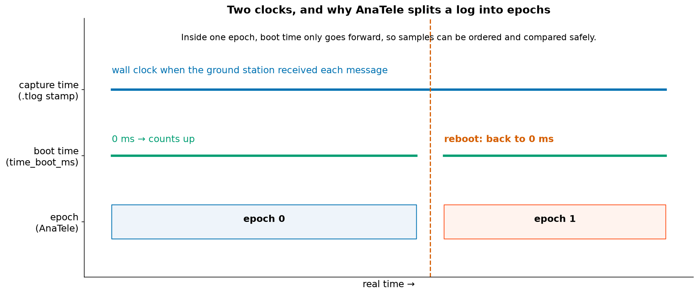

# 3. Time and sources

## Two clocks

Each record in a log has a time, but the time does not always come from the same clock.

- **Capture time**: the time when the ground station received the message (the 8-byte stamp in front of each `.tlog`
  record). It is wall-clock time. Thus, it can jump if a person adjusts the clock of the PC. It also includes the radio delay.
- **Boot time** (`time_boot_ms`, `time_usec`): the time since the flight controller got power. It is
  precise, but it **starts again from zero** when the board reboots.

## Epochs

If the board reboots during the log, "10 s after boot" occurs two times. If you put the two runs on one timeline, you mix two
different flights. AnaTele prevents this. It divides the log into **epochs**. A new epoch starts each time that a clock
clearly goes back. In one epoch, time only moves forward. Thus, AnaTele can safely put samples in sequence, pair them and compare them.

These are the exact tests (for each source):

| Clock | New epoch when… | Reason for the margin |
|---|---|---|
| `.tlog` boot time `time_boot_ms` | it decreases by more than **10 s** | Small decreases come from packets that are delayed or in a different sequence |
| DataFlash boot time | it decreases by more than **1 s** | The board writes on-board records in sequence |
| `.tlog` capture time | it decreases by more than **2 s** | Adjustments of the PC clock divide the full capture |

AnaTele identifies a decrease of boot time from near $2^{32}$ ms to near zero as a counter **wrap** (after ~49.7 days).
It is not a reboot. AnaTele shows each epoch division as a diagnostic, thus you can see its cause.

## Sources

A capture can contain messages from more than one system: the drone, a gimbal, the ground station, a companion
computer. MAVLink identifies each sender with a *system id* and a *component id*. AnaTele calls each pair a
**source** (for example, `1:1` is the autopilot). It never mixes signals from different sources.

## Pairing samples

Many checks compare two signals, for example the desired roll and the actual roll. The samples do not arrive at exactly the same
time. Thus, AnaTele pairs each sample with the **nearest** sample of the other signal, within a tolerance. For
attitude, the tolerance is **0.25 s**. If no sample is sufficiently near, AnaTele skips the pair. It does not guess.

!!! note "Design principle"
    AnaTele does not interpolate or invent data. A derived value always comes from real samples that are sufficiently near in time for
    a comparison. The value keeps a link to its record.
