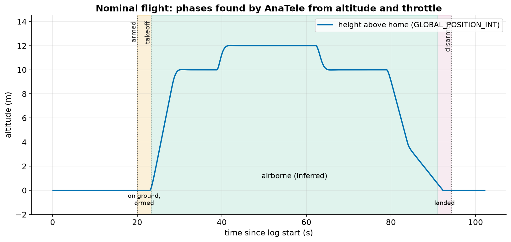
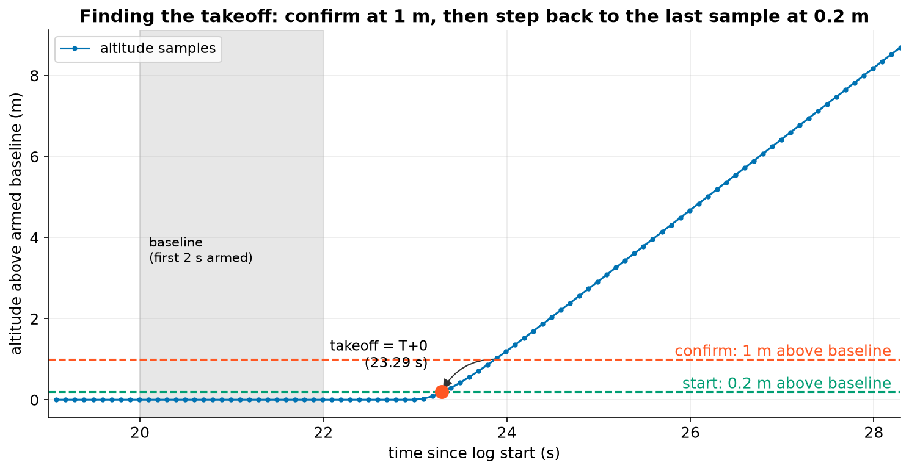
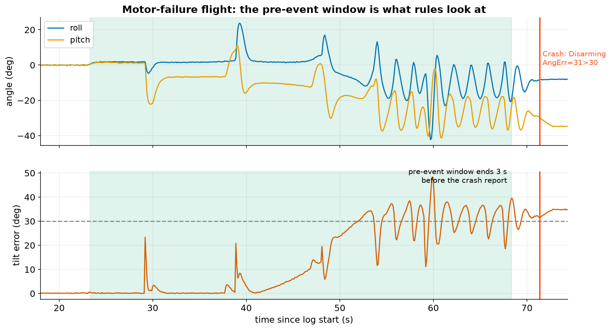

# 4. Flight phases

A crash investigation is about **timing**: what was normal, when did it stop being normal, what came first.
So the first thing AnaTele does with each armed period (an *episode*) is split it into phases.

In the nominal simulated flight, the drone arms at 20.0 s and AnaTele finds takeoff at **23.29 s**. It's
airborne until 91.09 s and disarms at 94.27 s.

## Step 1: the armed baseline

Altitude estimates drift, so "altitude = 0" doesn't reliably mean "on the ground". AnaTele takes the **median**
home-relative altitude during the first **2 s** after arming as the ground level (the *baseline*). The median is
used instead of the mean so a single bad sample can't move it.

## Step 2: confirm, then backtrack

1. Find the first sample at least **1.0 m** above the baseline. That is clearly flying, not noise.
2. Check that there was real **demand** in the 5 s before it: throttle at least **10 %**, or (if throttle isn't
   logged) a motor output of at least 25 % of its range. If the altitude rose with no demand, it's treated as
   estimate drift and the drone is *not* considered airborne.
3. Walk **backwards** to the last sample still within **0.2 m** of the baseline. That's the takeoff time, **T+0**.

If the autopilot itself reports "Taking off" or "In air" (a landed-state message), AnaTele uses that instead and
labels the phase *reported* rather than *inferred*.

## Step 3: the pre-event window

Rules mostly look at the time **before** anything went wrong. Once the drone has hit the ground, all the
sensors go wild, and that's a consequence, not a cause.

The window ends at the earliest of:

- the first moment roll or pitch exceeds **60°** (an attitude excursion, i.e. loss of control);
- **3 s** before an autopilot crash report (the *event guard*);
- the last sample at least 0.5 m above the baseline.

In the motor-failure flight, ArduPilot reported *"Crash: Disarming: AngErr=31>30"* at 71.37 s. The roll and pitch
never passed 60°, so the pre-event window runs from takeoff (23.29 s) to **68.37 s**, exactly 3 s before the
report.

!!! info "Phase labels in the report"
    - `airborne_reported`: from the autopilot's own landed-state messages.
    - `airborne_inferred`: from altitude rise plus demand, as above.
    - `no_airborne_evidence`: armed, but never clearly flew.
    - `unassessable`: no altitude data, so we can't tell.
