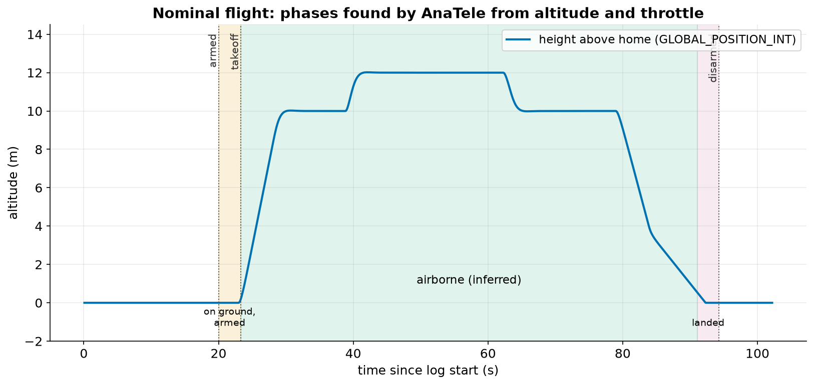
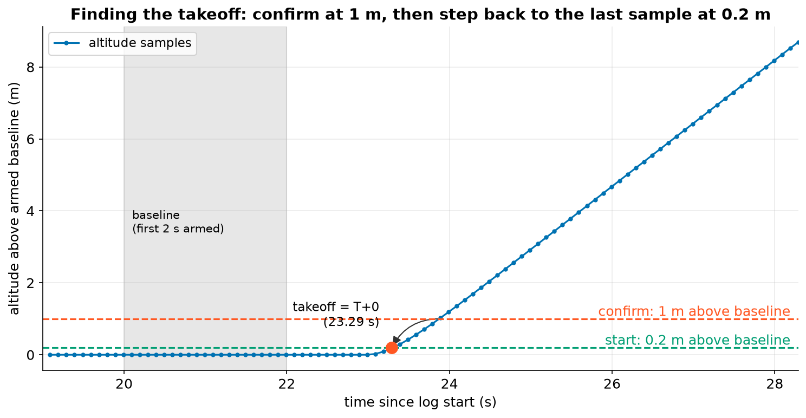
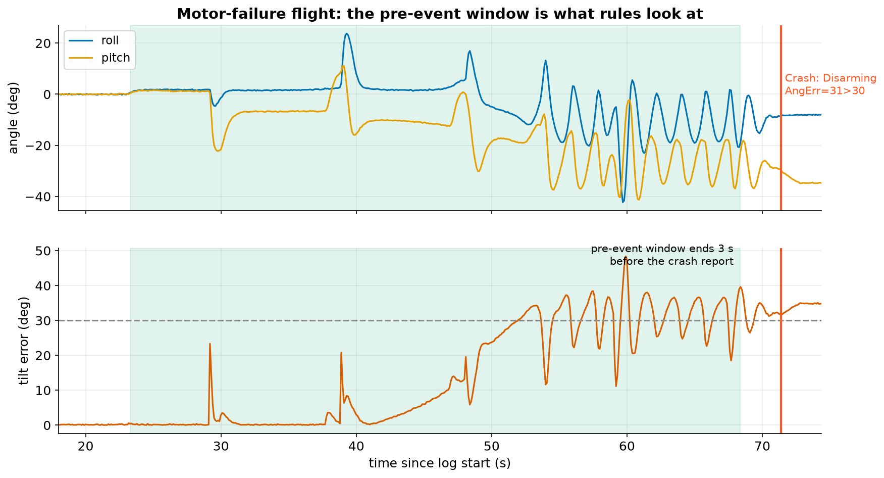

# 4. Flight phases

A crash investigation is about **timing**: what was normal, when it stopped to be normal, and what occurred first.
Thus, for each armed period (an *episode*), AnaTele first divides the period into phases.

In the nominal simulated flight, the drone arms at 20.0 s and AnaTele finds the takeoff at **23.29 s**. The drone is
airborne until 91.09 s and disarms at 94.27 s.

## Step 1: the armed baseline

Altitude estimates drift. Thus, "altitude = 0" does not always mean "on the ground". AnaTele uses the **median**
altitude above home during the first **2 s** after arming as the ground level (the *baseline*). AnaTele uses the median
and not the mean, because one bad sample cannot move the median.

## Step 2: confirm, then go back

1. Find the first sample that is a minimum of **1.0 m** above the baseline. At this altitude, the drone clearly flies. It is not noise.
2. Make sure that real **demand** occurred in the 5 s before that sample. The demand is throttle of a minimum of **10 %**.
   If the log has no throttle, the demand is a motor output of a minimum of 25 % of its range. If the altitude increased with no demand, AnaTele records it as a
   drift of the estimate. Then the drone is *not* airborne.
3. Go **back** to the last sample that is still within **0.2 m** of the baseline. This is the takeoff time, **T+0**.

If the autopilot reports "Taking off" or "In air" (a landed-state message), AnaTele uses that report.
It labels the phase *reported*, not *inferred*.

## Step 3: the pre-event window

Most rules examine the time **before** the problem started. After the drone hits the ground, all
sensors show extreme values. These values are a result, not a cause.

The window ends at the earliest of these times:

- the first time that roll or pitch is more than **60°** (an attitude excursion, that is, a loss of control);
- **3 s** before a crash report from the autopilot (the *event guard*);
- the last sample that is a minimum of 0.5 m above the baseline.

In the motor-failure flight, ArduPilot reported *"Crash: Disarming: AngErr=31>30"* at 71.37 s. The roll and the pitch
were never more than 60°. Thus, the pre-event window goes from takeoff (23.29 s) to **68.37 s**, exactly 3 s before the
report.

!!! info "Phase labels in the report"
    - `airborne_reported`: from the landed-state messages of the autopilot.
    - `airborne_inferred`: from an increase in altitude together with demand, as above.
    - `no_airborne_evidence`: armed, but the drone never clearly flew.
    - `unassessable`: no altitude data. Thus, AnaTele cannot decide.
