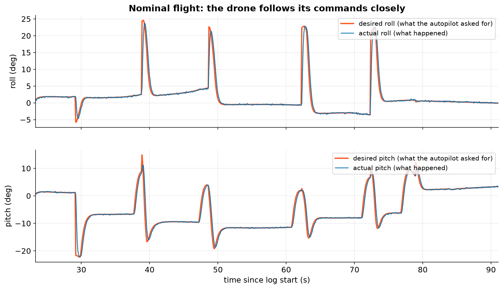
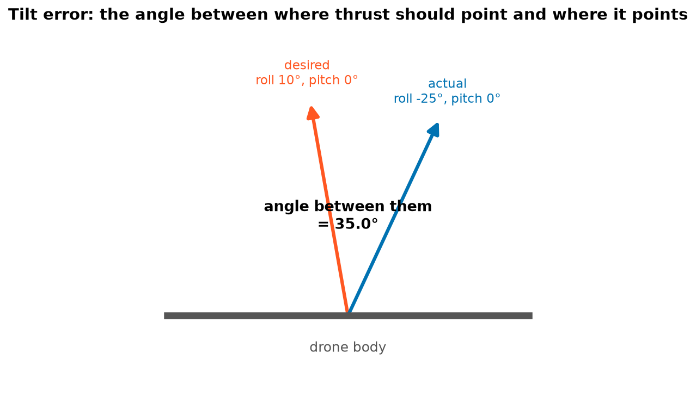
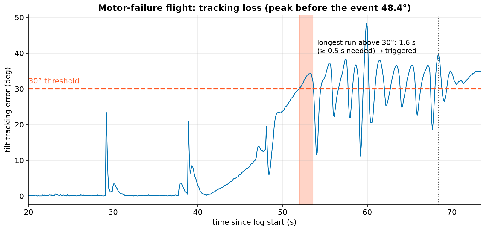

# 5. Attitude and tilt error

## Desired versus actual

The autopilot constantly decides what attitude it **wants** (desired roll and pitch). It then tries to achieve it
with the motors. A healthy drone follows closely:

When a motor is failing, a propeller is damaged or the frame is wrongly configured, the drone can no longer follow.
The gap between "wanted" and "got" grows. This is one of the strongest clues in an investigation.

## One number: the tilt error

Roll and pitch errors could be checked separately, but what really matters is **which way the thrust points**. So
AnaTele turns each (roll, pitch) pair into a unit vector along the drone's thrust axis:

$$ \hat{t}(\phi, \theta) = \big( \sin\theta \cos\phi,\; -\sin\phi,\; \cos\theta \cos\phi \big) $$

where $\phi$ is roll and $\theta$ is pitch. The **tilt error** is the angle between the desired and actual vectors:

$$ e = \arccos\!\big( \hat{t}_\text{desired} \cdot \hat{t}_\text{actual} \big). $$

Desired and actual samples are paired with the nearest-in-time rule from chapter 3 (within 0.25 s).

## What it looks like in a failure

In the nominal flight the tilt error never exceeds **23.4°**, during brisk turns. In the motor-failure flight it
first passes 30° at **51.99 s** and peaks at **48.4°** before the event window ends. The longest stretch above 30°
lasts **1.6 s**. The `tracking-loss` rule needs **30° for at least 0.5 s**, so it is **triggered**.

!!! warning "Tilt error is a symptom, not a cause"
    A large tilt error says "the drone could not do what it was told". It doesn't say why. A weak motor, a loose
    prop, the wrong frame type, a very aggressive tune or a strong gust can all cause it. AnaTele uses it as
    evidence for the *thrust/configuration* hypothesis (chapter 9), together with the motor signals in chapter 6.
