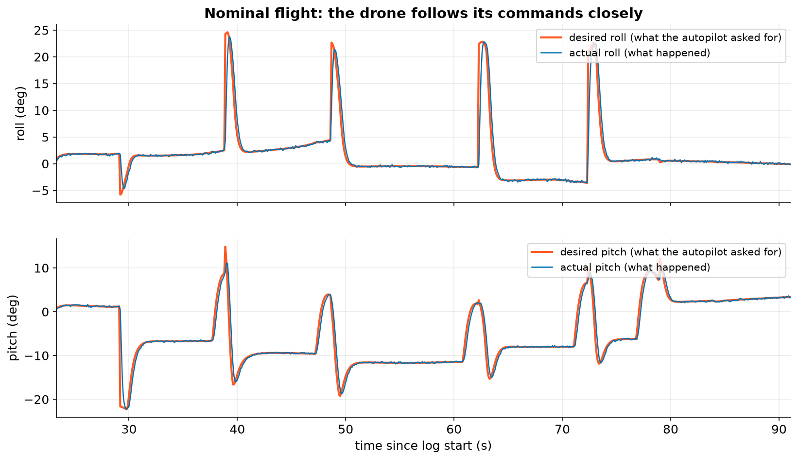
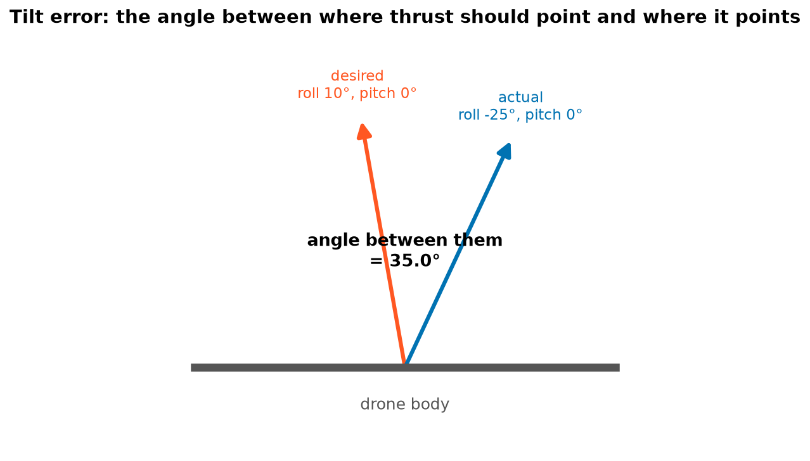
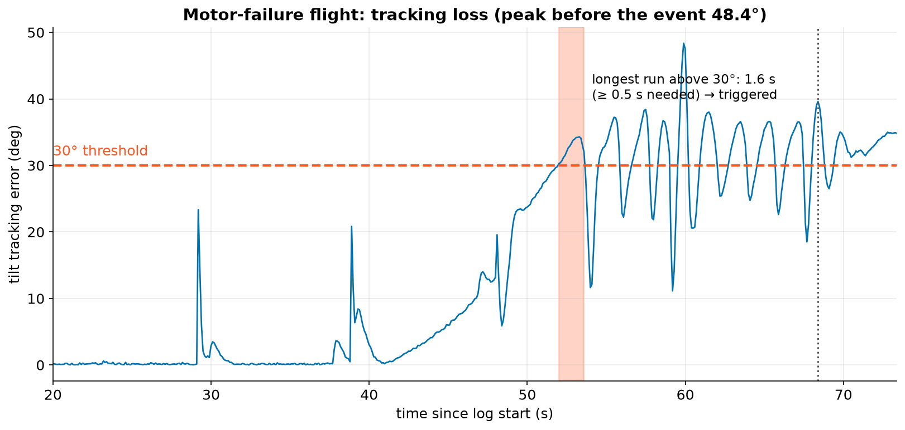

# 5. Attitude and tilt error

## Desired versus actual

The autopilot continuously decides the attitude that it **wants** (desired roll and pitch). Then it tries to get that attitude
with the motors. A healthy drone follows the desired attitude closely:

A motor can fail, a propeller can be damaged or the frame configuration can be wrong. Then the drone cannot follow the desired attitude.
The difference between "wanted" and "got" increases. This is one of the strongest clues in an investigation.

## One number: the tilt error

It is possible to examine the roll error and the pitch error separately. But the important property is **the direction of the thrust**. Thus,
AnaTele changes each (roll, pitch) pair into a unit vector along the thrust axis of the drone:

$$ \hat{t}(\phi, \theta) = \big( \sin\theta \cos\phi,\; -\sin\phi,\; \cos\theta \cos\phi \big) $$

where $\phi$ is roll and $\theta$ is pitch. The **tilt error** is the angle between the desired vector and the actual vector:

$$ e = \arccos\!\big( \hat{t}_\text{desired} \cdot \hat{t}_\text{actual} \big). $$

AnaTele pairs the desired samples and the actual samples with the nearest-in-time rule from chapter 3 (within 0.25 s).

## The tilt error in a failure

In the nominal flight, the tilt error is never more than **23.4°**. This maximum occurs during fast turns. In the motor-failure flight, the tilt error is
more than 30° first at **51.99 s**. Its maximum is **48.4°** before the end of the event window. The longest period above 30°
is **1.6 s**. The `tracking-loss` rule needs **30° for a minimum of 0.5 s**. Thus, the rule is **triggered**.

!!! warning "Tilt error is a symptom, not a cause"
    A large tilt error means "the drone could not do the commanded movement". It does not tell why. Possible causes are a weak motor, a loose
    propeller, the wrong frame type, an aggressive tune or a strong gust. AnaTele uses the tilt error as
    evidence for the *thrust/configuration* hypothesis (chapter 9), together with the motor signals in chapter 6.
