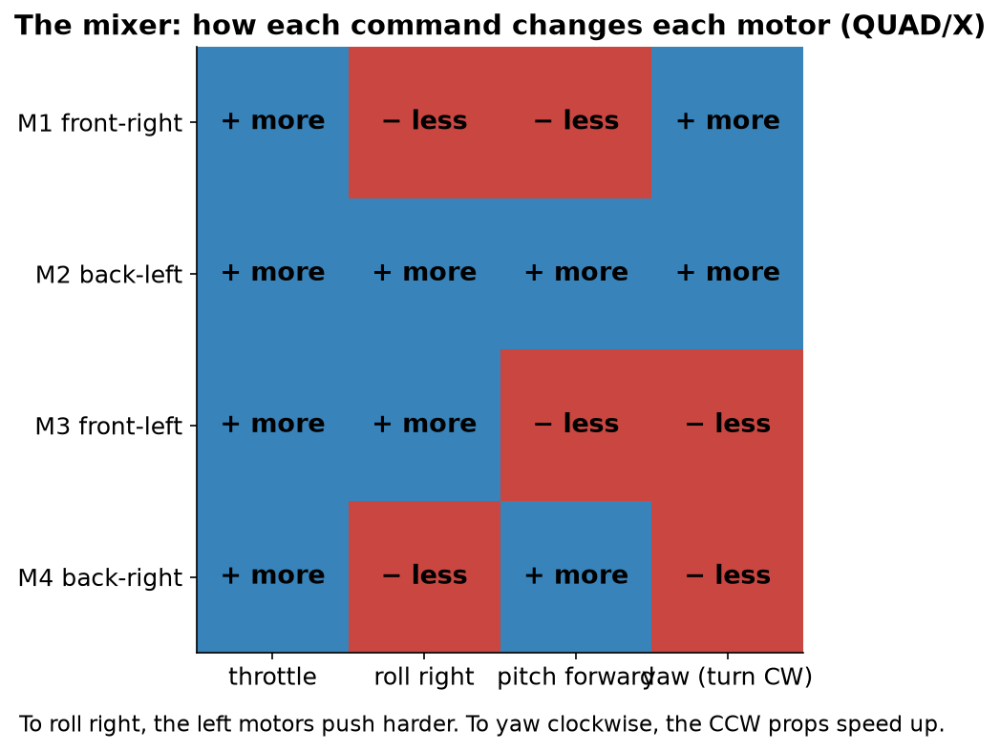
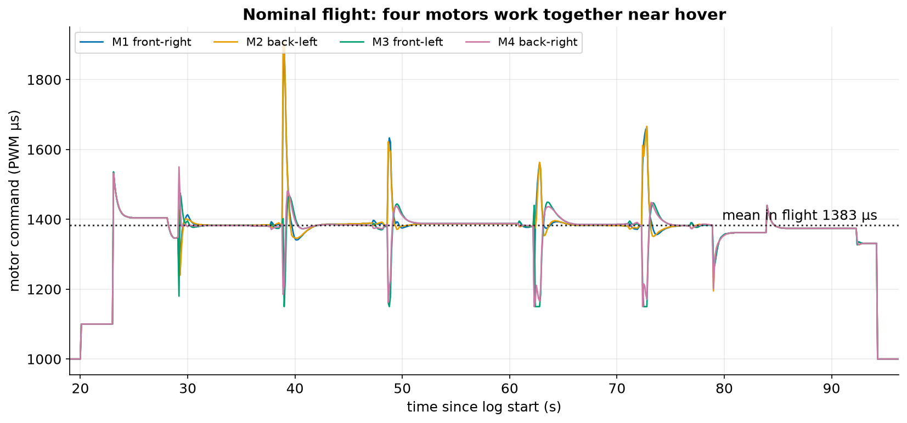
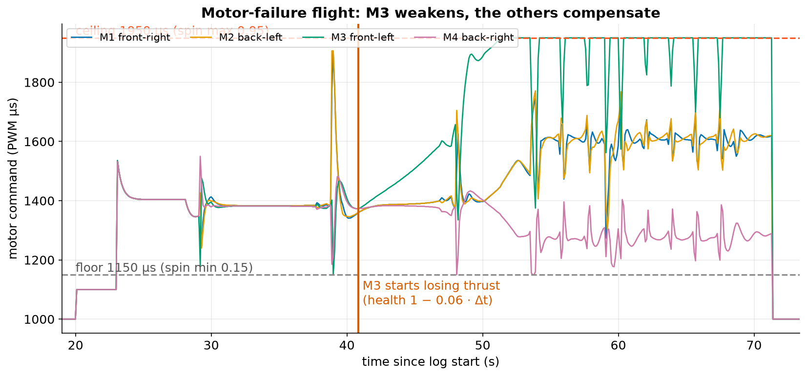
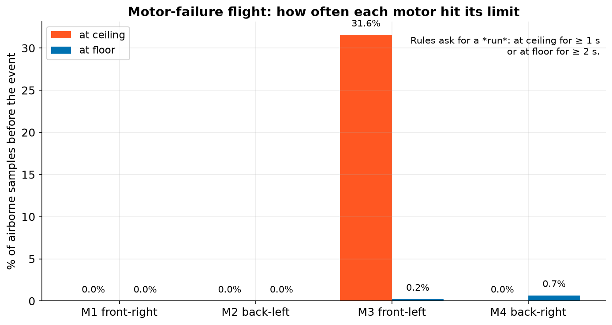

# 6. Motors and mixing

## The mixer

The pilot or the autopilot asks for four items: **throttle** (up/down), **roll**, **pitch** and **yaw**. The
**mixer** changes these four items into one command for each motor.

Each motor has an arm position $(x, y)$ (right, forward) and a turn direction $s$ (+1 for CCW, −1 for CW). For each motor, the command is
about

$$ u_i = \text{throttle} \;-\; x_i\,\text{roll} \;+\; y_i\,\text{pitch} \;+\; s_i\,\text{yaw}. $$

Each command must stay between `MOT_SPIN_MIN` and `MOT_SPIN_MAX`. If the sum is out of these limits, ArduPilot (and the
AnaTele simulator) keeps roll and pitch, because they keep the drone upright. It reduces yaw first.

Try the widget: move the roll slider until one motor gets to a limit.

## Healthy motors

In the nominal flight, all four commands move together around a mean of about **1383 µs** while the drone is airborne.
They move apart for short periods during turns and accelerations.

## A failing motor

In the motor-failure scenario, the simulator causes motor 3 to lose thrust. Its health decreases as
$h_3 = \max(0.3,\; 1 - 0.06\,(t - t_f))$ from $t_f = 40.85$ s. The autopilot does not know this. It only sees that the
drone tilts in the wrong direction. Thus, it **commands more output from motor 3** and less output from the opposite motor (4).

!!! tip "Read this correctly"
    The motor with the **highest** command is frequently the **weak** motor. The controller tries to replace
    the missing thrust. A log records *commands*, not thrust. Thus, AnaTele says "command anomaly". It never says "motor 3 failed".

## Saturation

A motor is **at ceiling** if its PWM is within 2 µs of the ceiling. It is **at floor** if its PWM is within 2 µs of the floor.
The limits come from the parameters in the log:

$$ \text{floor} = \text{PWM}_\text{min} + \text{SPIN}_\text{min}\,(\text{PWM}_\text{max} - \text{PWM}_\text{min}) $$

$$ \text{ceiling} = \text{PWM}_\text{min} + \text{SPIN}_\text{max}\,(\text{PWM}_\text{max} - \text{PWM}_\text{min}) $$

With 1000–2000 µs and spin limits of 0.15/0.95, the limits are **1150 µs** and **1950 µs**.

Before the event, motor 3 is at its ceiling for **31.6 %** of the airborne samples. Its longest continuous period
is **2.2 s**. The `motor-ceiling-saturation` rule needs a minimum of 1 s. Thus, the rule is **triggered**. No motor stays at the
floor for 2 s. Thus, `motor-floor-saturation-pre-event` is not triggered.

## Imbalance

AnaTele also calculates the mean command of each motor over the pre-event window (as a fraction of the PWM range). In the
failure flight, the means are M1 0.47, M2 0.47, **M3 0.65**, **M4 0.34**. The spread is **0.31**. This is more than the screening limit of 0.12.
Thus, `motor-output-imbalance-pre-event` is triggered. Wind, an offset payload and yaw demand can also cause an
imbalance. The report tells you this.
