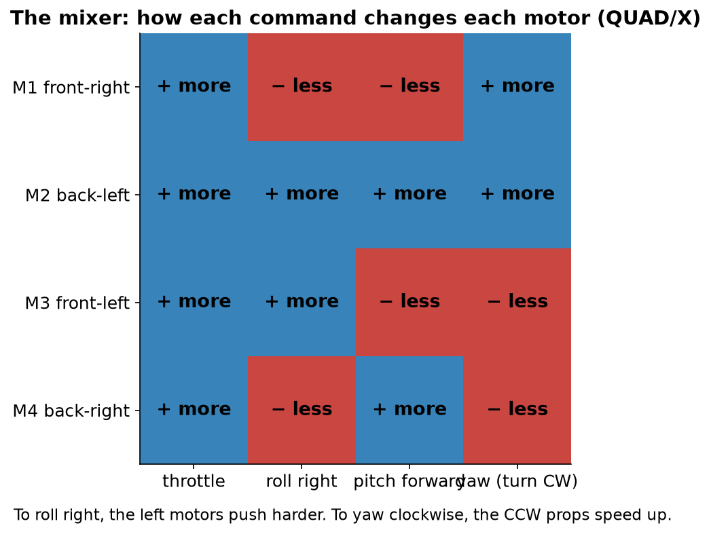
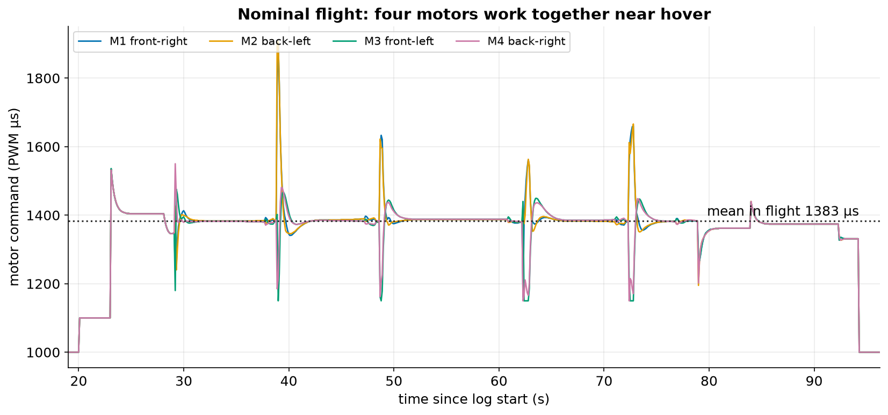
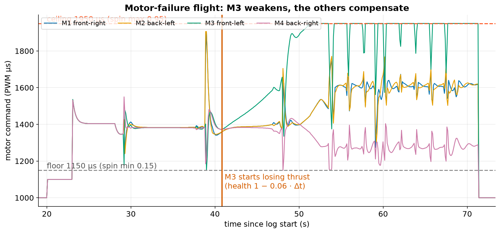
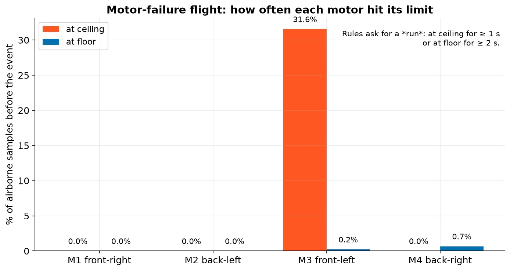

# 6. Motors and mixing

## The mixer

The pilot or autopilot asks for four things: **throttle** (up/down), **roll**, **pitch** and **yaw**. The
**mixer** turns these into one command per motor.

For each motor at arm position $(x, y)$ (right, forward) with spin $s$ (+1 for CCW, −1 for CW), the command is
roughly

$$ u_i = \text{throttle} \;-\; x_i\,\text{roll} \;+\; y_i\,\text{pitch} \;+\; s_i\,\text{yaw}. $$

Each command must stay between `MOT_SPIN_MIN` and `MOT_SPIN_MAX`. If the sum doesn't fit, ArduPilot (and
AnaTele's simulator) keeps roll and pitch, because they keep the drone upright, and gives up yaw first.

Try it: push the roll slider until one motor hits a limit.

## Healthy motors

In the nominal flight all four commands move together around a mean of about **1383 µs** while airborne.
They spread apart briefly in turns and accelerations.

## A failing motor

In the motor-failure scenario, the simulator makes motor 3 lose thrust. Its health falls as
$h_3 = \max(0.3,\; 1 - 0.06\,(t - t_f))$ from $t_f = 40.85$ s. The autopilot doesn't know this. It only sees the
drone tilting the wrong way, so it **commands motor 3 harder** and the opposite motor (4) softer.

!!! tip "Read this the right way round"
    The motor with the **highest** command is often the **weak** one. The controller is trying to make up for
    missing thrust. A log records *commands*, not thrust, so AnaTele says "command anomaly", never "motor 3 failed".

## Saturation

A motor is **at ceiling** if its PWM is within 2 µs of the ceiling, and **at floor** if within 2 µs of the floor.
The limits come from the log's own parameters:

$$ \text{floor} = \text{PWM}_\text{min} + \text{SPIN}_\text{min}\,(\text{PWM}_\text{max} - \text{PWM}_\text{min}) $$

$$ \text{ceiling} = \text{PWM}_\text{min} + \text{SPIN}_\text{max}\,(\text{PWM}_\text{max} - \text{PWM}_\text{min}) $$

With 1000–2000 µs and spin limits 0.15/0.95, that's **1150 µs** and **1950 µs**.

Before the event, motor 3 spends **31.6 %** of the airborne samples at its ceiling. Its longest unbroken stretch
is **2.2 s**. The `motor-ceiling-saturation` rule needs at least 1 s, so it's **triggered**. No motor stays at the
floor for 2 s, so `motor-floor-saturation-pre-event` is not triggered.

## Imbalance

AnaTele also averages each motor's command over the pre-event window (as a fraction of the PWM range). In the
failure flight the means are M1 0.47, M2 0.47, **M3 0.65**, **M4 0.34**: a spread of **0.31**, above the 0.12
screening limit. `motor-output-imbalance-pre-event` is triggered. Wind, payload offset and yaw demand can also cause
imbalance, and the report says so.
