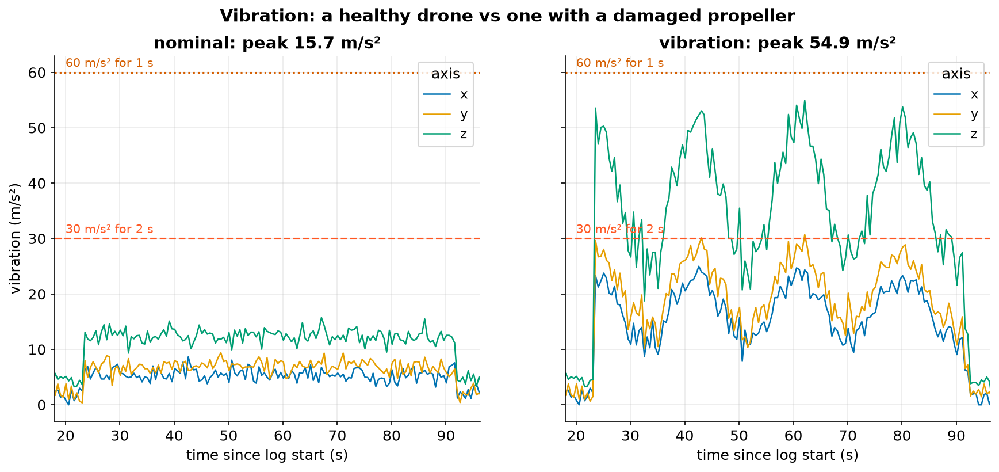
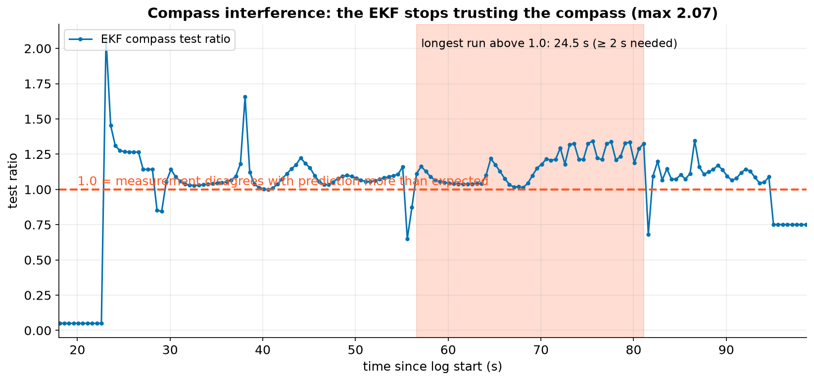
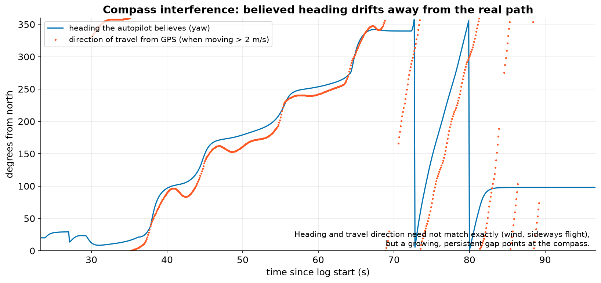

# 7. Vibration, EKF and compass

## Vibration

The accelerometers measure acceleration. The autopilot needs this measurement to know the direction of "down". A damaged propeller,
a loose motor or a stiff mounting adds vibration, and the accelerometers also measure this vibration. If the vibration is too high, the position
and altitude estimates become less accurate.

ArduPilot records the vibration levels in m/s² for each axis. The ArduPilot guidance says that **30** is a level to examine, and **60**
is bad.

| Flight | Peak vibration | Longest period above 30 m/s² (pre-event) | Rule |
|---|---|---|---|
| nominal | 15.7 m/s² | 0 s | not triggered |
| vibration (damaged prop) | 54.9 m/s² | **12.5 s** on z | **triggered** |

`vibration-persistent-pre-event` triggers if an axis stays above **30 for 2 s**, or above **60 for 1 s**. The
flight with the damaged propeller also recorded **283 accelerometer clipping events**. In a clipping event, the sensor gets to its maximum value.
Thus, `clipping-pre-event` also triggers.

## The EKF: the best estimate of the autopilot

ArduPilot combines all of its sensors in an **Extended Kalman Filter (EKF)**. For each sensor, the EKF predicts the next
reading. Then it compares the prediction with the actual reading. The difference, divided by the expected size of the difference, is
the **test ratio**:

$$ \text{ratio} = \frac{\text{innovation}^2}{\text{expected variance}} \quad\text{(reported so that } 1.0 = \text{at the limit).} $$

A ratio below 1 means that the sensor agrees with the filter. A ratio above 1 means that the EKF starts to distrust the sensor.

## Compass interference

High motor currents make magnetic fields. If the compass is too near the power wires, its heading changes
each time that the motors work hard.

In the compass-interference flight, the EKF compass ratio got to **2.07**. Before the event, it stayed above 1.0 for
**24.5 s** in one continuous period. `ekf-compass-innovation-pre-event` needs a ratio **above 1.0 for 2 s**. Thus, the rule is **triggered**.

When the heading is wrong, the drone flies in curved circles that become larger ("toilet-bowling"). The autopilot steers
to the direction that it *calculates*, not to the direction that it actually points to.

!!! note "Why a 'compasses inconsistent' message after a crash proves little"
    After the motor-failure crash, the simulator wrote *"PreArm: Compasses inconsistent"*. Real ArduPilot does the same.
    A crash can bend a compass mount. This message comes *after* the incident. AnaTele records it
    (`compasses-inconsistent-reported`), but gives it little weight.
