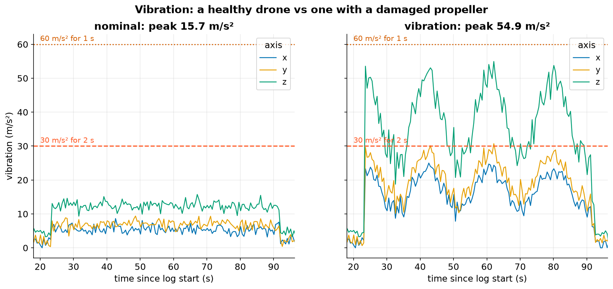
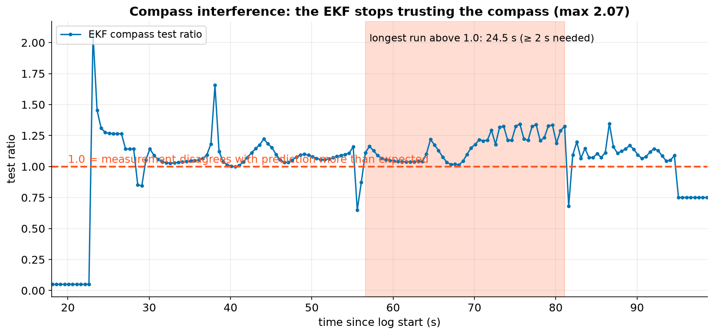
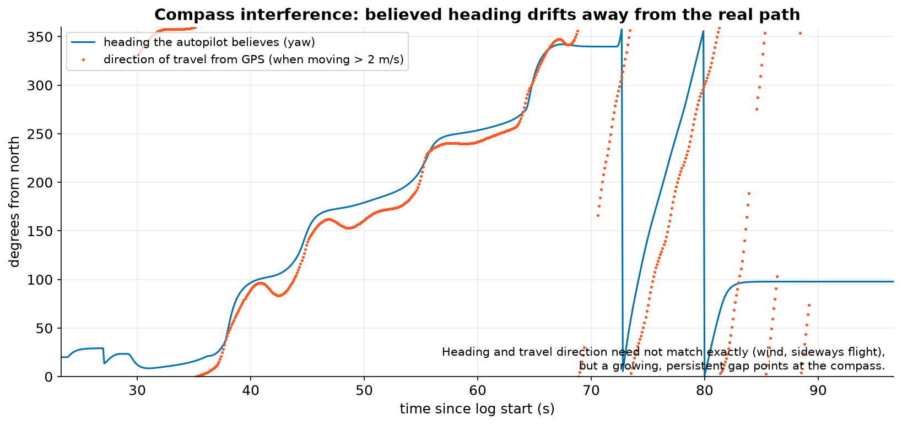

# 7. Vibration, EKF and compass

## Vibration

The accelerometers measure acceleration, which the autopilot needs to know which way is down. A damaged propeller,
loose motor or stiff mounting adds shaking that the accelerometers also pick up. Too much of it and the position
and altitude estimates degrade.

ArduPilot logs vibration levels in m/s² for each axis. Its own guidance treats **30** as worth looking at and **60**
as bad.

| Flight | Peak vibration | Longest run above 30 m/s² (pre-event) | Rule |
|---|---|---|---|
| nominal | 15.7 m/s² | 0 s | not triggered |
| vibration (damaged prop) | 54.9 m/s² | **12.5 s** on z | **triggered** |

`vibration-persistent-pre-event` triggers if any axis stays above **30 for 2 s** or above **60 for 1 s**. The
damaged-prop flight also logged **283 accelerometer clipping events**, where the sensor hit its maximum, so
`clipping-pre-event` triggers too.

## The EKF: the autopilot's best guess

ArduPilot fuses all its sensors in an **Extended Kalman Filter (EKF)**. For each sensor it predicts what the next
reading should be, then compares that with the actual reading. The gap, scaled by how big a gap it expects, is
the **test ratio**:

$$ \text{ratio} = \frac{\text{innovation}^2}{\text{expected variance}} \quad\text{(reported so that } 1.0 = \text{at the limit).} $$

Below 1 means the sensor agrees with the filter. Above 1 means the EKF is starting to distrust it.

## Compass interference

High motor currents create magnetic fields. If the compass sits too close to the power wires, its heading shifts
whenever the motors work hard.

In the compass-interference flight, the EKF compass ratio reached **2.07**. Before the event it stayed above 1.0 for
**24.5 s** in one run. `ekf-compass-innovation-pre-event` needs **above 1.0 for 2 s**, so it's **triggered**.

When the heading is wrong, the drone flies in curving, growing circles ("toilet-bowling"). The autopilot steers
for where it *thinks* it's facing, not where it actually is.

!!! note "Why a 'compasses inconsistent' message after a crash proves little"
    After the motor-failure crash, the simulator (like real ArduPilot) printed *"PreArm: Compasses inconsistent"*.
    A crash can bend a compass mount, so this message comes *after* the incident. AnaTele records it
    (`compasses-inconsistent-reported`) but gives it little weight.
