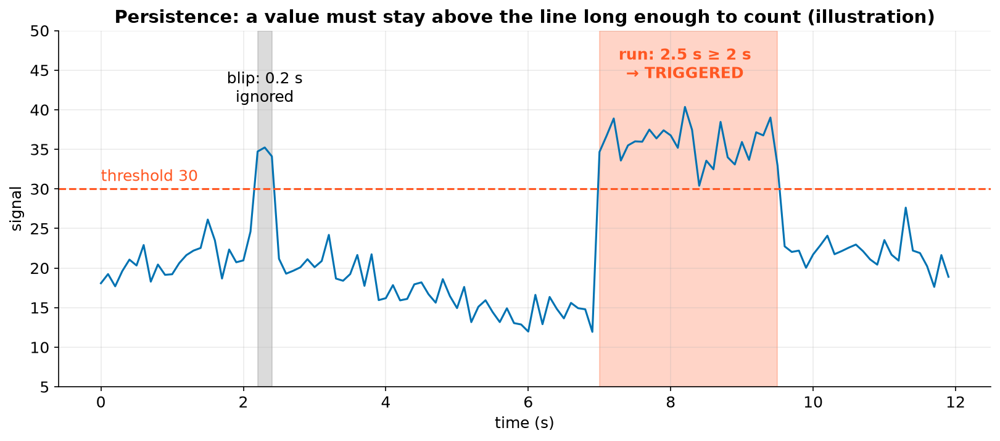
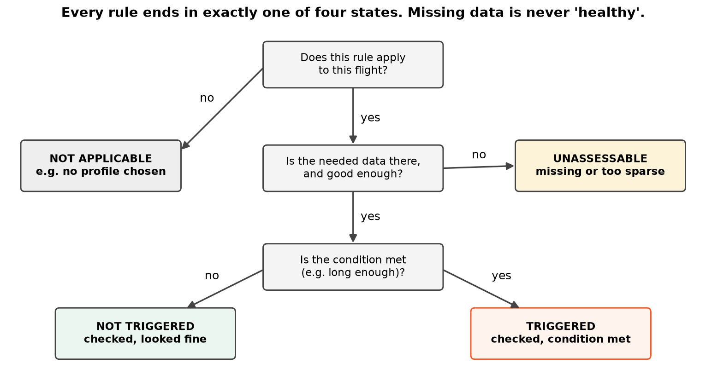
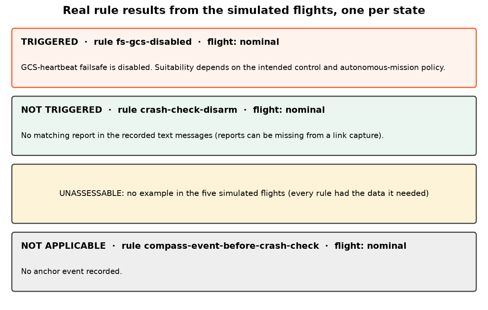

# 8. Rules and their four states

## What a rule is

A rule is a small, versioned, written-down check: "if *this signal* stays above *this threshold* for *this long*,
during *this phase*, report it". All rules live in one file, the **rule pack** (`telemetry_platform/rules/core.yaml`).
Every report records which pack version and SHA-256 it used, so the same log always gives the same answer.

## Persistence: ignore blips, catch trends

Real signals are noisy. A single spike is usually meaningless, so most rules need a **run**: consecutive samples
above the threshold, lasting at least `for_s` seconds. Two more details:

- If two samples are too far apart (more than the **maximum gap**), the run is broken. AnaTele doesn't assume what
  happened in between.
- A run's length is measured from its **first to its last** sample above the threshold.

Try it, including what happens when data gets sparse:

## The four states

| State | Meaning |
|---|---|
| **triggered** | The data is there and the condition was met. |
| **not triggered** | The data is there and the condition was *not* met. |
| **unassessable** | The data needed is missing, or too sparse to decide. **Not the same as healthy.** |
| **not applicable** | The rule doesn't apply here, e.g. a profile check when no profile was selected. |

Here are real examples from the simulated flights:

!!! warning "Unknown is never healthy"
    Many tools show a green tick when a check *couldn't run*. AnaTele never does. If a log has no vibration data,
    the vibration rules say **unassessable**, and any hypothesis that depends on them says so too.

## Counting the five simulated flights

| Flight | triggered | not triggered | not applicable |
|---|---|---|---|
| nominal | 1 | 19 | 2 |
| motor_failure | 7 | 14 | 1 |
| compass_interference | 2 | 18 | 2 |
| vibration | 5 | 15 | 2 |
| radio_failsafe | 2 | 18 | 2 |

The one rule that triggers even in the nominal flight is `fs-gcs-disabled`. It's a configuration observation
(the ground-station failsafe is turned off), not a fault. That's why rules have **severities** and are kept
separate from **hypotheses**.
