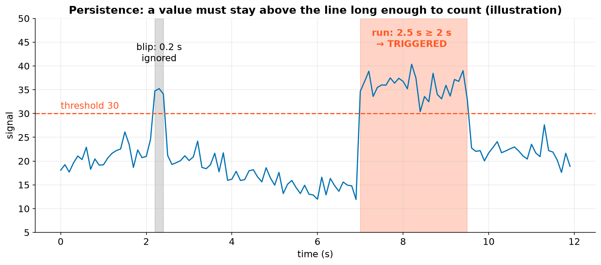
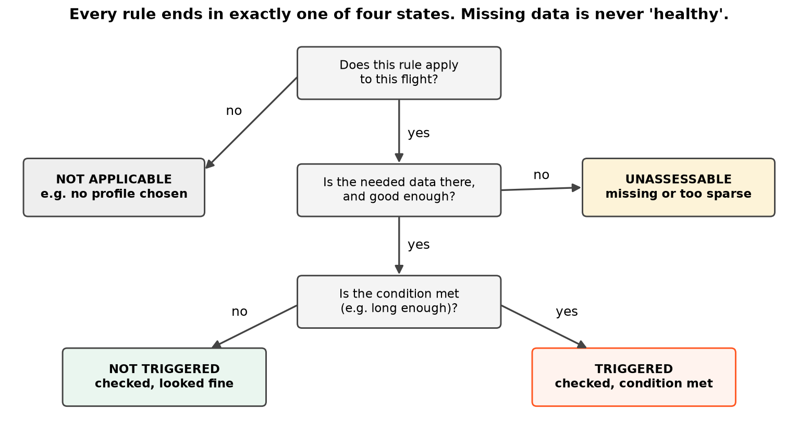
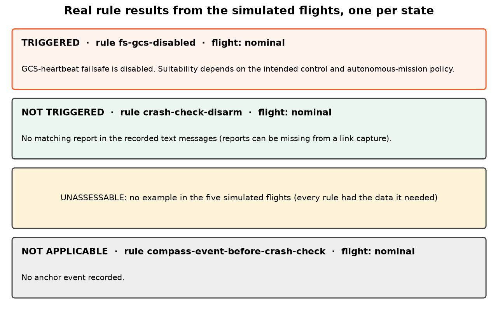

# 8. Rules and their four states

## What a rule is

A rule is a small, written check with a version. An example: "if *this signal* stays above *this threshold* for *this period*,
during *this phase*, report it". All rules are in one file, the **rule pack** (`telemetry_platform/rules/core.yaml`).
Each report records the pack version and the SHA-256 that it used. Thus, the same log always gives the same answer.

## Persistence: ignore short peaks, find trends

Real signals have noise. Usually, one peak has no meaning. Thus, most rules need a **run**: sequential samples
above the threshold, for a minimum of `for_s` seconds. Two more details apply:

- If the interval between two samples is too long (more than the **maximum gap**), the run stops. AnaTele does not guess what
  occurred between the samples.
- AnaTele measures the length of a run from its **first sample to its last sample** above the threshold.

Try the widget. Also look at the result when the data becomes sparse:

## The four states

| State | Meaning |
|---|---|
| **triggered** | The data is available, and the condition occurred. |
| **not triggered** | The data is available, and the condition did *not* occur. |
| **unassessable** | The necessary data is missing, or it is too sparse for a decision. **This is not the same as healthy.** |
| **not applicable** | The rule does not apply here, for example a profile check when you did not select a profile. |

These are real examples from the simulated flights:

!!! warning "Unknown is never healthy"
    Many tools show a green tick when a check *could not run*. AnaTele never does this. If a log has no vibration data,
    the vibration rules give **unassessable**. Each hypothesis that uses these rules also tells you this.

## Results of the five simulated flights

| Flight | triggered | not triggered | not applicable |
|---|---|---|---|
| nominal | 1 | 19 | 2 |
| motor_failure | 7 | 14 | 1 |
| compass_interference | 2 | 18 | 2 |
| vibration | 5 | 15 | 2 |
| radio_failsafe | 2 | 18 | 2 |

The only rule that triggers in the nominal flight is `fs-gcs-disabled`. It is an observation about the configuration
(the ground-station failsafe is off). It is not a fault. For this reason, rules have **severities**, and AnaTele keeps them
separate from **hypotheses**.
