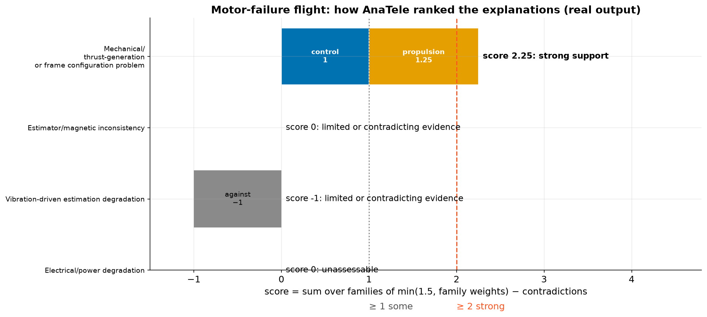

# 9. Hypotheses

Rules tell **what AnaTele observed**. Hypotheses ask **what can explain it**. AnaTele puts the hypotheses in sequence only for
episodes that end in a critical event (a crash report from the autopilot). In the five simulated flights, only the
motor-failure flight has such an episode.

## The four built-in hypotheses

| Hypothesis | Supported by (family, weight) | Counted against it |
|---|---|---|
| Mechanical / thrust or frame configuration | tracking-loss (control, 1) · motor floor saturation (propulsion, 1) · motor imbalance (propulsion, 0.75) · motor ceiling saturation (propulsion, 0.5) | – |
| Estimator / magnetic inconsistency | compass event before crash check (estimator, 1) · EKF compass innovation (magnetic, 1) · compasses inconsistent reported (magnetic, 0.25) | compass event flagged as after the upset (1) |
| Vibration-driven estimation degradation | persistent vibration (inertial, 1) · clipping (inertial, 1) | vibration *examined and correct* (0.5) · clipping *examined and correct* (0.5) |
| Electrical / power degradation | no support rules in this pack version | blocked if `power-monitoring-gap` triggers |

## The score

$$ \text{score} = \sum_{\text{families } f} \min\!\Big(1.5,\; \sum_{\text{triggered rules in } f} w\Big) \;-\; \sum_{\text{contradictions}} w $$

The **family limit of 1.5** is important. Three rules that all measure motor commands are not three independent items of
evidence. The limit for each family prevents one type of evidence from controlling the score. Evidence from **different** families
(for example, *control* and *propulsion*) adds together.

| Label | When |
|---|---|
| strong support | score ≥ 2 |
| some support | score ≥ 1 |
| weak support | score > 0 |
| mixed support | there is both support and contradiction |
| limited or contradicting evidence | score ≤ 0 |
| unassessable | AnaTele could not examine any of its rules (or a blocking rule triggered) |

## Worked example: the motor-failure flight

- **Thrust/configuration**: control family = 1 (tracking-loss). Propulsion family = 0.75 + 0.5 = 1.25
  (imbalance + ceiling), below the limit. Score = 1 + 1.25 = **2.25**, thus **strong support**.
- **Vibration**: no rule triggered. AnaTele *examined* the two vibration rules *and found them correct*. This gives −0.5 − 0.5 =
  **−1.0**: *limited or contradicting evidence*. When AnaTele examines a rule and finds nothing, this counts **against** an explanation.
- **Magnetic**: score **0**. The "Compasses inconsistent" message after the crash does not count, because it is not from
  the time window of the flight.
- **Power**: **unassessable**. The current pack has no rule that can support it. AnaTele shows it as a reminder of the
  data that the log *cannot* give you. To confirm it, you need logs of the battery voltage/current.

Change the evidence yourself:

!!! danger "This is a screening order, not a probability"
    A score of 2.25 does not mean "90 % likely". The weights are written expert judgements. The list tells
    you **what to examine first**. Each hypothesis also shows the *discriminating evidence* that can confirm it or
    remove it. For thrust problems, this evidence is ESC RPM/current telemetry, a motor test with the propellers removed and a physical
    inspection.
