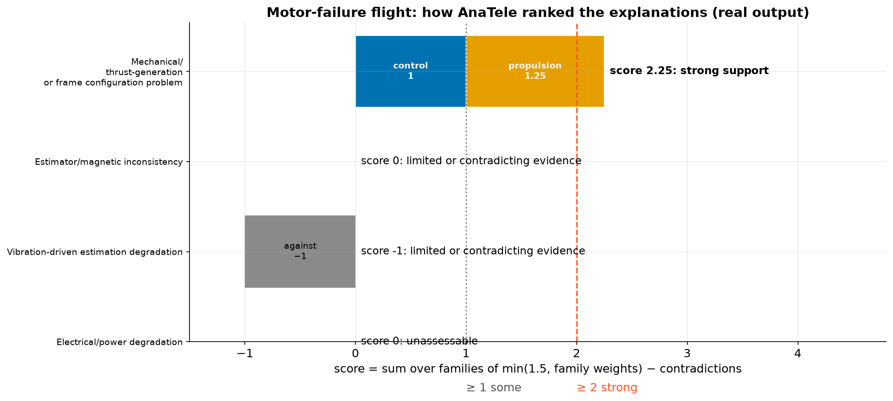

# 9. Hypotheses

Rules say **what was observed**. Hypotheses ask **what could explain it**. AnaTele ranks the hypotheses only for
episodes that end in a critical event (an autopilot crash report). In the five simulated flights that's only the
motor-failure flight.

## The four built-in hypotheses

| Hypothesis | Supported by (family, weight) | Counted against it |
|---|---|---|
| Mechanical / thrust or frame configuration | tracking-loss (control, 1) · motor floor saturation (propulsion, 1) · motor imbalance (propulsion, 0.75) · motor ceiling saturation (propulsion, 0.5) | – |
| Estimator / magnetic inconsistency | compass event before crash check (estimator, 1) · EKF compass innovation (magnetic, 1) · compasses inconsistent reported (magnetic, 0.25) | compass event flagged as coming after the upset (1) |
| Vibration-driven estimation degradation | persistent vibration (inertial, 1) · clipping (inertial, 1) | vibration *checked and fine* (0.5) · clipping *checked and fine* (0.5) |
| Electrical / power degradation | no support rules yet in this pack version | blocked if `power-monitoring-gap` fires |

## The score

$$ \text{score} = \sum_{\text{families } f} \min\!\Big(1.5,\; \sum_{\text{triggered rules in } f} w\Big) \;-\; \sum_{\text{contradictions}} w $$

The **family cap of 1.5** matters. Three rules that all measure motor commands are not three independent pieces of
evidence. Capping each family stops one kind of evidence from dominating. Evidence from **different** families
(say, *control* and *propulsion*) does add up.

| Label | When |
|---|---|
| strong support | score ≥ 2 |
| some support | score ≥ 1 |
| weak support | score > 0 |
| mixed support | there is both support and contradiction |
| limited or contradicting evidence | score ≤ 0 |
| unassessable | none of its rules could be checked (or a blocking rule fired) |

## Worked example: the motor-failure flight

- **Thrust/configuration**: control family = 1 (tracking-loss). Propulsion family = 0.75 + 0.5 = 1.25
  (imbalance + ceiling), under the cap. Score = 1 + 1.25 = **2.25**, so **strong support**.
- **Vibration**: nothing triggered, and both vibration rules were *checked and fine*, giving −0.5 − 0.5 =
  **−1.0**: *limited or contradicting evidence*. Checking and finding nothing counts **against** an explanation.
- **Magnetic**: score **0**. The post-crash "Compasses inconsistent" message doesn't count, because it isn't from
  the flight's own time window.
- **Power**: **unassessable**. The current pack has no rule that can support it, so it's listed as a reminder of
  what the log *can't* tell you. Confirming it needs battery voltage/current logs.

Toggle the evidence yourself:

!!! danger "This is a screening order, not a probability"
    A score of 2.25 doesn't mean "90 % likely". The weights are written-down expert judgements, and the list tells
    you **what to inspect first**. Each hypothesis also lists the *discriminating evidence* that would confirm or
    rule it out. For thrust problems that's ESC RPM/current telemetry, a props-off motor test and a physical
    inspection.
