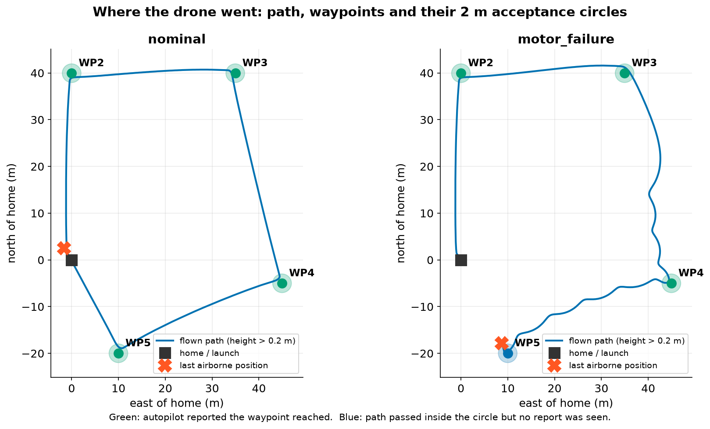
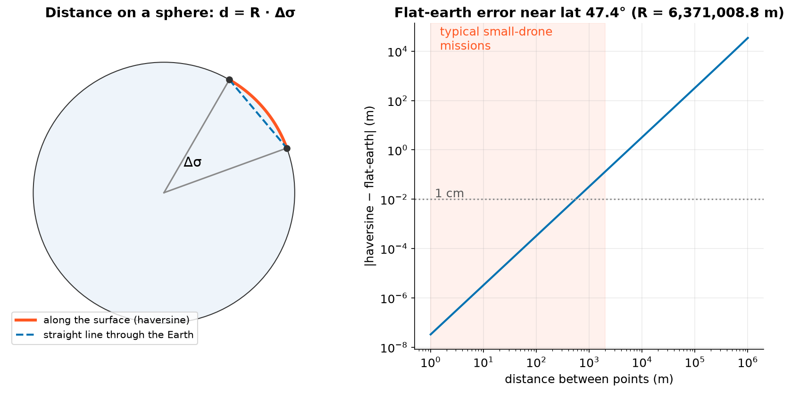
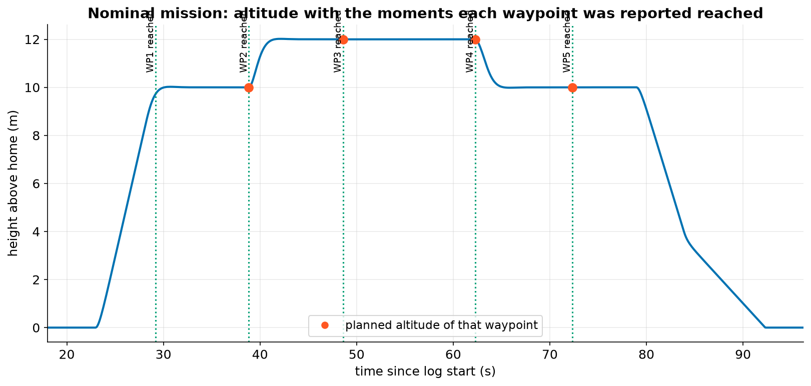
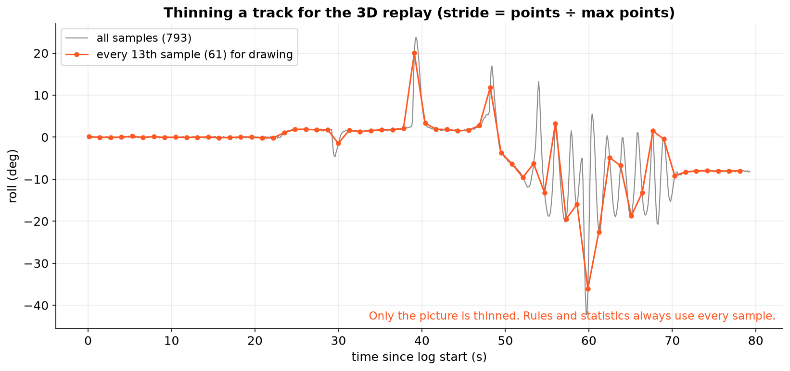

# 10. Missions and geometry

## Where did the drone go?

An **AUTO mission** is a list of numbered items. Usually, the items are waypoints (latitude, longitude, altitude). The ground
station uploads them. The autopilot flies them in sequence and reports `MISSION_ITEM_REACHED` when it gets to each one.

AnaTele makes the uploaded plan again from the messages in the log. Then, for each waypoint, it examines whether the
drone actually got there.

The simulated mission is a takeoff to 10 m, four waypoints and a return-to-launch. In the nominal flight, the autopilot reports all
waypoints as reached. In the motor-failure flight:

| Item | Status | Nearest recorded position |
|---|---|---|
| WP2–WP4 | `reported_complete` | 0.97, 0.97, 0.70 m |
| WP5 | `geometry_consistent_with_completion` | 0.32 m, but no "reached" report before the crash |
| RTL | `completion_not_observed` | (not an item with a position) |

## Distance on a sphere

GPS gives latitude and longitude in degrees, but we need metres. On a sphere of radius $R$, the shortest distance
between two points is along the surface. The **haversine formula** gives this distance:

$$ h = \sin^2\!\frac{\Delta\varphi}{2} + \cos\varphi_1 \cos\varphi_2 \sin^2\!\frac{\Delta\lambda}{2}, \qquad
d = 2R \arcsin\sqrt{h} $$

with $\varphi$ = latitude, $\lambda$ = longitude (in radians) and $R = 6\,371\,008.8$ m (the mean radius of the Earth).

Over some kilometres, the flat-earth calculation is accurate to millimetres. This is much smaller than the GPS error. But AnaTele uses
haversine, because it is correct in all conditions, also for long survey flights and at high latitudes.

## When is a waypoint reached?

ArduPilot records a waypoint as reached when the drone is within `WP_RADIUS_M` (2 m in the simulation). GPS has its
own uncertainty. Thus, AnaTele accepts

$$ d_\text{nearest} \le \texttt{WP\_RADIUS\_M} + h_\text{acc} $$

where $h_\text{acc}$ is the horizontal accuracy of the GPS at that time. If the waypoint passes this test, AnaTele labels it *consistent with
completion*, not *completed*. A near position is not proof.

## Drawing the path

The 3D replay in the desktop app draws the flown path with the waypoints. To draw quickly, it uses a maximum of
6,000 points. It keeps each *k*-th sample, with $k = \lceil n / 6000 \rceil$:

!!! note
    This reduction changes only the **picture**. All rules, statistics and distances above use all of the samples.
