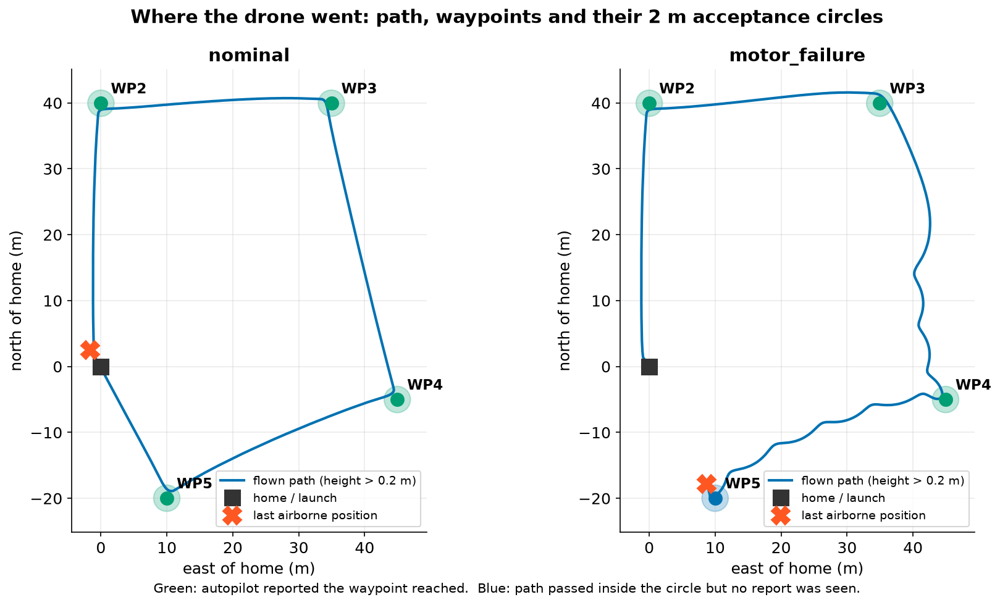
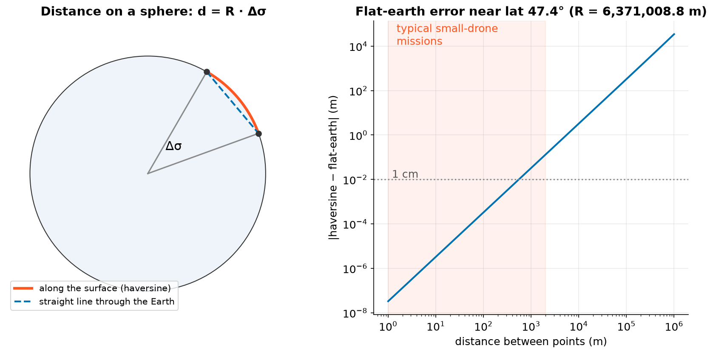
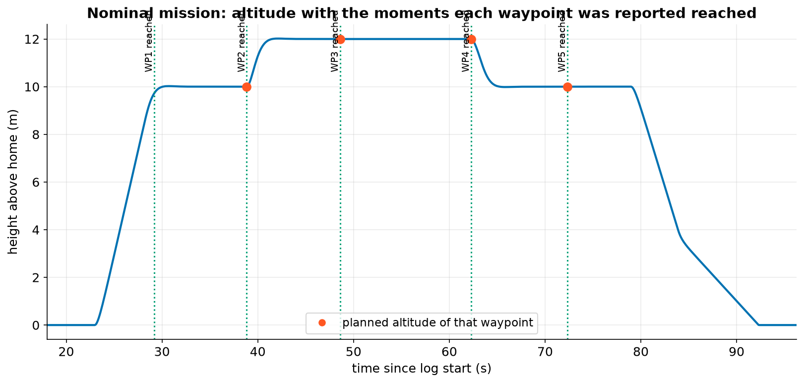
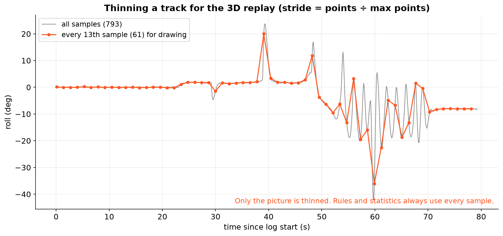

# 10. Missions and geometry

## Where did it go?

An **AUTO mission** is a list of numbered items, usually waypoints (latitude, longitude, altitude). The ground
station uploads them, the autopilot flies them in order and reports `MISSION_ITEM_REACHED` as it gets to each one.

AnaTele rebuilds the uploaded plan from the log's own messages. Then, for each waypoint, it checks whether the
drone actually got there.

The simulated mission is a takeoff to 10 m, four waypoints and a return-to-launch. In the nominal flight every
waypoint is reported reached. In the motor-failure flight:

| Item | Status | Nearest recorded position |
|---|---|---|
| WP2–WP4 | `reported_complete` | 0.97, 0.97, 0.70 m |
| WP5 | `geometry_consistent_with_completion` | 0.32 m, but no "reached" report before the crash |
| RTL | `completion_not_observed` | (not a positional item) |

## Distance on a sphere

GPS gives latitude and longitude in degrees, but we need metres. On a sphere of radius $R$, the shortest distance
between two points is along the surface. The **haversine formula** gives it:

$$ h = \sin^2\!\frac{\Delta\varphi}{2} + \cos\varphi_1 \cos\varphi_2 \sin^2\!\frac{\Delta\lambda}{2}, \qquad
d = 2R \arcsin\sqrt{h} $$

with $\varphi$ = latitude, $\lambda$ = longitude (in radians) and $R = 6\,371\,008.8$ m (the mean Earth radius).

Over a few kilometres the flat-earth shortcut is accurate to millimetres, far smaller than GPS error. AnaTele uses
haversine anyway because it's correct everywhere, including long survey flights and high latitudes.

## When does a waypoint count as reached?

ArduPilot treats a waypoint as reached when the drone is within `WP_RADIUS_M` (2 m in the simulation). GPS has its
own uncertainty, so AnaTele allows

$$ d_\text{nearest} \le \texttt{WP\_RADIUS\_M} + h_\text{acc} $$

where $h_\text{acc}$ is the GPS horizontal accuracy at that moment. Passing this test is labelled *consistent with
completion*, not *completed*: being close isn't proof.

## Drawing the path

The 3D replay in the desktop app draws the flown path with the waypoints. To keep drawing fast it uses at most
6,000 points, keeping every *k*-th sample with $k = \lceil n / 6000 \rceil$:

!!! note
    Thinning only affects the **picture**. Every rule, statistic and distance above uses every sample.
