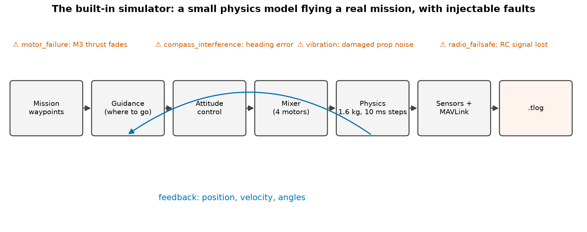
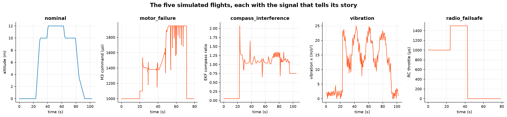

# 11. The simulator

Every chart in this course came from AnaTele's built-in flight simulator. It exists so that you can **learn and test
without crashing a real drone**. Each scenario has a known cause, so you can check that the analysis finds it.

```bash
anatele simulate --out simulations          # all five scenarios
anatele simulations/sim_motor_failure.tlog  # analyse one
```

## How it works



Every **10 ms** the simulator:

1. **Guidance** picks a target velocity towards the active waypoint.
2. **Attitude control** turns that into desired roll and pitch (capped at 0.52 rad ≈ 30°), and a yaw target.
3. The **mixer** (chapter 6) turns throttle and torques into four motor commands between 0.15 and 0.95.
4. **Physics** turns commands into thrust and torque. It then integrates Newton's laws for a 1.6 kg quad with
   0.18 m arms, drag and a gusting wind.
5. **Sensors and MAVLink**: every 100 ms it writes `ATTITUDE`, `GLOBAL_POSITION_INT`, `SERVO_OUTPUT_RAW` and
   more (and slower health messages every 500 ms) into a genuine `.tlog`, byte for byte as Mission Planner would.

The thrust per motor is

$$ F_i = h_i \cdot F_\text{max} \cdot u_i, \qquad F_\text{max} = \frac{m g}{4 \cdot 0.38} \approx 10.3\ \text{N}, $$

so at the hover output 0.38, four healthy motors exactly hold the weight. $h_i$ is the motor's **health** (1 =
perfect).

## The five scenarios



| Scenario | What is injected | What AnaTele finds |
|---|---|---|
| `nominal` | nothing | only the configuration note `fs-gcs-disabled` |
| `motor_failure` | motor 3 health $\max(0.3, 1 - 0.06(t - t_f))$ from 2 s after WP3 becomes active | tracking loss, ceiling saturation, imbalance; *thrust/configuration: strong support* |
| `compass_interference` | heading error that grows with motor current | EKF compass innovation above 1 for 24.5 s |
| `vibration` | random torque noise (a damaged prop) | persistent vibration, 283 clips |
| `radio_failsafe` | RC signal lost mid-mission | pre-arm *radio failsafe* reports |

!!! tip "Make your own"
    `Simulator(scenario, seed, mission=[...], wind=(n, e))` in `telemetry_platform/simulator.py` takes your own
    mission and wind. Different seeds give different noise but the same physics.

!!! warning
    The simulator is a teaching and testing model, not a certified flight dynamics model. Real crashes are messier.
    Use it to understand the method, not to calibrate thresholds for a real aircraft.
