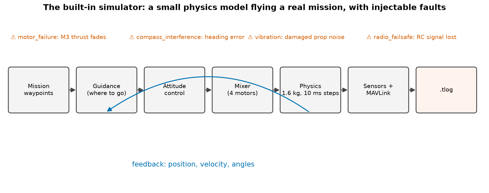
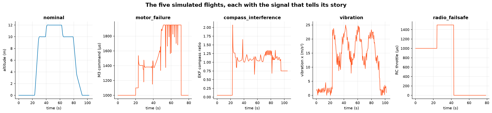

# 11. The simulator

All charts in this course came from the built-in flight simulator of AnaTele. The simulator lets you **learn and test
without a crash of a real drone**. Each scenario has a known cause. Thus, you can make sure that the analysis finds it.

```bash
anatele simulate --out simulations          # all five scenarios
anatele simulations/sim_motor_failure.tlog  # analyse one
```

## How it works



Each **10 ms**, the simulator does these steps:

1. **Guidance** selects a target velocity in the direction of the active waypoint.
2. **Attitude control** changes the target velocity into the desired roll and pitch (with a limit of 0.52 rad ≈ 30°), and a yaw target.
3. The **mixer** (chapter 6) changes throttle and torques into four motor commands between 0.15 and 0.95.
4. **Physics** changes the commands into thrust and torque. Then it integrates Newton's laws for a 1.6 kg quad with
   0.18 m arms, drag and a gusting wind.
5. **Sensors and MAVLink**: each 100 ms, the simulator writes `ATTITUDE`, `GLOBAL_POSITION_INT`, `SERVO_OUTPUT_RAW` and
   more (and slower health messages each 500 ms) into a genuine `.tlog`. Each byte is the same as Mission Planner writes.

The thrust for each motor is

$$ F_i = h_i \cdot F_\text{max} \cdot u_i, \qquad F_\text{max} = \frac{m g}{4 \cdot 0.38} \approx 10.3\ \text{N}, $$

thus, at the hover output of 0.38, four healthy motors hold exactly the weight. $h_i$ is the **health** of the motor (1 =
perfect).

## The five scenarios



| Scenario | Injected fault | Result in AnaTele |
|---|---|---|
| `nominal` | nothing | only the configuration note `fs-gcs-disabled` |
| `motor_failure` | motor 3 health $\max(0.3, 1 - 0.06(t - t_f))$ from 2 s after WP3 becomes active | tracking loss, ceiling saturation, imbalance; *thrust/configuration: strong support* |
| `compass_interference` | heading error that increases with motor current | EKF compass innovation above 1 for 24.5 s |
| `vibration` | random torque noise (a damaged propeller) | persistent vibration, 283 clips |
| `radio_failsafe` | loss of the RC signal during the mission | pre-arm *radio failsafe* reports |

!!! tip "Make your own scenario"
    `Simulator(scenario, seed, mission=[...], wind=(n, e))` in `telemetry_platform/simulator.py` accepts your own
    mission and wind. Different seeds give different noise, but the same physics.

!!! warning
    Do not use the simulator to calibrate thresholds for a real aircraft. The simulator is a model for teaching and tests, not a certified flight dynamics model.
    Real crashes are more complex. Use the simulator to understand the method.
