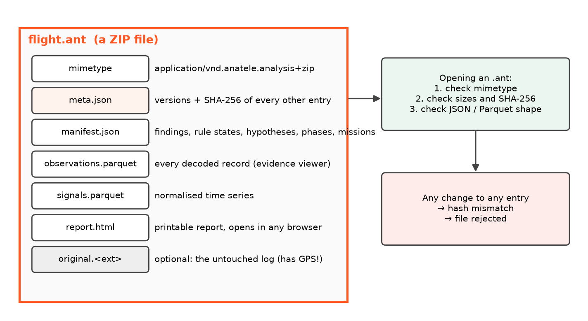

# 12. Sharing with .ant files

Frequently, a team does an investigation. The pilot, the builder and a reviewer must all see the same data.
If you send a raw log, each person can use a different version of each tool. Thus, AnaTele saves the **full
analysis** as one file: `.ant`.



## Contents

An `.ant` file is a usual ZIP file. You can open it with any unzip tool, but AnaTele examines it strictly:

1. `mimetype` must be exactly `application/vnd.anatele.analysis+zip`.
2. `meta.json` contains the **SHA-256** hash of each other entry. A SHA-256 hash is a fingerprint of 64 characters.
   If you change one byte of a file, the fingerprint changes fully.
3. AnaTele sets a size limit on each entry, calculates its hash and compares the hash. It validates the JSON and Parquet structure **before**
   it shows anything.

If any value does not agree, AnaTele rejects the file. A changed analysis cannot pass as the original.

## Save and open

=== "Desktop"
    **File → Save Analysis As (.ant)** (Ctrl+S). To open, use **File → Open** or drag and drop.

=== "Command line"
    ```bash
    anatele export flight.tlog -o flight.ant            # analysis only
    anatele export flight.tlog -o flight.ant --include-original
    anatele analyse flight.ant                           # print the summary
    ```

=== "Web / API"
    To download, use `GET /api/logs/{id}/export.ant`. To import, use `POST /api/analyses`.

!!! warning "Privacy"
    Do not use `--include-original` unless the recipient must run the analysis again or examine the raw bytes.
    `--include-original` puts the unchanged log in the file. The log contains **GPS positions**: where you fly, and frequently where
    you live.

## The report in the file

`report.html` is a printable report that contains all of its content: findings, hypotheses, rule states, phases and the mission
table. It opens in all browsers. Thus, a person without AnaTele can also read the result.

---

**You completed the course.** Next, open a real log in the desktop app. Use the
[Usage guide](../USAGE.md) for the controls and the [Diagnostics reference](../DIAGNOSTICS.md) for all rules.
