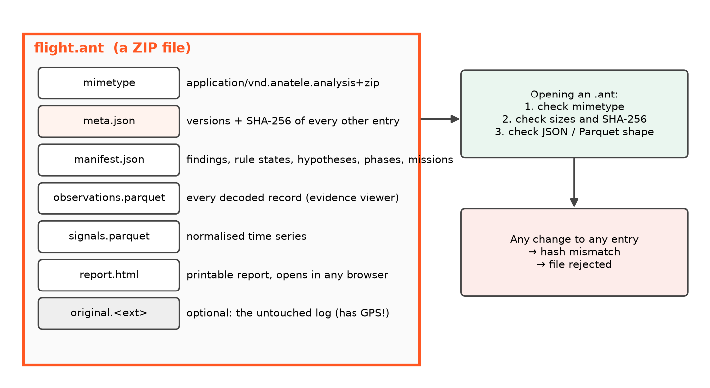

# 12. Sharing with .ant files

An investigation is often a team effort. The pilot, the builder and a reviewer may all need to see the same thing.
Instead of sending a raw log and hoping everyone uses the same version of every tool, AnaTele saves the **whole
analysis** as one file: `.ant`.



## What is inside

An `.ant` is an ordinary ZIP file. You can open it with any unzip tool, but AnaTele checks it strictly:

1. `mimetype` must be exactly `application/vnd.anatele.analysis+zip`.
2. `meta.json` lists the **SHA-256** hash of every other entry. A SHA-256 hash is a 64-character fingerprint:
   change one byte of a file and the fingerprint changes completely.
3. Each entry is size-limited, hashed and compared. The JSON and Parquet structure is validated **before**
   anything is shown.

Any mismatch and the file is rejected. A modified analysis can't pass as the original.

## Saving and opening

=== "Desktop"
    **File → Save Analysis As (.ant)** (Ctrl+S). Open with **File → Open** or drag and drop.

=== "Command line"
    ```bash
    anatele export flight.tlog -o flight.ant            # analysis only
    anatele export flight.tlog -o flight.ant --include-original
    anatele analyse flight.ant                           # print the summary
    ```

=== "Web / API"
    `GET /api/logs/{id}/export.ant` to download, `POST /api/analyses` to import.

!!! warning "Privacy"
    `--include-original` embeds the untouched log, and that contains **GPS positions** (where you fly, often where
    you live). Leave it out unless the receiver needs to re-run the analysis or inspect raw bytes.

## The report inside

`report.html` is a self-contained, printable report: findings, hypotheses, rule states, phases and the mission
table. It opens in any browser, so someone without AnaTele can still read the result.

---

**You've finished the course.** Next: open a real log in the desktop app, use the
[Usage guide](../USAGE.md) for the controls and the [Diagnostics reference](../DIAGNOSTICS.md) for every rule.
