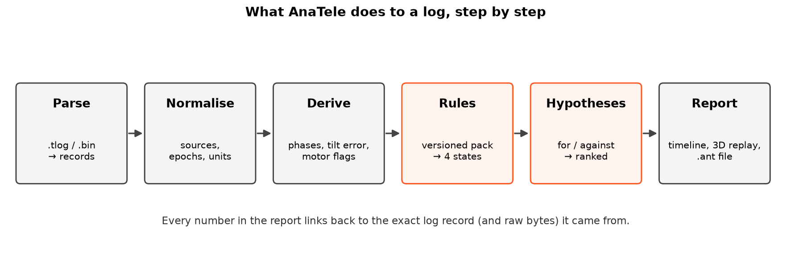

# Learn AnaTele from scratch

This is an illustrated course. You do **not** need previous knowledge. You do not need to have flown a drone, opened a log
or seen the mathematics before. At the end of the course, you can read an AnaTele report and explain each number in it.

Each chart comes from **real data**: flights from the built-in simulator of AnaTele, analysed by the
same code that you run. The script that draws the charts is
[`docs/figures/make_guide_figures.py`](https://github.com/Avinashistoocool/AnaTele/tree/main/docs/figures).
Some pages also have small interactive widgets that run in your browser.

!!! tip "Do you prefer paper?"
    The same material is available as a printable PDF:
    [AnaTele Illustrated Guide (PDF)](../AnaTele_Illustrated_Guide.pdf).

## Reading map

| # | Chapter | Subjects |
|---|---|---|
| 1 | [Drones 101](01-drones-101.md) | Motors, roll/pitch/yaw, how a quadcopter can hover |
| 2 | [Logs and MAVLink](02-logs-and-mavlink.md) | What a flight log is, and its contents |
| 3 | [Time and sources](03-time-and-sources.md) | Clocks, reboots and why AnaTele uses *epochs* |
| 4 | [Flight phases](04-flight-phases.md) | How AnaTele finds takeoff, flight and the crash window |
| 5 | [Attitude and tilt error](05-attitude-and-tilt-error.md) | "Did the drone do the commanded movement?" in one number |
| 6 | [Motors and mixing](06-motors-and-mixing.md) | How four motors make all movements, and saturation |
| 7 | [Vibration, EKF and compass](07-vibration-ekf-compass.md) | Signals for sensor health, and how bad signals look |
| 8 | [Rules and their four states](08-rules-and-states.md) | Thresholds, persistence and "unknown is not healthy" |
| 9 | [Hypotheses](09-hypotheses.md) | How evidence becomes a list of explanations in sequence |
| 10 | [Missions and geometry](10-missions-and-geometry.md) | Waypoints, distances on a sphere, "where did the drone go?" |
| 11 | [The simulator](11-simulator.md) | The physics model that made all charts here |
| 12 | [Sharing with .ant files](12-sharing-ant.md) | One tamper-evident file for a full investigation |
| | [Glossary](glossary.md) | All terms in one location |
| | [Interactive widgets](widgets-demo.md) | All widgets on one page |

## How to use this course

- **Do you have little time?** Read chapters 1, 4, 5 and 9. These chapters are sufficient to read a crash report.
- **Do you investigate a real crash?** Read chapters 4–9 together with the [Diagnostics reference](../DIAGNOSTICS.md).
- **Do you write your own rules?** Read chapters 8 and 9, then [Writing a rule](../DIAGNOSTICS.md#writing-a-rule).

!!! note "The one idea to remember"
    AnaTele reports **observations** and **hypotheses**. It never gives a crash verdict or a probability of cause.
    If data is missing, the answer is *unknown*, never *correct*.
