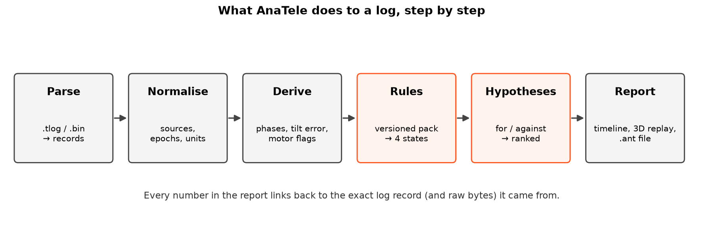

# Learn AnaTele from scratch

This is an illustrated course. It assumes **no** background: you don't need to have flown a drone, opened a log
or seen the maths before. By the end you'll be able to read an AnaTele report and explain every number in it.

Every chart is drawn from **real data**: flights from AnaTele's built-in simulator, analysed by the
same code you run. The script that draws them is
[`docs/figures/make_guide_figures.py`](https://github.com/Avinashistoocool/AnaTele/tree/main/docs/figures).
Some pages also have small interactive widgets that run in your browser.

!!! tip "Prefer paper?"
    The same material is available as a printable PDF:
    [AnaTele Illustrated Guide (PDF)](../AnaTele_Illustrated_Guide.pdf).

## Reading map

| # | Chapter | You will learn |
|---|---|---|
| 1 | [Drones 101](01-drones-101.md) | Motors, roll/pitch/yaw, why a quadcopter can hover |
| 2 | [Logs and MAVLink](02-logs-and-mavlink.md) | What a flight log is and what is inside it |
| 3 | [Time and sources](03-time-and-sources.md) | Clocks, reboots and why AnaTele uses *epochs* |
| 4 | [Flight phases](04-flight-phases.md) | How AnaTele finds takeoff, flight and the crash window |
| 5 | [Attitude and tilt error](05-attitude-and-tilt-error.md) | "Did the drone do what it was told?" in one number |
| 6 | [Motors and mixing](06-motors-and-mixing.md) | How four motors make every movement, and saturation |
| 7 | [Vibration, EKF and compass](07-vibration-ekf-compass.md) | Sensor health signals and what bad looks like |
| 8 | [Rules and their four states](08-rules-and-states.md) | Thresholds, persistence and "unknown is not healthy" |
| 9 | [Hypotheses](09-hypotheses.md) | Turning evidence into a ranked list of explanations |
| 10 | [Missions and geometry](10-missions-and-geometry.md) | Waypoints, distances on a sphere, "where did it go?" |
| 11 | [The simulator](11-simulator.md) | The physics model that made every chart here |
| 12 | [Sharing with .ant files](12-sharing-ant.md) | One tamper-evident file for a whole investigation |
| | [Glossary](glossary.md) | Every term in one place |
| | [Interactive widgets](widgets-demo.md) | All the widgets on one page |

## How to use this course

- **In a hurry?** Read chapters 1, 4, 5 and 9. That's enough to read a crash report.
- **Investigating a real crash?** Do chapters 4–9 next to the [Diagnostics reference](../DIAGNOSTICS.md).
- **Writing your own rules?** Read chapters 8 and 9, then [Writing a rule](../DIAGNOSTICS.md#writing-a-rule).

!!! note "The one idea to keep in mind"
    AnaTele reports **observations** and **hypotheses**. It never gives a crash verdict or a probability of cause.
    If data is missing, the answer is *unknown*, never *fine*.
